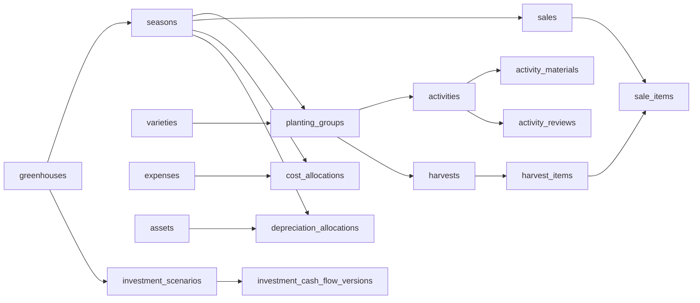

# Inofarm: konteks untuk Claude Code

**Sesi baru, termasuk dari akun Claude lain: mulai dari [serah terima 17 November 2026](docs/context/HANDOFF_20261117.md).** Isinya posisi kode (`github/main` `52c8ab9`, semua branch fitur sampai PR #70 sudah di-merge), kronologi 10–17 November dengan tautan bukti, hasil tes terakhir, pekerjaan terbuka, cara menjalankan dan preferensi kerja pengguna.

**Keuangan biaya standar, grafik pemasukan dan pembeli, 21 November 2026 (branch `keuangan-biaya-standar`, di-merge ke main lewat PR):** FC/VC adalah **satu lembar biaya standar per Musim ke-n untuk seluruh kebun**, sama untuk setiap GH (tanpa isian per GH; 7 baris wajib Inofarm, baris tambahan boleh). Laporan musim memakai lembar itu (formula `season-standard-cost-rational-half-up-v2`); alokasi dan penyusutan nyata hanya rujukan. Tab Keuangan Android: grafik batang bertumpuk Mitra/Perorangan yang bisa diketuk (minggu/bulan/tahun), laba musim berjalan, Biaya standar, Ringkasan investor, **ikon mata** untuk biaya nyata. Pembeli: daftar + impor .xlsx/.csv, dipilih di form penjualan; mitra grade A/B/C per kg; retail belum. **Migration 23** (sequence, lembar biaya, customers, `sales.customer_id`, `sale_items.buyer_grade`) **sudah** diterapkan ke `inofarm_finance_local` pada 21 November 2026 dengan backup (58 tabel, 28 migration; lembar biaya dibuat saat pertama dibuka, angkanya belum diisi). Backend 220 tes, JVM 177, lint 0 error (sesudah 6 perbaikan dari review akhir: laporan final ditolak bila ada baris biaya kosong, hash sumber tidak terpengaruh GH lain, kunci lembar hanya dari GH aktif, pembeli bisa dilepas, impor idempoten, Catat pengeluaran ikut ikon mata; belum diuji ulang di emulator); emulator API 30 terhadap Laravel nyata + `inofarm_test` untuk semua layar baru; belum ponsel fisik. [Bukti dan batas](docs/context/FINANCE_STANDARD_COST_EVIDENCE_20261121.md).

**Desain ulang tab Kelola pengelola, 21–22 November 2026 (branch `perbaikan-bug-audit-pengelola`, belum di-commit):** Kelola diatur per objek (Greenhouse, Orang, Akun saya) mengikuti kanvas yang disetujui; halaman pengaturan per GH, daftar data master dengan cari dan filter, sheet ubah dua langkah (Ringkasan tetap, keputusan pengguna), Pekerja dan akun, detail akun, dan Nonaktifkan greenhouse berpemeriksa (`feature/admin/Kelola.kt`, `KelolaData.kt`). Terang/Gelap pengelola pindah ke Kelola → Akun saya. Pengaturan GH dimuat paralel (2,5 detik, sebelumnya >7), segmen sama lebar (`FarmSegmentedTabs(equalWidth)`), dialog Kelola edge-to-edge (`FarmFullScreenDialog`). Uji backend nyata menemukan bug: `GET greenhouses` tidak mengirim `running_group_id`, sehingga Nonaktifkan mengira tidak ada tanam saat ini; kini memakai periode manager-home dan fixture disamakan dengan API. JVM 180, `FinanceAdminUiTest` + `FinanceAdminTest` 14/14 (fixture), lint 0 error; semua layar Kelola dilihat di emulator API 30 terhadap `inofarm_finance_local` tanpa menyimpan data. Belum ponsel fisik, TalkBack, mode gelap. [Bukti dan batas](docs/context/MANAGER_KELOLA_REDESIGN_EVIDENCE_20261121.md).

**Masukan lapangan Inofarm untuk catat kegiatan dan panen, 20 November 2026 (branch `inofarm-field-feedback-recording`, belum di-merge):** Mulai tanam menjadi **Mulai semai**; nama musim otomatis `<GH> Musim <n>`; pop up "Greenhouse belum dimulai semai" untuk pengelola. Di form kegiatan: label "Waktu", EC tanpa satuan, **PPM opsional** (EC wajib, server dan Android), pengukuran **sebelum dan sesudah inject sekaligus** (dua baris `measurement` satu `entry_batch_id`; bila jamnya sama, sesudah inject dianggap terakhir), **Nutrisi AB Mix** (jumlah + mL/L/gram, nutrisi tambahan diketik; `NutritionCatalog`), "Satuan" untuk umur, "Stadia/Fase". Panen per varietas berisi baris **Layak/Cacat** (kg, buah opsional) **tanpa grade dan jam** (12.00 WIB); server memakai grade sistem Layak/Cacat (`QualityGradeCatalog`) sehingga penjualan tidak berubah. Ada grafik pola panen per varietas. Tanpa migration; penjualan/keuangan tidak disentuh. Backend 181 tes; backend nyata 3 fase + SQL PASS; belum ponsel fisik; grafik belum dilihat di layar. [Bukti dan batas](docs/context/INOFARM_FIELD_FEEDBACK_EVIDENCE_20261120.md).

**Kesiapan backend, 18 November 2026 (branch `api-guest-401`):** PHPUnit di main sesudah #79/#83/#84 lulus (174 tes). Tamu tanpa token dan tanpa `Accept: application/json` kini mendapat 401, bukan 500 `Route [login] not defined` (backend 175 tes / 4.761 assertion; Android tidak terdampak). Pembacaan `inofarm_finance_local` dalam transaksi yang di-rollback: migration 22 terakhir, tidak ada yang tertunda, inbox dan Beranda terbaca untuk 5 GH, tidak ada baris yang berubah. Backup 18 November berhasil di-restore ke instance MySQL sementara (checksum tabel yang tidak disentuh identik) lalu dimigrasikan ke 22. [Bukti dan batas](docs/context/BACKEND_READINESS_EVIDENCE_20261118.md).

**Uji backend nyata lanjutan, 18 November 2026 (di-merge ke main lewat PR #83 dan #84 pada 18 November 2026, bersama dokumen #79):** di emulator API 30 (`-gpu swiftshader_indirect`) terhadap Laravel nyata dan `inofarm_test`, empat fase baru `RecordingReworkBackendDeviceTest` lulus bersama fase lama (5/5, mode verify SQL 4/4): koreksi per bagian oleh pekerja (alasan wajib di form dan 422 di API) dan pengelola, isian pengelola dengan `running_period_version` setelah penetapan periode, antrean offline yang terkirim sekali (1 audit/receipt/feed per catatan), dan Cek catatan panen dua varietas. `managerVerifiesWorkerRevisionsThroughGuardedBackend` kini memakai form gabungan. `FinanceEntryUiTest` penuh: 15 gagal, semuanya baseline, tes investasi lulus. Empat temuan kecil diusulkan, belum dikerjakan. [Bukti dan batas](docs/context/RECORDING_REWORK_BACKEND_COVERAGE_EVIDENCE_20261118.md).

**Backend nyata untuk rombak pencatatan dan tes investasi, 18 November 2026 (di-merge ke main lewat PR #80–#82 pada 18 November 2026):** `RecordingReworkBackendDeviceTest` lulus 3/3 di emulator API 30 (`-gpu swiftshader_indirect`) terhadap Laravel nyata dan MySQL `inofarm_test`. SQL membuktikan satu isian menjadi satu baris per bagian dengan `entry_batch_id` sama, `planting_group_id` null untuk catatan GH, bahan semprot ketikan di semua GH aktif, `fruit_count` null dan pekerja tanpa penugasan yang ditolak keuangan (403). Uji ini menemukan bug: inbox Cek catatan menjawab 500 begitu ada catatan pekerja tingkat GH (`ActivityReviewService` membaca kelompok yang null). Bug itu diperbaiki di backend (174 tes), dan cleanup fixture kini juga menghapus `activity_reviews`. Tes investasi tidak bisa direproduksi gagal (12/12 lulus); tesnya diperkuat, aplikasi tidak diubah. Belum diuji di ponsel fisik. [Bukti dan batas](docs/context/INVESTMENT_TEST_AND_REAL_BACKEND_EVIDENCE_20261118.md).

**Rombak pencatatan per greenhouse, 17–18 November 2026 (keputusan pengguna; di-merge ke main lewat PR #72–#78 pada 18 November 2026):** Catat cukup memilih greenhouse untuk kedua peran. Satu form "Catat kegiatan" per GH (HSS/HST wajib diketik, pengukuran, nutrisi, penyemprotan per varietas, stadia, catatan) menjadi satu catatan per bagian dengan `entry_batch_id` yang sama. Pengukuran/nutrisi/stadia/umum disimpan per musim GH (`planting_group_id` kosong); hanya semprot per varietas. Panen dua varietas berdampingan, jumlah buah opsional. Wizard dua langkah dengan 1–2 varietas, tanpa penugasan; pekerja mengakses semua GH aktif. Tema terang bawaan, diatur di menu avatar. Backend 173 tes. Migration 22 dan daftar bahan semprot (50 bahan, 10 per GH) **sudah** diterapkan ke `inofarm_finance_local` pada 18 November 2026 dengan backup. JVM 137, lint 0 error; tes UI hanya dengan fixture di emulator API 30, belum backend nyata atau ponsel fisik. Keuangan tidak diubah. [Bukti, branch dan batas](docs/context/RECORDING_REWORK_EVIDENCE_20261118.md).

**Input pengelola Batal / Simpan → Ringkasan, 17 November 2026 (keputusan pengguna, Android saja):** semua input pengelola kini hanya punya **Batal** dan **Simpan**; Simpan membuka langkah 2 dari 2, **Ringkasan**, dengan Ubah / Simpan. Berlaku untuk kegiatan, pengukuran, panen, biaya, alokasi, penjualan, aset, penyusutan, admin/master/akun, keputusan cek catatan (dialog ringkasan), skenario investasi, evaluasi musim dan laporan investasi (ringkasan = hitungan server). Tidak ada lagi "Simpan draf" untuk pengelola: autosave tetap berjalan selama form terbuka, dan Batal mengembalikan salinan perangkat lewat `LocalFinanceStore.restoreDraft`. Pekerja tidak berubah (Simpan sebagai draf / Periksa / Kirim). Backend tidak berubah. JVM 121, lint 0 error; instrumentasi terfokus di emulator API 30 dengan fixture. [Bukti, tag tes baru dan batas](docs/context/MANAGER_SAVE_SUMMARY_EVIDENCE_20261117.md).

**Audit alur input pengelola 17 November 2026 (dokumen; rekomendasinya kemudian diputuskan di paragraf atas):** server tidak punya status draf; semua tulis langsung commit, kecuali laporan musim/investasi yang wajib pratinjau dengan hash sumber. Admin/master/akun, wizard, tanam saat ini, tutup/buka musim, selesai panen, keputusan cek catatan, skenario investasi dan pembatalan sudah langsung simpan. Saat audit, delapan form domain pengelola masih wajib Form → Periksa → Simpan; itu sudah diganti alur Batal / Simpan → Ringkasan (paragraf atas). Temuan lain: Android belum aman terhadap `fruit_count: null` (crash laten) dan belum memakai fitur backend 17 November. [Matriks, rekomendasi dan temuan](docs/context/MANAGER_INPUT_FLOW_AUDIT_20261117.md).

**Keputusan 11 November 2026 (masukan dosen pembimbing): pengelola adalah super admin.** Pengelola mengakses semua greenhouse dan semua akun tanpa penugasan, alasan perubahan opsional, dan UI pengelola dirombak menjadi empat tab. Batas integritas data tetap berlaku di server. Backend terbukti oleh tes (backend 157 tes); UI Android terkompilasi dan lulus tes JVM, tetapi **belum diverifikasi di emulator atau perangkat**. [Bukti, batas dan sisa pekerjaan](docs/context/MANAGER_SUPERADMIN_EVIDENCE_20261111.md), [keputusan](docs/migration/finance-20261029/DECISIONS.md).

**Alur CRUD pengelola 17 November 2026:** form admin/master tidak lagi memakai draf. Tombolnya "Batal" dan "Simpan", tanpa kunci satu slot yang memblokir Tambah/Ubah, dan penolakan final 4xx membuka form kembali alih-alih terjebak di "Kirim ulang". "Tambah greenhouse" dari daftar kini membuka wizard, dan ada tombol "Nonaktifkan / Aktifkan lagi" langsung. Backend tidak berubah. JVM 121 tes, lint 0 error; `FinanceAdminUiTest` 4/4 dan `FinanceAdminTest` 6/6 lulus di emulator API 30 dengan fixture, belum diuji di backend nyata atau perangkat fisik. [Bukti](docs/context/MANAGER_ADMIN_FLOW_EVIDENCE_20261117.md).

**Fase frontend dan deployment 15 November 2026 (merge ke main lewat PR #59–#64):** F1 baseline profile, F2 harden, F3 transisi tujuan dan back prediktif, F4 haptik dan momen "Semua terkirim", F5 polish (ripple, splash forest, ikon adaptif, tarik untuk memperbarui, pemisah ribuan `IdrGrouping` dengan titik yang diketik menjadi koma), D4 signing rilis dari luar repo dan penjaga URL HTTPS (versi 0.3.0), D5 runbook pilot, Q1 triase tes UI, Q2 dry run emulator terhadap Laravel/MySQL `inofarm_test`. JVM 119 tes, lint 0 error; `FinanceEntryUiTest` sekitar 15 dari 65 masih gagal karena layar berubah. Belum: server pilot, keystore pemilik, ponsel fisik, TalkBack. [Bukti Q2 dan sisa pekerjaan](docs/context/PILOT_READINESS_EVIDENCE_20261115.md), [gap](docs/context/GAP_ANALYSIS.md).

**Penyelarasan backend dengan jawaban lapangan Inofarm 17 November 2026 (merge ke main lewat PR #67, backend saja):** salin master antar GH, alokasi biaya lintas GH dengan usulan bagi rata dan pindah musim, panen boleh tanpa jumlah buah, cash flow bulanan (+CSV), perbandingan musim, pemakaian bahan per musim, jejak pembayaran QRIS pada penjualan, tutup musim menolak sisa buah tanpa catatan, alasan dilewati hanya untuk nutrisi, dan momen ukur sebelum/sesudah inject. Migration **21** di source dan di `inofarm_finance_local` sejak 17 November 2026 (backup dulu). Backend 167 tes lulus, kontrak lulus. **Android belum memakai dan belum siap menerima `fruit_count: null`.** [Bukti dan batas](docs/context/FIELD_ALIGNMENT_BACKEND_EVIDENCE_20261117.md).

**Tampilan Canopy 12 November 2026 (kode selesai, polish belum):** login, dock pengelola dengan Catat di tengah, app bar sapaan, sheet Catat berkotak, Beranda (hero kas, pintasan, kartu greenhouse), detail greenhouse, Riwayat dan Cek catatan, Keuangan dan Kelola, serta semua form pengelola (kerangka `FarmFormFrame` di `feature/FormCanopy.kt`: header X, strip konteks, bagian berkartu, chip pilihan pendek, isian angka berpasangan, bar bawah penuh lebar, langkah Periksa, wizard, form akun) sudah bergaya Canopy; halaman pekerja menyusul pada 13 November 2026 (paragraf di bawah). Font Plus Jakarta Sans berlaku untuk semua peran; tanggal dan jam pengelola memakai picker Android. **Belum:** pemisah ribuan tampilan pada nominal, langkah wizard 2-3 dan form pada mode gelap/200%/360 dp belum terlihat di layar, TalkBack nyata, dan pass polish/harden akhir. `FinanceEntryUiTest` penuh: 17 gagal (15 baseline + 2 yang kemudian diperbaiki, belum dijalankan ulang penuh). Bukti emulator dengan fixture, bukan perangkat fisik: [bukti dan sisa pekerjaan](docs/context/FRONTEND_CANOPY_EVIDENCE_20261112.md).

**Halaman pekerja Canopy 13 November 2026 (merge ke main lewat PR #57 dan #58):** dock forest dua tab dengan Catat di tengah, header sapaan, Beranda dengan kartu ringkasan dan kartu per greenhouse, halaman satu greenhouse, sheet Catat dengan pilihan greenhouse, form kegiatan, pengukuran dan panen dengan `FarmFormFrame` (aturan K8 dicabut), langkah Periksa, Riwayat Canopy dengan chip greenhouse, progres panen, dan alur "Cek nutrisi semua greenhouse". Backend, API, kontrak dan schema SQLite tidak berubah. Tes JVM 112 lulus, lint tetap; `FinanceEntryUiTest` penuh 17 dari 65 gagal di emulator API 29 tanpa kegagalan baru yang konsisten dibanding baseline (20 gagal). Bukti emulator dengan fixture, **belum diuji di perangkat fisik atau backend nyata**; sebagian bagian spesifikasi belum dikerjakan. [Bukti, batas dan pertanyaan terbuka](docs/context/WORKER_CANOPY_EVIDENCE_20261112.md).

**Alur pekerja dirapikan 11 November 2026:** dua tab (Beranda, Riwayat), tombol Catat, indikator "N belum terkirim", kartu ringkasan per greenhouse dan koreksi dengan acuan otomatis. Bukti emulator API 30 dengan fixture sintetis, **belum diuji di perangkat fisik atau backend nyata**. [Bukti, batas dan matriks temuan](docs/context/WORKER_FLOW_EVIDENCE_20261111.md).

Penyelarasan pekerja 10–11 November 2026 menambah pilihan greenhouse langsung, agenda WIB, picker lapangan, verifikasi panen per revisi dan progres pekerja. Source backend memakai migration 20, dengan verifikasi hanya pada `inofarm_test`. Database aplikasi lokal `inofarm_finance_local` sudah di migration 20 sejak 14 November 2026 (55 tabel, backup dan bukti di [bukti D1](docs/context/DEPLOYMENT_MIGRATION_EVIDENCE_20261114.md)). [Status, bukti dan gate PK0–PK7](docs/context/WORKER_ALIGNMENT_EVIDENCE_20261110.md).

Baseline diperbarui **10 November 2026 setelah remediasi**, source engineering `a67577d`. Baca `AGENTS.md` root dan `backend/AGENTS.md` sebelum bekerja. Instruksi pengguna terbaru mengatasi histori. [Bukti penyelesaian audit](docs/context/AUDIT_REMEDIATION_20261110.md) menjadi rujukan status terbaru.

## Mulai di sini

1. [Bukti penyelesaian audit](docs/context/AUDIT_REMEDIATION_20261110.md), lalu [audit database, frontend, backend dan API](docs/context/SYSTEM_AUDIT_20261110.md): temuan, prioritas, evidence dan batas pemeriksaan.
2. [Status implementasi](docs/context/IMPLEMENTATION_STATUS.md) dan [gap aktif](docs/context/GAP_ANALYSIS.md).
3. [Inventaris database](docs/context/DATABASE_INVENTORY_20261110.md): seluruh tabel, kolom, tipe, FK dan perbedaan database aplikasi/uji.
4. [Peta route aktual](docs/context/API_ROUTE_MAP_20261110.md), [kontrak v2](contracts/v2/README.md), [OpenAPI](contracts/v2/openapi.json), schema JSON dan fixture di `contracts/v2/`.
5. [PRD](docs/context/PRD.md), [arsitektur](docs/context/ARCHITECTURE.md), [data contracts](docs/context/DATA_CONTRACTS.md), [keputusan](docs/migration/finance-20261029/DECISIONS.md), lalu source/test modul terkait.

Proposal aktif: `D:/Semester 7/Capstone 2/Proposal/Proposal Aplikasi Pencatatan Keuangan .pdf`, 60 halaman, SHA-256 `e4d7389e2fb1385d43ed507f33d211b7e66f92eae1bade4f15c64c6cf3bfc273`. Proposal menentukan kebutuhan bisnis; keputusan pengguna berikutnya memperluasnya. PDF bukan spesifikasi nama endpoint atau nama kolom SQL.

## Produk dan batas

**Aplikasi Mobile Pencatatan Operasional dan Evaluasi Keuangan Greenhouse Melon Hidroponik**. Input manual melalui Android, dengan banyak greenhouse, musim dan kelompok tanam. Mencakup kegiatan/bahan/pengukuran, panen, biaya/alokasi, penjualan lunas, aset/penyusutan, evaluasi musim, investasi tahunan, ekspor dan recovery.

Tidak ada IoT, sensor otomatis, ESP32, dosing, frontend React, payment gateway, piutang atau akuntansi lengkap dalam produk aktif. Source/runtime IoT telah dilepas; tabel, migration dan arsip historis tetap dipertahankan. Folder `firmware/.pio` ignored yang tersisa adalah cache build lokal, bukan fitur aktif.

Finance merupakan launcher default tanpa flag `-PfinanceApp`. Jangan menghidupkan kembali launcher owner/API v1 berdasarkan dokumen lama. Catatan FIN00 dan handoff 30 Oktober/8 November adalah histori; checkpoint pengelola PG0–PG7 sudah ada pada baseline ini.

## Stack aktual

| Bagian | Implementasi |
|---|---|
| Android | Kotlin, Jetpack Compose Material3, ViewModel/StateFlow, coroutines, OkHttp 4.12.0, JSON manual dan BigDecimal |
| Toolchain Android | AGP 9.1.1, Compose compiler plugin 2.2.10, Compose BOM 2025.08.01, Gradle 9.3.1; runner memakai JDK 25, target bytecode Java 17 |
| Platform | minSdk 29 (Android 10), compile/target SDK 37; versionName 0.3.0/code 3 |
| Identitas APK | debug/profile `com.inofarm.jogja.finance`; release `com.inofarm.jogja`; APK instrumentasi terpisah |
| Penyimpanan Android | SQLiteOpenHelper schema **11**, vault/sesi dan payload terenkripsi per server+akun, draf/outbox durable; bukan Room |
| Sinkronisasi | foreground coordinator dan Android JobScheduler/JobService; bukan WorkManager |
| Backend | PHP, Laravel 13 (constraint `^13.17`), Sanctum 4, controller/domain service/Query Builder/Eloquent, BCMath |
| Database server | MySQL 8; runtime lokal diperiksa versi 8.0.30; migration finance sampai **22** di source dan database lokal (27 file migration, 55 tabel); `php artisan migrate:status --pending=1` gagal bila ada yang tertinggal |
| Laporan | snapshot immutable; Dompdf 3.1.6 untuk PDF, CSV dari snapshot yang sama |
| Pengujian | PHPUnit, Kotlin/JUnit, MockWebServer, Android instrumentation, checker Python JSON Schema dan oracle perhitungan |

Versi dependency pasti ada di `backend/composer.lock` dan Gradle; jangan menganggap constraint `composer.json` sebagai versi terpasang. Tidak perlu menambah dependency atau meng-upgrade hanya karena tersedia versi baru.

## Peran dan kewenangan

Role wire hanya **`worker`** (pekerja) dan **`manager`** (pengelola). Pekerja mengakses semua greenhouse aktif tanpa penugasan (rombak pencatatan 18 November 2026). **Pengelola adalah super admin**: `GreenhouseAccess` mengembalikan semua greenhouse (aktif dan nonaktif) dan semua akun untuk role `manager`, tanpa penugasan. Penugasan kini hanya berarti pekerja mana yang bekerja di greenhouse itu, dan hanya akun pekerja yang bisa ditugaskan. Actor diambil dari sesi server, bukan field buatan client.

| Kemampuan | Pekerja | Pengelola |
|---|---|---|
| Login/logout/sesi | Akun sendiri | Akun sendiri |
| Baca konteks, jadwal, target, kegiatan dan panen | Greenhouse penugasan | Semua greenhouse |
| Membuat kegiatan/panen | Parent sah, musim terbuka, GH aktif | Sama, di greenhouse mana pun |
| Koreksi kegiatan/panen | Milik sendiri, versi cocok, musim terbuka, **alasan wajib** | Semua, catatan opsional, audit |
| Pembatalan kegiatan/panen | Tidak | Ya, catatan opsional; tetap dibatasi saldo/referensi dan musim |
| Cek catatan pekerja | Baca keputusan/alasan pada catatan sendiri | Inbox catatan asal pekerja; Sesuai / Perlu diperbaiki per revisi (**alasan wajib hanya untuk Perlu diperbaiki**) |
| Master, jadwal, target, penugasan | Baca yang diizinkan | Membuat/mengubah/menonaktifkan di greenhouse mana pun; tanpa hard delete histori |
| Akun | Tidak mengelola akun lain | Buat akun, edit nama/email/peran/status, reset password untuk semua akun (`GET /users?all_accounts=1`) |
| Tanam saat ini GH (periode berjalan) | Baca | Tetapkan kelompok secara eksplisit dan diaudit, catatan opsional |
| Target/selesai panen | Mencatat hasil dan kondisi rincian | Atur target, tandai selesai/buka kembali, catatan opsional |
| Tutup/buka musim | Tidak | Tindakan terpisah dengan validasi, catatan opsional |
| Biaya, alokasi, aset, penyusutan, penjualan | Tidak, termasuk API/sync/file | Semua greenhouse |
| Evaluasi, investasi, laporan, ekspor | Tidak | Preview, review, publikasi laporan terbit dan unduh PDF/CSV |
| Backup/recovery | Tidak | Membutuhkan kapabilitas operator sistem eksplisit di konfigurasi, bukan otomatis dari role |

Batas integritas yang tetap ditolak server: tidak ada hard delete histori/ledger/audit/laporan; laporan terbit tidak bisa diedit; saldo panen terjual, alokasi biaya dan anggaran penyusutan dijaga transaksi; musim tertutup harus dibuka dulu; pengelola tidak boleh menonaktifkan atau menurunkan peran dirinya sendiri, dan harus selalu ada minimal satu pengelola aktif (penjaga ini belum teruji lewat API); perubahan akun mencabut token akun yang diubah; password hanya bisa direset. Tidak ada self-registration/reset password publik. Alasan tetap wajib untuk keputusan "Perlu diperbaiki", recovery dan pembatalan lampiran.

Cek catatan berbeda dari pengiriman: `ACCEPTED` berarti server menerima catatan. Kegiatan pekerja yang belum dicek boleh tampil di Beranda dengan label **Belum dicek**. Revisi invalid dikecualikan dari kartu pengukuran pengelola, tetapi tetap ada di riwayat. Koreksi menghasilkan revisi baru yang perlu keputusan baru. Catatan pengelola sendiri bukan otomatis keputusan verifikasi pekerja.

## Struktur source dan navigasi

| Lokasi | Tanggung jawab |
|---|---|
| `android/app/src/main/java/com/inofarm/jogja/MainActivity.kt` | Launcher ke FinanceRoot |
| `android/app/src/main/java/com/inofarm/jogja/FinanceRuntime.kt` | Wiring repository, store, vault dan sync |
| `android/app/src/main/java/com/inofarm/jogja/feature/FinanceRoot.kt` | Shell/navigasi per peran dan host fitur |
| `android/app/src/main/java/com/inofarm/jogja/feature/` | auth, context, activities, verification, managerhome, harvest, history, expenses, sales, assets, reports, investments, attachments, exports, recovery, admin |
| `android/app/src/main/java/com/inofarm/jogja/core/` | contracts, database, session, sync, network dan desain bersama |
| `backend/routes/api_v2.php` | Satu-satunya API produk aktif, dimuat oleh routes/api.php |
| `backend/app/Http/Controllers/V2/` | HTTP, validasi envelope/query, respons |
| `backend/app/Domain/` | Aturan scope, cultivation, activities, harvest, finance, sync dan kontrak |
| `backend/database/migrations/` | Skema additive, termasuk legacy yang tidak dihapus |
| `backend/tests/` | Guard database dan tes unit/fitur |

Pekerja: login → pilih greenhouse (musim dan kelompok otomatis) → kegiatan/panen → review → draf/belum terkirim → detail/riwayat/koreksi. Pengelola memiliki empat tab selalu terlihat: **Beranda, Riwayat, Keuangan, Kelola** (`ManagerTab`, `FinanceNavigation.kt`), tombol **Catat** (kegiatan, pengukuran, panen, biaya, penjualan) dan indikator **"N belum terkirim"** di top bar yang membuka sheet dengan "Kirim sekarang". Beranda menampilkan semua greenhouse, kartu "N catatan pekerja perlu dicek" dan "Tambah greenhouse" (wizard tiga langkah, `GreenhouseWizard.kt`, butuh koneksi seperti tulis admin lain). Satu greenhouse membuka halaman detail dengan bagian Ringkasan, Kegiatan, Panen, Keuangan, Pengaturan. Riwayat menggabungkan kegiatan, pengukuran dan panen dengan chip; biaya, penjualan dan aset membuka tab Keuangan. Kelola memuat greenhouse, pekerja dan akun, data master, jadwal dan target, serta akun saya. Status pengelola ini terkompilasi dan lulus tes JVM, **belum diverifikasi di emulator atau perangkat**.

Navigasi pekerja punya dua tab: **Beranda** dan **Riwayat** (`WorkerDestinations`, `FinanceNavigation.kt`). Tombol **Catat** (`ExtendedFloatingActionButton`, tag `finance-record-fab`) menawarkan kegiatan, pengukuran dan panen; bila konteks belum lengkap, sheet konteks terbuka lebih dulu. Indikator **"N belum terkirim"** di top bar membuka sheet berisi catatan yang belum terkirim atau perlu dicek, dengan "Kirim sekarang"; ID kiriman dan percobaan kirim tidak tampil untuk pekerja. Beranda menampilkan kartu tiap greenhouse (jadwal hari ini dan pengukuran terakhir dari cache perangkat) dan satu kartu "N catatan perlu diperbaiki" di atas daftar. Riwayat punya chip Kegiatan, Pengukuran, Panen dan "Catatan saya" (aktif secara awal); baris menampilkan **Draf** atau status cek (Belum dicek, Sesuai, Perlu diperbaiki). Form memakai "Simpan sebagai draf" dan "Kirim". Koreksi pekerja memilih acuan sendiri lewat `CorrectionReference`: acuan dinilai ulang hanya bila tanggal atau jam kejadian berubah dibanding revisi server. Pengelola tetap memilih acuan manual.

Draf tidak dipindahkan parent-nya ketika pengguna mengganti GH untuk browsing. Riwayat dan pemilih banyak membaca cache hasil `sync/changes`, bukan selalu GET list resource saat layar dibuka. Karena itu salah tampilan dapat berasal dari cache/scope/epoch, bukan selalu route HTTP.

## Kontrak API yang harus diikuti

Base URL konfigurabel dan harus berakhir `/api/v2/`; debug emulator default `http://10.0.2.2:8000/api/v2/`. Release memerlukan konfigurasi HTTPS. `FinanceHttpApi` menolak path absolut, `..`, URL berskema di path, serta redirect otomatis. Bearer token Sanctum dengan ability `finance-v2`; semua endpoint selain login melewati auth dan finance-session.

| Alur | Endpoint relatif utama |
|---|---|
| Auth | POST `auth/login`, POST `auth/logout`, GET `me` |
| Sync | GET `sync/status`, GET `sync/changes`, POST `sync/operations`, POST `sync/reconcile` |
| Beranda | GET `manager-home`, POST `greenhouses/{id}/running-period` |
| Master/akun | `greenhouses`, `seasons`, `planting-groups`, `varieties`, `materials`, `units`, `grades`, `expense-categories`, `assignments`, `users`; POST `users/assignment-candidate` |
| Acuan | `schedules`, `targets`; GET `{resource}/{id}/versions` |
| Kegiatan | `activities`, `activities/{id}`, `activities/{id}/cancel`, `activities/{id}/audit`, GET `measurements/latest` |
| Verifikasi | GET/POST `activity-reviews`, GET `activity-reviews/recorders`, GET `activities/{id}/verification` |
| Panen | `harvests`, detail/cancel/audit/availability; GET `planting-groups/{id}/harvest-progress`; POST `planting-groups/{id}/harvest-completion` |
| Keuangan | `expenses`, `cost-allocations`, `sales`, `assets`, `depreciation-allocations`, detail/cancel/audit; GET `expenses/{id}/availability` |
| Evaluasi musim | POST `season-reports/preview`, GET `season-reports/preview/sources`, GET/POST `season-reports`, GET `reports/{id}` dan `reports/{id}/sources` |
| Investasi | `investment-scenarios` dan detail/cancel/audit; POST `investment-reports/preview`, GET/POST `investment-reports`, detail/sources |
| Ekspor | GET `report-exports/{id}/{pdf\|csv}?expected_snapshot_hash=...` |
| Berkas | `attachments/policy`, `attachments`, `attachments/{id}/content`, detail/audit/cancel |
| Recovery | `recovery/policy`, `recovery/backups`, detail/validate, `recovery/restores`; tidak ada HTTP apply restore produksi |

Tabel ini ringkasan, bukan janji semua resource mendukung semua method. Lihat [153 kombinasi route aktual dan gap OpenAPI](docs/context/API_ROUTE_MAP_20261110.md). `/sync/operations` saat ini **khusus activity**, bukan dispatcher semua entity. Android `OperationRoute.forOperation` mengirim panen/keuangan/verifikasi ke endpoint masing-masing.

Mutasi domain memakai envelope JSON top-level: `schema_version: "2"`, `sync_epoch`, `operation_id`, `entity_id`, `entity_type`, `action`, `base_version`, `payload`. Tidak dibungkus lagi dalam key `operation` untuk request JSON biasa. Upload multipart memakai metadata `operation` dan binary `file`; preview/login/candidate/recovery mengikuti kontraknya sendiri.

- UUID canonical lowercase. Create memakai base_version null; update/cancel memakai integer versi positif. Nama entity wire tidak selalu nama path: `planting_groups` vs `planting-groups`, `cost_allocation` vs `cost-allocations`.
- Uang IDR DECIMAL(20,2); kuantitas/harga umumnya DECIMAL(20,6). Desimal JSON **string**, jumlah buah/versi integer. Total transaksi HALF_UP sekali setelah penjumlahan presisi penuh. Kosong/null berbeda dari nol.
- `occurred_at` memuat offset; server menyimpan UTC. Kalender HSS/HST/WIB memakai Asia/Jakarta, hari pertama 1. Stadia dipilih aktual, bukan otomatis dari umur.
- EC mS/cm dan PPM ppm tidak dikonversi. Pengukuran baru membutuhkan keduanya, `materials=[]`. Pengamatan opsional: DO, suhu air, tinggi tanaman, jumlah/lebar daun dan basis sampel.
- Operasi retry mempertahankan UUID/envelope/hash. Mutation+audit+receipt+feed satu transaksi; local record+outbox satu transaksi lokal. Same ID dengan isi berbeda ditolak. Replay tetap memeriksa akses.
- Error memuat code/message/field_errors/request_id/reasons, dan informasi konflik bila relevan. 401 perlu sesi; 403 hak; 404 objek/cakupan; 409 konflik; 422 validasi; 429 pembatasan. Jangan mereduksi semua alasan menjadi satu pesan generik.
- Pull memakai cursor/epoch/scope. Client baru mengirim `activity_reviews=1`; pergantian scope memutar ulang feed yang sah. Restore epoch menahan antrean lama untuk rekonsiliasi, bukan replay/clear otomatis.
- Request JSON dibatasi 16 KiB; file memiliki policy privat terpisah. Kebijakan produksi upload/retensi/recovery masih perlu keputusan.

**Hasil remediasi API (baseline 10 November; OpenAPI sekarang 111 path/156 operasi):** OpenAPI kini memuat 108 path/152 operasi, setara 153 operasi runtime setelah pdf/csv diekspansi. Parity dua arah lulus. Respons sukses dengan body memiliki schema, sedangkan logout204 tanpa body. Schema master/acuan/akun, login/profil, review, receipt/audit dan latest diperjelas. Envelope feed memiliki payload polimorfik untuk snapshot historis. `measurements/latest` sudah mengecualikan review invalid pada revisi aktif dan menerima revisi koreksi pending. [Evidence](docs/context/AUDIT_REMEDIATION_20261110.md).

## Database dan model data

Relasi inti: `greenhouses → seasons → planting_groups → activities/harvests`. Kelompok merujuk varietas; kegiatan opsional merujuk jadwal dan memiliki detail bahan. Panen memiliki rincian grade/jumlah/kg. Penjualan merujuk rincian panen dalam satu musim. Pengeluaran dipisahkan dari alokasi biaya; perolehan aset dipisahkan dari penyusutan. Investasi adalah skenario tahunan tersendiri.



Diagram menunjukkan relasi utama, bukan seluruh FK. Snapshot laporan, ledger, lampiran dan recovery memiliki relasi tambahan di kamus fisik.

| Domain | Tabel fisik |
|---|---|
| Identitas dan cakupan | users, greenhouses, greenhouse_assignments, entity_identities |
| Budidaya/master | seasons, planting_groups, varieties, units, materials, grades, expense_categories |
| Acuan | schedules, targets, cultivation_reference_versions |
| Kegiatan | activities, activity_materials, activity_reference_snapshots, activity_reviews |
| Panen | harvests, harvest_items, harvest_reference_snapshots |
| Biaya/aset | expenses, cost_allocations, assets, depreciation_allocations |
| Penjualan | sales, sale_items |
| Investasi/laporan | investment_scenarios, investment_cash_flow_versions, report_snapshots |
| Lampiran/recovery | record_attachments, backup_runs, restore_runs |
| Sinkronisasi/audit | sync_state, sync_operations, audit_logs, change_feed |
| Legacy terpelihara | tanks, devices, events, config_versions, phase_versions, workers, worker_versions, shift_versions |
| Infrastruktur | migrations, cache, cache_locks, jobs, job_batches, failed_jobs, sessions, password_reset_tokens, personal_access_tokens |

Nama konseptual `attachments`/`cash_flows` di rancangan lama bukan nama tabel fisik: gunakan `record_attachments`/`investment_cash_flow_versions`. Tidak semua entitas domain memiliki Eloquent model; banyak service memakai Query Builder. ID internal `users.id` bigint, identitas publik `users.public_id` UUID. Jangan mengganti keduanya atau menganggap semua PK UUID.

Target database per 18 November memiliki **55 tabel**, migration finance 1–22 ditambah lima migration awal (27 file). Migration 22 menambah `activities.season_id`, `entry_batch_id`, `age_basis`/`age_day`, `spray_date`/`spray_period`, membuat `activities.planting_group_id` serta dosis `activity_materials` nullable, dan menambah `materials.purpose`. Migration 20 menambah `harvest_reviews`; migration 21 membuat `harvest_items.fruit_count` nullable dan menambah `sales.payment_method`, `payment_reference`, `customer_type`. [Kamus kolom dan relasi](docs/context/DATABASE_INVENTORY_20261110.md) masih memotret finance 19 (54 tabel, 75 FK) dan membedakan struktur target dari lokal. FK historis dijaga; jangan hard-delete histori/ledger atau mengonversi tank/event menjadi greenhouse/kegiatan manusia.

**Kondisi laptop setelah remediasi** (kemudian migration 20 pada 14 November dan migration 21 pada 17 November, masing-masing dengan backup; kini 55 tabel): konfigurasi efektif backend menuju MySQL `127.0.0.1:3307`, database **inofarm_finance_local**. Migration17–19 telah diterapkan dengan cadangan SQL dan rekonsiliasi data. Kini 54 tabel/75 FK/24 migration total sampai finance19. Seluruh kolom asli pada52 tabel dengan74 baris identik sebelum/sesudah, orphan FK nol, registry14 identitas sehat dan pembacaan Beranda berhasil. Tabel review serta kolom observations/role/target/completion/quality sudah tersedia. Kondisi instalasi lain tetap diperiksa dari konfigurasi efektifnya.

Pengguna kemudian mengotorisasi penyelesaian temuan audit. Rollout additive lokal selesai dengan cadangan privat di outputs/audit-remediation-20261110. Restore cadangan rollout belum diuji. Untuk perubahan berikutnya, periksa koneksi efektif, pending migration, backup dan scope otorisasi. Lindungi inofarm_local, inofarm_finance_local dan database pengguna lainnya. **Tes hanya effective MySQL inofarm_test**, guard sebelum SQL. Jangan menjalankan reset/migrate:fresh/seed/restore pada database pengguna untuk pengujian.

## Aturan keuangan dan integritas

TC=FC+VC; TR berasal dari penjualan lunas aktif; laba=TR−TC; R/C=TR/TC; B/C sederhana=laba/TC. BEP biaya tercatat=TC/harga rata-rata, BEP harga=TC/kg terjual, hanya bila denominator sah. Beranda menampilkan kas bulan WIB, bukan laba/alokasi/penyusutan. Panen bukan penjualan. Perhitungan investasi tahunan memisahkan I0, arus kas actual/projection, diskonto, NPV/IRR/PP/DPP; jangan menyamakan satu panen dengan satu tahun.

Alokasi biaya, saldo penjualan, dan anggaran penyusutan dijaga transaksi/lock, bukan validasi form saja. Laporan yang diterbitkan immutable beserta sumber/versi/hash. Koreksi sumber tidak mengubah laporan lama. Nilai target, dosis, harga, diskonto dan contoh makalah tidak boleh menjadi seed/default produksi. Penutupan panen kelompok terpisah dari penutupan musim; klasifikasi layak/cacat per rincian, bukan melekat permanen pada grade.

## Menjalankan pemeriksaan

```powershell
./scripts/test-backend.ps1
./scripts/build-android.ps1 -JavaHome $env:JAVA_HOME
./.tools/finance-contracts-venv/Scripts/python.exe scripts/check-finance-contracts.py
python scripts/check-finance-context.py
```

Lokasi `.tools` spesifik laptop; gunakan tooling kompatibel jika tidak tersedia. Runner Android memerlukan JDK yang benar; JDK audit berada di `C:/Program Files/Eclipse Adoptium/jdk-25.0.4.101-hotspot`. Jangan menimpa env/SDK pengguna untuk menjalankan pemeriksaan. Runner HTTP fixture/device dan PHPUnit tidak boleh menulis database uji bersamaan. `scripts/local-database.ps1` adalah bootstrap/provisioning, bukan alat audit read-only. Jangan menjalankannya sembarang untuk memeriksa data existing.

Hasil remediasi 10 November (angka per 17 November: backend 167 tes/4.249 assertion, JVM 121, lint 0 error) mencakup backend144 tes/3.690 assertion, guard4 tes/12 assertion, JVM74 tes, debug/test APK dan lint lulus (0 error,16 warning,1 hint). Instrumentasi32 tes penyimpanan/sync/pengukuran lulus pada emulator API30, termasuk1.005 data cache, isolasi akun dan pencabutan akses. ContextRepository membaca cache bertahap sampai selesai dalam scope. Snapshot list akhir tetap memakai memori sebanding jumlah data, sehingga benchmark skala produksi masih perlu bukti perangkat sasaran. [Evidence remediasi](docs/context/AUDIT_REMEDIATION_20261110.md).

## Prioritas lanjut dan aturan kerja

1. DB-01, API-01, API-02, API-03 dan FE-01 telah ditangani pada baseline ini. Baca bukti remediasi sebelum membuka kembali temuan yang sama.
2. Lanjutkan QA-01 sesuai kebutuhan pengguna, termasuk UAT mitra, pentest berizin, perangkat fisik, TalkBack, OS background/Doze, latency dan benchmark dataset besar.
3. Keputusan produksi Q07/Q08, asumsi agronomi/keuangan dan pengecualian SOP tetap memerlukan keputusan pemilik.

Scope terbaru10 November mencakup implementasi perbaikan audit dan pembaruan context. Perbaikan sudah dicatat per branch/commit. Branch per fitur/bug/docs memakai nama kebab-case deskriptif tanpa prefix `codex/` (branch lama di-rename 15 November 2026). Periksa status/diff/staging dan pertahankan kerja pengguna. Commit hanya file task setelah checks. Remote publikasi adalah github. Fetch sebelum push, verifikasi hasil, dan jangan force-push atau merge main otomatis. Secrets/env/dump/log/build/outputs serta desain yang provenance-nya belum ditinjau tidak di-stage.

Untuk setiap perubahan berikutnya: requirement → acceptance → source/test → evidence → context. Bedakan hasil baru dari bukti lama dan mock dari API/database/device nyata. Tetap pertahankan KF01–14, KNF01–08, U01–21 kecuali ada keputusan formal.
