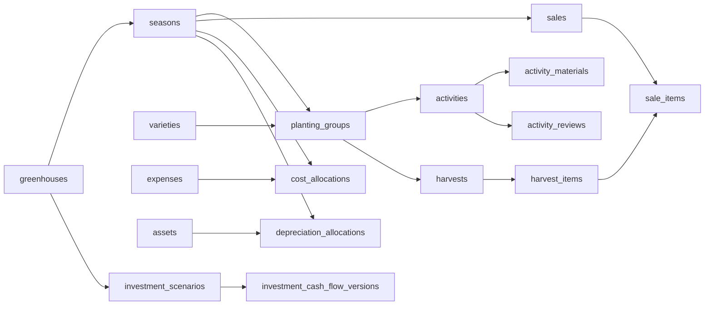

# Inofarm: konteks untuk Claude Code

**Keputusan 11 November 2026 (masukan dosen pembimbing): pengelola adalah super admin.** Pengelola mengakses semua greenhouse dan semua akun tanpa penugasan, alasan perubahan opsional, dan UI pengelola dirombak menjadi empat tab. Batas integritas data tetap berlaku di server. Backend terbukti oleh tes (backend 157 tes); UI Android terkompilasi dan lulus tes JVM, tetapi **belum diverifikasi di emulator atau perangkat**. [Bukti, batas dan sisa pekerjaan](docs/context/MANAGER_SUPERADMIN_EVIDENCE_20261111.md), [keputusan](docs/migration/finance-20261029/DECISIONS.md).

Penyelarasan pekerja 10–11 November 2026 menambah pilihan greenhouse langsung, agenda WIB, picker lapangan, verifikasi panen per revisi dan progres pekerja. Source backend memakai migration 20, dengan verifikasi hanya pada `inofarm_test`. Database aplikasi lokal berada pada checkpoint schema 19. [Status, bukti dan gate PK0–PK7](docs/context/WORKER_ALIGNMENT_EVIDENCE_20261110.md).

Baseline diperbarui **10 November 2026 setelah remediasi**, source engineering `a67577d`. Baca `AGENTS.md` root dan `backend/AGENTS.md` sebelum bekerja. Instruksi pengguna terbaru mengatasi histori. [Bukti penyelesaian audit](docs/context/AUDIT_REMEDIATION_20261110.md) menjadi rujukan status terbaru.

## Mulai di sini

1. [Bukti penyelesaian audit](docs/context/AUDIT_REMEDIATION_20261110.md), lalu [audit database, frontend, backend dan API](docs/context/SYSTEM_AUDIT_20261110.md): temuan, prioritas, evidence dan batas pemeriksaan.
2. [Status implementasi](docs/context/IMPLEMENTATION_STATUS.md) dan [gap aktif](docs/context/GAP_ANALYSIS.md).
3. [Inventaris database](docs/context/DATABASE_INVENTORY_20261110.md): seluruh tabel, kolom, tipe, FK dan perbedaan database aplikasi/uji.
4. [Peta route aktual](docs/context/API_ROUTE_MAP_20261110.md), [kontrak v2](contracts/v2/README.md), [OpenAPI](contracts/v2/openapi.json), schema JSON dan fixture di `contracts/v2/`.
5. [PRD](docs/context/PRD.md), [arsitektur](docs/context/ARCHITECTURE.md), [data contracts](docs/context/DATA_CONTRACTS.md), [keputusan](docs/migration/finance-20261029/DECISIONS.md), lalu source/test modul terkait.

Proposal aktif: `D:/Semester 7/Capstone 2/Proposal/Proposal Aplikasi Pencatatan Keuangan .pdf`, 60 halaman, SHA-256 `e4d7389e2fb1385d43ed507f33d211b7e66f92eae1bade4f15c64c6cf3bfc273`. Proposal menentukan kebutuhan bisnis; keputusan pengguna berikutnya memperluasnya. PDF bukan spesifikasi nama endpoint atau nama kolom SQL.

## Produk dan batas

**Aplikasi Mobile Pencatatan Operasional dan Evaluasi Keuangan Greenhouse Melon Hidroponik**. Input manual melalui Android, dengan banyak greenhouse, musim dan kelompok tanam. Mencakup kegiatan/bahan/pengukuran, panen, biaya/alokasi, penjualan lunas, aset/penyusutan, evaluasi musim, investasi tahunan, ekspor dan recovery.

Tidak ada IoT, sensor otomatis, ESP32, dosing, frontend React, payment gateway, piutang atau akuntansi lengkap dalam produk aktif. Source/runtime IoT telah dilepas; tabel, migration dan arsip historis tetap dipertahankan. Folder `firmware/.pio` ignored yang tersisa adalah cache build lokal, bukan fitur aktif.

Finance merupakan launcher default tanpa flag `-PfinanceApp`. Jangan menghidupkan kembali launcher owner/API v1 berdasarkan dokumen lama. Catatan FIN00 dan handoff 30 Oktober/8 November adalah histori; checkpoint pengelola PG0–PG7 sudah ada pada baseline ini.

## Stack aktual

| Bagian | Implementasi |
|---|---|
| Android | Kotlin, Jetpack Compose Material3, ViewModel/StateFlow, coroutines, OkHttp 4.12.0, JSON manual dan BigDecimal |
| Toolchain Android | AGP 9.1.1, Compose compiler plugin 2.2.10, Compose BOM 2025.08.01, Gradle 9.3.1; runner memakai JDK 25, target bytecode Java 17 |
| Platform | minSdk 29 (Android 10), compile/target SDK 37; versionName 0.2.0/code 2 |
| Identitas APK | debug/profile `com.inofarm.jogja.finance`; release `com.inofarm.jogja`; APK instrumentasi terpisah |
| Penyimpanan Android | SQLiteOpenHelper schema **10**, vault/sesi dan payload terenkripsi per server+akun, draf/outbox durable; bukan Room |
| Sinkronisasi | foreground coordinator dan Android JobScheduler/JobService; bukan WorkManager |
| Backend | PHP, Laravel 13 (constraint `^13.17`), Sanctum 4, controller/domain service/Query Builder/Eloquent, BCMath |
| Database server | MySQL 8; runtime lokal diperiksa versi 8.0.30; migration finance sampai **20** di source (database lokal di 19) |
| Laporan | snapshot immutable; Dompdf 3.1.6 untuk PDF, CSV dari snapshot yang sama |
| Pengujian | PHPUnit, Kotlin/JUnit, MockWebServer, Android instrumentation, checker Python JSON Schema dan oracle perhitungan |

Versi dependency pasti ada di `backend/composer.lock` dan Gradle; jangan menganggap constraint `composer.json` sebagai versi terpasang. Tidak perlu menambah dependency atau meng-upgrade hanya karena tersedia versi baru.

## Peran dan kewenangan

Role wire hanya **`worker`** (pekerja) dan **`manager`** (pengelola). Pekerja memerlukan penugasan greenhouse yang efektif. **Pengelola adalah super admin**: `GreenhouseAccess` mengembalikan semua greenhouse (aktif dan nonaktif) dan semua akun untuk role `manager`, tanpa penugasan. Penugasan kini hanya berarti pekerja mana yang bekerja di greenhouse itu, dan hanya akun pekerja yang bisa ditugaskan. Actor diambil dari sesi server, bukan field buatan client.

| Kemampuan | Pekerja | Pengelola |
|---|---|---|
| Login/logout/sesi | Akun sendiri | Akun sendiri |
| Baca konteks, jadwal, target, kegiatan dan panen | Greenhouse penugasan | Semua greenhouse |
| Membuat kegiatan/panen | Parent sah, musim terbuka, GH aktif | Sama, di greenhouse mana pun |
| Koreksi kegiatan/panen | Milik sendiri, versi cocok, musim terbuka, **alasan wajib** | Semua, catatan opsional, audit |
| Pembatalan kegiatan/panen | Tidak | Ya, catatan opsional; tetap dibatasi saldo/referensi dan musim |
| Cek catatan pekerja | Baca keputusan/alasan pada catatan sendiri | Inbox catatan asal pekerja; Sesuai / Perlu diperbaiki per revisi (**alasan wajib hanya untuk Perlu diperbaiki**) |
| Master, jadwal, target, penugasan | Baca yang diizinkan | Membuat/mengubah/menonaktifkan di greenhouse mana pun; tanpa hard delete histori |
| Akun | Tidak mengelola akun lain | Buat akun, edit nama/email/peran/status, reset password untuk semua akun (`GET /users?all_accounts=1`) |
| Tanam saat ini GH (periode berjalan) | Baca | Tetapkan kelompok secara eksplisit dan diaudit, catatan opsional |
| Target/selesai panen | Mencatat hasil dan kondisi rincian | Atur target, tandai selesai/buka kembali, catatan opsional |
| Tutup/buka musim | Tidak | Tindakan terpisah dengan validasi, catatan opsional |
| Biaya, alokasi, aset, penyusutan, penjualan | Tidak, termasuk API/sync/file | Semua greenhouse |
| Evaluasi, investasi, laporan, ekspor | Tidak | Preview, review, publikasi laporan terbit dan unduh PDF/CSV |
| Backup/recovery | Tidak | Membutuhkan kapabilitas operator sistem eksplisit di konfigurasi, bukan otomatis dari role |

Batas integritas yang tetap ditolak server: tidak ada hard delete histori/ledger/audit/laporan; laporan terbit tidak bisa diedit; saldo panen terjual, alokasi biaya dan anggaran penyusutan dijaga transaksi; musim tertutup harus dibuka dulu; pengelola tidak boleh menonaktifkan atau menurunkan peran dirinya sendiri, dan harus selalu ada minimal satu pengelola aktif (penjaga ini belum teruji lewat API); perubahan akun mencabut token akun yang diubah; password hanya bisa direset. Tidak ada self-registration/reset password publik. Alasan tetap wajib untuk keputusan "Perlu diperbaiki", recovery dan pembatalan lampiran.

Cek catatan berbeda dari pengiriman: `ACCEPTED` berarti server menerima catatan. Kegiatan pekerja yang belum dicek boleh tampil di Beranda dengan label **Belum dicek**. Revisi invalid dikecualikan dari kartu pengukuran pengelola, tetapi tetap ada di riwayat. Koreksi menghasilkan revisi baru yang perlu keputusan baru. Catatan pengelola sendiri bukan otomatis keputusan verifikasi pekerja.

## Struktur source dan navigasi

| Lokasi | Tanggung jawab |
|---|---|
| `android/app/src/main/java/com/inofarm/jogja/MainActivity.kt` | Launcher ke FinanceRoot |
| `android/app/src/main/java/com/inofarm/jogja/FinanceRuntime.kt` | Wiring repository, store, vault dan sync |
| `android/app/src/main/java/com/inofarm/jogja/feature/FinanceRoot.kt` | Shell/navigasi per peran dan host fitur |
| `android/app/src/main/java/com/inofarm/jogja/feature/` | auth, context, activities, verification, managerhome, harvest, history, expenses, sales, assets, reports, investments, attachments, exports, recovery, admin |
| `android/app/src/main/java/com/inofarm/jogja/core/` | contracts, database, session, sync, network dan desain bersama |
| `backend/routes/api_v2.php` | Satu-satunya API produk aktif, dimuat oleh routes/api.php |
| `backend/app/Http/Controllers/V2/` | HTTP, validasi envelope/query, respons |
| `backend/app/Domain/` | Aturan scope, cultivation, activities, harvest, finance, sync dan kontrak |
| `backend/database/migrations/` | Skema additive, termasuk legacy yang tidak dihapus |
| `backend/tests/` | Guard database dan tes unit/fitur |

Pekerja: login → konteks GH/musim/kelompok → kegiatan/panen → review → draf/antrekan → detail/riwayat/koreksi. Pengelola memiliki empat tab selalu terlihat: **Beranda, Riwayat, Keuangan, Kelola** (`ManagerTab`, `FinanceNavigation.kt`), tombol **Catat** (kegiatan, pengukuran, panen, biaya, penjualan) dan indikator **"N belum terkirim"** di top bar yang membuka sheet dengan "Kirim sekarang". Beranda menampilkan semua greenhouse, kartu "N catatan pekerja perlu dicek" dan "Tambah greenhouse" (wizard tiga langkah, `GreenhouseWizard.kt`, butuh koneksi seperti tulis admin lain). Satu greenhouse membuka halaman detail dengan bagian Ringkasan, Kegiatan, Panen, Keuangan, Pengaturan. Riwayat menggabungkan kegiatan, pengukuran dan panen dengan chip; biaya, penjualan dan aset membuka tab Keuangan. Kelola memuat greenhouse, pekerja dan akun, data master, jadwal dan target, serta akun saya. Navigasi pekerja tidak berubah (Beranda, Antrean, Kegiatan, Panen). Status ini terkompilasi dan lulus tes JVM, **belum diverifikasi di emulator atau perangkat**.

Draf tidak dipindahkan parent-nya ketika pengguna mengganti GH untuk browsing. Riwayat dan pemilih banyak membaca cache hasil `sync/changes`, bukan selalu GET list resource saat layar dibuka. Karena itu salah tampilan dapat berasal dari cache/scope/epoch, bukan selalu route HTTP.

## Kontrak API yang harus diikuti

Base URL konfigurabel dan harus berakhir `/api/v2/`; debug emulator default `http://10.0.2.2:8000/api/v2/`. Release memerlukan konfigurasi HTTPS. `FinanceHttpApi` menolak path absolut, `..`, URL berskema di path, serta redirect otomatis. Bearer token Sanctum dengan ability `finance-v2`; semua endpoint selain login melewati auth dan finance-session.

| Alur | Endpoint relatif utama |
|---|---|
| Auth | POST `auth/login`, POST `auth/logout`, GET `me` |
| Sync | GET `sync/status`, GET `sync/changes`, POST `sync/operations`, POST `sync/reconcile` |
| Beranda | GET `manager-home`, POST `greenhouses/{id}/running-period` |
| Master/akun | `greenhouses`, `seasons`, `planting-groups`, `varieties`, `materials`, `units`, `grades`, `expense-categories`, `assignments`, `users`; POST `users/assignment-candidate` |
| Acuan | `schedules`, `targets`; GET `{resource}/{id}/versions` |
| Kegiatan | `activities`, `activities/{id}`, `activities/{id}/cancel`, `activities/{id}/audit`, GET `measurements/latest` |
| Verifikasi | GET/POST `activity-reviews`, GET `activity-reviews/recorders`, GET `activities/{id}/verification` |
| Panen | `harvests`, detail/cancel/audit/availability; GET `planting-groups/{id}/harvest-progress`; POST `planting-groups/{id}/harvest-completion` |
| Keuangan | `expenses`, `cost-allocations`, `sales`, `assets`, `depreciation-allocations`, detail/cancel/audit; GET `expenses/{id}/availability` |
| Evaluasi musim | POST `season-reports/preview`, GET `season-reports/preview/sources`, GET/POST `season-reports`, GET `reports/{id}` dan `reports/{id}/sources` |
| Investasi | `investment-scenarios` dan detail/cancel/audit; POST `investment-reports/preview`, GET/POST `investment-reports`, detail/sources |
| Ekspor | GET `report-exports/{id}/{pdf\|csv}?expected_snapshot_hash=...` |
| Berkas | `attachments/policy`, `attachments`, `attachments/{id}/content`, detail/audit/cancel |
| Recovery | `recovery/policy`, `recovery/backups`, detail/validate, `recovery/restores`; tidak ada HTTP apply restore produksi |

Tabel ini ringkasan, bukan janji semua resource mendukung semua method. Lihat [153 kombinasi route aktual dan gap OpenAPI](docs/context/API_ROUTE_MAP_20261110.md). `/sync/operations` saat ini **khusus activity**, bukan dispatcher semua entity. Android `OperationRoute.forOperation` mengirim panen/keuangan/verifikasi ke endpoint masing-masing.

Mutasi domain memakai envelope JSON top-level: `schema_version: "2"`, `sync_epoch`, `operation_id`, `entity_id`, `entity_type`, `action`, `base_version`, `payload`. Tidak dibungkus lagi dalam key `operation` untuk request JSON biasa. Upload multipart memakai metadata `operation` dan binary `file`; preview/login/candidate/recovery mengikuti kontraknya sendiri.

- UUID canonical lowercase. Create memakai base_version null; update/cancel memakai integer versi positif. Nama entity wire tidak selalu nama path: `planting_groups` vs `planting-groups`, `cost_allocation` vs `cost-allocations`.
- Uang IDR DECIMAL(20,2); kuantitas/harga umumnya DECIMAL(20,6). Desimal JSON **string**, jumlah buah/versi integer. Total transaksi HALF_UP sekali setelah penjumlahan presisi penuh. Kosong/null berbeda dari nol.
- `occurred_at` memuat offset; server menyimpan UTC. Kalender HSS/HST/WIB memakai Asia/Jakarta, hari pertama 1. Stadia dipilih aktual, bukan otomatis dari umur.
- EC mS/cm dan PPM ppm tidak dikonversi. Pengukuran baru membutuhkan keduanya, `materials=[]`. Pengamatan opsional: DO, suhu air, tinggi tanaman, jumlah/lebar daun dan basis sampel.
- Operasi retry mempertahankan UUID/envelope/hash. Mutation+audit+receipt+feed satu transaksi; local record+outbox satu transaksi lokal. Same ID dengan isi berbeda ditolak. Replay tetap memeriksa akses.
- Error memuat code/message/field_errors/request_id/reasons, dan informasi konflik bila relevan. 401 perlu sesi; 403 hak; 404 objek/cakupan; 409 konflik; 422 validasi; 429 pembatasan. Jangan mereduksi semua alasan menjadi satu pesan generik.
- Pull memakai cursor/epoch/scope. Client baru mengirim `activity_reviews=1`; pergantian scope memutar ulang feed yang sah. Restore epoch menahan antrean lama untuk rekonsiliasi, bukan replay/clear otomatis.
- Request JSON dibatasi 16 KiB; file memiliki policy privat terpisah. Kebijakan produksi upload/retensi/recovery masih perlu keputusan.

**Hasil remediasi API (baseline 10 November; OpenAPI sekarang 111 path/156 operasi):** OpenAPI kini memuat 108 path/152 operasi, setara 153 operasi runtime setelah pdf/csv diekspansi. Parity dua arah lulus. Respons sukses dengan body memiliki schema, sedangkan logout204 tanpa body. Schema master/acuan/akun, login/profil, review, receipt/audit dan latest diperjelas. Envelope feed memiliki payload polimorfik untuk snapshot historis. `measurements/latest` sudah mengecualikan review invalid pada revisi aktif dan menerima revisi koreksi pending. [Evidence](docs/context/AUDIT_REMEDIATION_20261110.md).

## Database dan model data

Relasi inti: `greenhouses → seasons → planting_groups → activities/harvests`. Kelompok merujuk varietas; kegiatan opsional merujuk jadwal dan memiliki detail bahan. Panen memiliki rincian grade/jumlah/kg. Penjualan merujuk rincian panen dalam satu musim. Pengeluaran dipisahkan dari alokasi biaya; perolehan aset dipisahkan dari penyusutan. Investasi adalah skenario tahunan tersendiri.



Diagram menunjukkan relasi utama, bukan seluruh FK. Snapshot laporan, ledger, lampiran dan recovery memiliki relasi tambahan di kamus fisik.

| Domain | Tabel fisik |
|---|---|
| Identitas dan cakupan | users, greenhouses, greenhouse_assignments, entity_identities |
| Budidaya/master | seasons, planting_groups, varieties, units, materials, grades, expense_categories |
| Acuan | schedules, targets, cultivation_reference_versions |
| Kegiatan | activities, activity_materials, activity_reference_snapshots, activity_reviews |
| Panen | harvests, harvest_items, harvest_reference_snapshots |
| Biaya/aset | expenses, cost_allocations, assets, depreciation_allocations |
| Penjualan | sales, sale_items |
| Investasi/laporan | investment_scenarios, investment_cash_flow_versions, report_snapshots |
| Lampiran/recovery | record_attachments, backup_runs, restore_runs |
| Sinkronisasi/audit | sync_state, sync_operations, audit_logs, change_feed |
| Legacy terpelihara | tanks, devices, events, config_versions, phase_versions, workers, worker_versions, shift_versions |
| Infrastruktur | migrations, cache, cache_locks, jobs, job_batches, failed_jobs, sessions, password_reset_tokens, personal_access_tokens |

Nama konseptual `attachments`/`cash_flows` di rancangan lama bukan nama tabel fisik: gunakan `record_attachments`/`investment_cash_flow_versions`. Tidak semua entitas domain memiliki Eloquent model; banyak service memakai Query Builder. ID internal `users.id` bigint, identitas publik `users.public_id` UUID. Jangan mengganti keduanya atau menganggap semua PK UUID.

Target database lengkap memiliki **54 tabel, 75 FK**, migration finance 1–19 ditambah lima migration awal. [Kamus kolom dan relasi lengkap](docs/context/DATABASE_INVENTORY_20261110.md) membedakan struktur target dari lokal. FK historis dijaga; jangan hard-delete histori/ledger atau mengonversi tank/event menjadi greenhouse/kegiatan manusia.

**Kondisi laptop setelah remediasi:** konfigurasi efektif backend menuju MySQL `127.0.0.1:3307`, database **inofarm_finance_local**. Migration17–19 telah diterapkan dengan cadangan SQL dan rekonsiliasi data. Kini 54 tabel/75 FK/24 migration total sampai finance19. Seluruh kolom asli pada52 tabel dengan74 baris identik sebelum/sesudah, orphan FK nol, registry14 identitas sehat dan pembacaan Beranda berhasil. Tabel review serta kolom observations/role/target/completion/quality sudah tersedia. Kondisi instalasi lain tetap diperiksa dari konfigurasi efektifnya.

Pengguna kemudian mengotorisasi penyelesaian temuan audit. Rollout additive lokal selesai dengan cadangan privat di outputs/audit-remediation-20261110. Restore cadangan rollout belum diuji. Untuk perubahan berikutnya, periksa koneksi efektif, pending migration, backup dan scope otorisasi. Lindungi inofarm_local, inofarm_finance_local dan database pengguna lainnya. **Tes hanya effective MySQL inofarm_test**, guard sebelum SQL. Jangan menjalankan reset/migrate:fresh/seed/restore pada database pengguna untuk pengujian.

## Aturan keuangan dan integritas

TC=FC+VC; TR berasal dari penjualan lunas aktif; laba=TR−TC; R/C=TR/TC; B/C sederhana=laba/TC. BEP biaya tercatat=TC/harga rata-rata, BEP harga=TC/kg terjual, hanya bila denominator sah. Beranda menampilkan kas bulan WIB, bukan laba/alokasi/penyusutan. Panen bukan penjualan. Perhitungan investasi tahunan memisahkan I0, arus kas actual/projection, diskonto, NPV/IRR/PP/DPP; jangan menyamakan satu panen dengan satu tahun.

Alokasi biaya, saldo penjualan, dan anggaran penyusutan dijaga transaksi/lock, bukan validasi form saja. Laporan yang diterbitkan immutable beserta sumber/versi/hash. Koreksi sumber tidak mengubah laporan lama. Nilai target, dosis, harga, diskonto dan contoh makalah tidak boleh menjadi seed/default produksi. Penutupan panen kelompok terpisah dari penutupan musim; klasifikasi layak/cacat per rincian, bukan melekat permanen pada grade.

## Menjalankan pemeriksaan

```powershell
./scripts/test-backend.ps1
./scripts/build-android.ps1 -JavaHome $env:JAVA_HOME
./.tools/finance-contracts-venv/Scripts/python.exe scripts/check-finance-contracts.py
python scripts/check-finance-context.py
```

Lokasi `.tools` spesifik laptop; gunakan tooling kompatibel jika tidak tersedia. Runner Android memerlukan JDK yang benar; JDK audit berada di `C:/Program Files/Eclipse Adoptium/jdk-25.0.4.101-hotspot`. Jangan menimpa env/SDK pengguna untuk menjalankan pemeriksaan. Runner HTTP fixture/device dan PHPUnit tidak boleh menulis database uji bersamaan. `scripts/local-database.ps1` adalah bootstrap/provisioning, bukan alat audit read-only. Jangan menjalankannya sembarang untuk memeriksa data existing.

Hasil remediasi 10 November (angka kini: backend 157 tes, JVM 89) mencakup backend144 tes/3.690 assertion, guard4 tes/12 assertion, JVM74 tes, debug/test APK dan lint lulus (0 error,16 warning,1 hint). Instrumentasi32 tes penyimpanan/sync/pengukuran lulus pada emulator API30, termasuk1.005 data cache, isolasi akun dan pencabutan akses. ContextRepository membaca cache bertahap sampai selesai dalam scope. Snapshot list akhir tetap memakai memori sebanding jumlah data, sehingga benchmark skala produksi masih perlu bukti perangkat sasaran. [Evidence remediasi](docs/context/AUDIT_REMEDIATION_20261110.md).

## Prioritas lanjut dan aturan kerja

1. DB-01, API-01, API-02, API-03 dan FE-01 telah ditangani pada baseline ini. Baca bukti remediasi sebelum membuka kembali temuan yang sama.
2. Lanjutkan QA-01 sesuai kebutuhan pengguna, termasuk UAT mitra, pentest berizin, perangkat fisik, TalkBack, OS background/Doze, latency dan benchmark dataset besar.
3. Keputusan produksi Q07/Q08, asumsi agronomi/keuangan dan pengecualian SOP tetap memerlukan keputusan pemilik.

Scope terbaru10 November mencakup implementasi perbaikan audit dan pembaruan context. Perbaikan sudah dicatat per branch/commit. Branch per fitur/bug/docs memakai prefix codex/. Periksa status/diff/staging dan pertahankan kerja pengguna. Commit hanya file task setelah checks. Remote publikasi adalah github. Fetch sebelum push, verifikasi hasil, dan jangan force-push atau merge main otomatis. Secrets/env/dump/log/build/outputs serta desain yang provenance-nya belum ditinjau tidak di-stage.

Untuk setiap perubahan berikutnya: requirement → acceptance → source/test → evidence → context. Bedakan hasil baru dari bukti lama dan mock dari API/database/device nyata. Tetap pertahankan KF01–14, KNF01–08, U01–21 kecuali ada keputusan formal.
