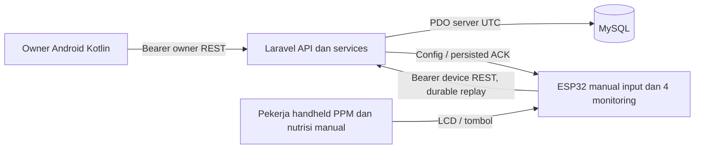
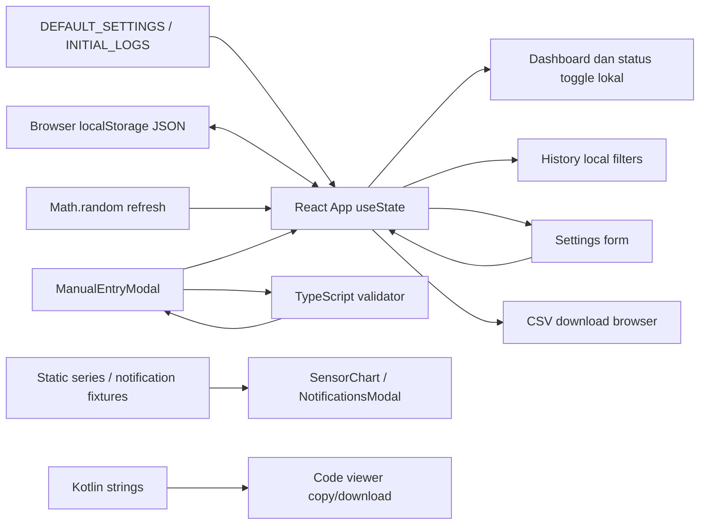
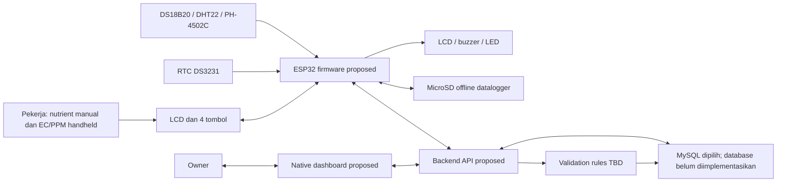

# Arsitektur Sistem dan Kesiapan Integrasi

## Instalasi tim dan baseline GitHub — 24 Oktober 2026

Panduan clone baru memisahkan setup Android Studio dari Laravel/MySQL lokal; environment, dependency dan runtime dibuat masing-masing komputer. Remote github ditambah tanpa mengganti origin GitLab; baseline GitHub diminta sebagai satu snapshot bersejarah terpisah. Tidak mengubah arsitektur/source aplikasi. [Evidence](../implementation/GITHUB_PUBLICATION.md).

## Rancangan ulang tanpa IoT — 21 Oktober 2026

Arsitektur target baru: pekerja/pengelola → Android Kotlin dan penyimpanan lokal/antrean → Laravel REST API → MySQL. Tidak ada producer ESP32 atau monitoring sensor dalam scope target. Evaluasi membaca data sah tersinkron; draf dan pembatalan tidak masuk total. Teknologi lokal spesifik belum dipilih. Arsitektur target, 17 diagram dan batasannya ada pada [paket diagram proposal](../design/mobile-greenhouse-20261021/README.md). Source Android/backend/firmware lama belum dimigrasikan; catatan implementasi di bawah tetap merekam kondisi lama.

## Data demo lokal — 20 Oktober 2026

Tooling CLI eksplisit inofarm:demo-history membentuk tandon/akun/pekerja/shift/config historis demo terisolasi; internal IngestController/Input/validator B-1/ShiftResolver existing menghasilkan event dan snapshot. Tidak ada endpoint/schema/Android/firmware berubah. Device simulator disabled tanpa kontak fisik. Detail [DEMO_DATA](../implementation/DEMO_DATA.md).

## Publikasi Git per fitur — 15 Oktober 2026

Pengguna mengotorisasi commit per fitur dan push ke GitLab UMY `andika.arya.ft23/inofarm_jogja`, memakai identitas Andika Arya Putra dan email kampus yang diberikan. Riwayat remote `main` beserta konfigurasi SAST/Secret Detection dipertahankan; impor snapshot lokal dikerjakan pada branch `codex/project-import` dan disusun menjadi commit berdasarkan fitur. Ini pengelompokan source yang sudah ada, bukan rekonstruksi tanggal pengerjaan. Environment, credential, cache IDE, runtime, log dan artefak build tidak dipublikasikan. Verifikasi lokal dan prosedur ada di [GIT_WORKFLOW](../implementation/GIT_WORKFLOW.md); tidak mengubah requirement/kontrak/aturan agronomis dan tidak menutup gate hardware, pentest atau handover.

## Koreksi presentation/navigation — 15 Oktober 2026

OwnerApp memusatkan navigasi tab dan shortcut fase; pemilihan Dashboard tidak memulihkan saved stack yang dapat menampilkan destination lain, sedangkan state Riwayat/Pengaturan tetap dipulihkan. Guard memakai nav.currentDestination, bukan route yang ditangkap callback. Tinggi navigasi diukur onSizeChanged dalam pixel lalu dikonversi menurut density; NavHost mereservasi tinggi aktual hanya saat navigasi terlihat. safeDrawingPadding/imePadding tetap pada parent. HistoryFilterMode adalah state presentation rememberSaveable yang terpisah dari appliedFilters. Layer VM/repository/API tetap existing. Verifikasi lokal dan keterbatasan: VERIFICATION / outputs/ui-navigation-20261015/README.md.

## Run ulang IDE — 15 Oktober 2026

Shared app run config dipulihkan module/Gradle-before-run; Inofarm MainActivity menarget specified Activity existing. Launcher membuka GUI Studio/emulator baru secara normal; embedded emulator existing ditampilkan lewat Running Devices. Backend helper tetap background, transcript lokal tersedia. Build/install/start CMD PASS; tanpa perubahan layer/data/kontrak.

## Konfigurasi koneksi login — 14 Oktober 2026

BuildConfig memusatkan default endpoint: debug10.0.2.2, override USB127 dari launcher, release/profile kosong atau property HTTPS. ApiEndpoint memilih base saat login dan memigrasikan legacy local URL secara terbatas; active session/cache scope tetap pasangan server existing. Login disclosure dan permission debug Android17 untuk default emulator; HTTP release tetap ditolak. Build/unit/lint/UI1 dan owner live login tanpa reverse PASS lokal; bukan acceptance USB fisik/custom LAN/hardware. Detail DECISIONS/VERIFICATION.

## Tooling launcher — 14 Oktober 2026

Follow-up provisioning owner lokal melalui model User hashed dengan guard local/MySQL/inofarm_local; akses tandon ditetapkan server-side, login/dashboard API PASS. Tidak ada perubahan layer/API/credential APK. Detail VERIFICATION.

Run-Inofarm.cmd memanggil PowerShell7 launcher: buka android di Android Studio, gunakan JBR/SDK existing, perangkat ADB/AVD, MySQL/API lokal existing, assembleDebug/install-r/reverse8000/start MainActivity. android/.run menyediakan konfigurasi Android App setelah Sync; generated .idea lokal diabaikan. Build/launch/API health VERIFIED_LOCAL, bukan pengujian autentikasi/sensor atau deployment. Layer aplikasi/kontrak tidak berubah.

## Delta performa Android — 13 Oktober 2026

OwnerViewModel memulai restore cancellable setelah konstruksi, memetakan snapshot pada Default, menerbitkan satu state setelah epoch/session diperiksa, kemudian refresh server. Snapshot memori SessionStore menyimpan token/expiry/start/scope/generation; getter UI tidak melakukan I/O/Keystore. Persistence/HTTP setup memakai IO; parsing API dan mapping DTO memakai Default. Parsing JSON cache bounded tetap pada IO bersama dekripsi di bawah storage lock. Logout/401/expiry membatalkan akses memori segera dan menjadwalkan purge IO NonCancellable tanpa menahan lock di UI. Request membawa pasangan server/token dari satu snapshot.

ReadCache schema2 memakai enam AtomicFile terenkripsi per resource dengan lock penyimpanan antar-instance, scope server/account/tank, total2MiB termasuk staging replacement, dedup500 history dan cursor cache null. Schema1 diinvalidasi, sesi tidak dihapus karena pergantian format. Repository tetap menunggu write kecil di IO; tidak ada scope write global/antrean baru. Cold startup memuat cache sebelum server, sehingga cache terlambat tidak menimpa respons baru.

Jendela history mempunyai maksimal100 live row dan dua cursor, tanpa bookmark tumbuh; prev_cursor memang disediakan CursorPaginator Laravel existing. Workers/shifts tetap mengambil semua halaman100 untuk konsistensi editor, tetapi list pekerja/shift dirender lazy. Dua hero nodpi didecode IO sesuai viewport, tanpa cache bitmap global. Tren memoized. Fallback tidak memasang source/effect Haze; blur18dp/Auto tetap saat didukung. Release/profile R8+resource shrinking; profile menyimpan ABI spesifik lintas APK instrumentation (generator lokal), release tanpa rules test tersebut. Runtime profile22 PASS pada emulator; pengukuran tidak membuktikan performa fisik. [ANDROID_PERFORMANCE](../implementation/ANDROID_PERFORMANCE.md).

## Delta Liquid Glass — 12 Oktober 2026

Android tetap Compose/ViewModel/repository existing. DesignSystem.kt diperluas; GlassComponents.kt memusatkan Haze, glyph vektor, header/hero/selector/footer; EditorComponents.kt memberi field/range/date picker/detail layout. OwnerApp menjaga nav/session/lifecycle dan menyembunyikan tab utama pada detail. SettingsScreen mempunyai satu draft saveable lintas empat halaman dengan checkpoint/baseVersion/matching ACK, error footer terlihat dan viewport mengikuti tinggi terukur; WorkersScreen memisahkan segment tanpa membuang ID/version. Haze 1.6.10 dipin tanpa upgrade toolchain; minSdk26 tetap. Blur API31+ non-low-RAM/battery saver off, opaque mint pada API26–30/low-RAM/battery saver atau effect override disabled. Variant profile lokal non-debug untuk pengukuran tidak menjadi rilis/deployment. Backend/firmware/React/data layer/kontrak tidak berubah. [UI_REDESIGN](../implementation/UI_REDESIGN.md).

## Delta presentation Android — 11 Oktober 2026

DesignSystem.kt memusatkan theme/warna/typography/spacing/shape/depth/motion; UiComponents menyediakan section, banner, field, reasons dan disclosure. OwnerApp tetap memakai nav/session/lifecycle existing, dengan tab vektor adaptif. Dashboard memakai grid berdasarkan ruang/font; History tetap LazyColumn ber-ID immutable dan applied filter. MainActivity/manifest menetapkan edge-to-edge, light system bars dan adjustResize; inset konsumsi menjaga konten/keyboard.

Glass terbatas pada navigasi melalui opaque tinted solid + highlight/elevasi, tanpa blur/API/dependency baru. Repository, DTO, session/cache, OwnerViewModel, ConfigDraft, REST/backend/firmware/React tidak diubah. Index175 tetap sama di branch codex/android-ui-redesign; tidak stage/commit/push/deploy. Detail/evidence [UI_REDESIGN](../implementation/UI_REDESIGN.md).

## Delta arsitektur T1–T7

Android memakai status per-resource/per-action, HTTP cancellable, session epoch/query generation, retained export dan saveable editor ID/version/draft. Login memberi stable account/tank IDs serta expiry; read cache AtomicFile AES-GCM/Keystore di noBackupFilesDir scoped server-account-tank, schema 1/max500/max2 MiB. Cache provenance tetap last-known dan backend authoritative; tidak ada offline write queue.

Backend memisahkan latest trusted source-time reading dari latest receipt; guard testing memeriksa effective MySQL inofarm_test sebelum provider/mutasi termasuk URL/cached/read-write override. Fresh provisioning menyediakan test-only account; instance existing tetap legacy. Firmware memindahkan HTTP ke worker FreeRTOS; loop tombol/alarm/SD terpisah. Queue fair scan melewati marker blocked tanpa menghapus payload; HTTP bench explicit gate/private parsed host.

Git workspace sekarang aktif pada codex/audit-fixes-t1-t7, 175 staged awal dipertahankan tanpa commit/push/deploy. Lihat [DECISIONS](../implementation/DECISIONS.md) dan [VERIFICATION](../implementation/VERIFICATION.md). Kompilasi bukan acceptance fisik.

> **Kondisi aktual setelah implementasi 10 Oktober 2026:** audit awal di bawah dipertahankan sebagai sejarah. Kini ada Android Kotlin yang dibangun menjadi APK, Laravel/MySQL lokal dengan migrations/API/auth, dan firmware PlatformIO dengan build ESP32/headless serta compile-check adapter. React tidak diubah. Android → REST owner API → MySQL dan device HTTP fixture → ingestion → owner repository telah diuji; ESP32 fisik belum tersedia. Lihat [API](../implementation/API.md), [VERIFICATION](../implementation/VERIFICATION.md), [README](../../README.md).

## Implementasi lokal terbaru

- `android/`: Compose presentation, ViewModel/StateFlow, data DTO/repository/OkHttp, session Android Keystore. URL API configurable, token bukan credential MySQL. Tidak ada worker login/PPM Android.
- `backend/`: Laravel controllers/middleware, services ConfigurationStore/NutrientValidator/ShiftResolver, Eloquent models dan migrations MySQL. Scope tank/role/device dari server. Sesi database UTC eksplisit; recurrence/tampilan WIB. Production empty, CLI provisioning owner/device, testing schema terpisah.
- `firmware/`: portable menu/core, Arduino adapters BOM, durable SD queue/ACK/config cache, HTTP(S), LCD/buttons/reminder. Wiring/calibration tidak diisi; compile bukan pengujian board. Konfigurasi save-server dan applied-device dibedakan.
- Versi konfigurasi/fase/worker/shift dan snapshot event menjaga history/replay. Validasi B-1 authoritative, seluruh reasons disimpan. Tidak ada task otomatis dosing/TDS/future greenhouse input.



Schema/Q-10 koreksi record, clock policy fisik, wiring/calibration, security pentest/rotation, GitLab/SOP multi-platform dan handover reviewer tetap terbuka sesuai bukti. Backend lokal bukan deployment greenhouse.

Audit 10 Oktober 2026. Current berarti ditemukan pada workspace. Target dan expected paths merupakan rekomendasi setelah persetujuan implementasi, bukan komponen yang telah dibuat. Lihat [PRD](PRD.md) untuk scope/Q dan [DATA_CONTRACTS](DATA_CONTRACTS.md) untuk field/provenance.

## 1. CURRENT ARCHITECTURE

Sistem yang berjalan menurut source adalah web single-page React/TypeScript. Tidak ada native Android app atau backend/IoT source dalam workspace. Dependencies yang terdaftar tidak membuktikan penggunaan: `express`, `dotenv`, `@google/genai`, `motion` ada di package.json tetapi tidak ada server/auth/GenAI call di source yang ditemukan. README masih boilerplate AI Studio.

```text
PROJECT_ROOT/
  Aturan Main/              proposal DOCX dan dua SOP PDF
  src/
    App.tsx                 parent state, localStorage, simulated refresh, CSV
    main.tsx                React createRoot
    index.css               Tailwind tokens/styles
    types/index.ts          data types TS
    utils/validation.ts     fixture/settings dan pure validation
    utils/kotlinTemplates.ts 7 template teks, bukan Kotlin module
    components/
      DashboardScreen.tsx HistoryScreen.tsx SettingsScreen.tsx
      ManualEntryModal.tsx NotificationsModal.tsx KotlinCodeViewer.tsx
      SensorChart.tsx TopAppBar.tsx BottomNavBar.tsx
  index.html vite.config.ts tsconfig.json package.json
  README.md metadata.json .env.example .gitignore
  AGENTS.md                 instruksi baru audit
  docs/context/             lima dokumen baru audit
```

Tidak ada app/, .git, .gitlab-ci.yml, Gradle/Manifest/resources XML, Kotlin physical file, libs.versions.toml, test runner/test suite, lockfile/node_modules, API/repository/database/firmware. `.gitignore` tidak membuktikan ignore diterapkan pada Git tracked history yang tidak tersedia.

| Aspek | Fakta current |
|---|---|
| UI | React `^19.0.1`, React DOM `^19.0.1`; Tailwind `^4.3.3`; lucide icons; Material Symbols/Inter dari Google Fonts |
| Build | Vite `^8.3.0`, plugin React `^6.1.1`, TypeScript `^7.0.2` pada manifest; **resolved versions tidak terverifikasi**, lockfile tidak ada |
| Scripts | dev Vite port 3000 host 0.0.0.0; build Vite; lint `tsc --noEmit`; preview; clean menghapus dist/server.js (tidak dijalankan) |
| Kotlin/AGP | Version tidak ada. Template plugin aliases mengacu `libs` tanpa catalog |
| SDK | Template compileSdk/targetSdk=35, minSdk=26; bukan configured SDK aktif |
| State | App `useState`, props/callbacks; screen state lokal; `useEffect` settings/logs → localStorage |
| Navigation | `currentTab` beranda/riwayat/pengaturan; conditional mounting; bukan router/back-stack platform |
| Persistence | `inofarm_settings`, `inofarm_logs` browser JSON; sensor/unread tidak persistent; parse tanpa runtime shape validation |
| Domain | validateNutrientInput memakai waktu HH:mm, nearest dua jadwal, abs diff, low/high sebelum late; tidak pakai sensor/RTC |
| Network/auth | Tidak ditemukan request IoT/backend/auth, credential handling, DI, coroutine atau data access API |
| Testing | Tidak ada suite/runner; lint hanya type check TS. Native compile/test tidak tersedia |



Pada current diagram tidak ada ESP32, server, broker MQTT atau database cloud karena tidak ditemukan. Random refresh tidak mengubah sensor.timestamp. Dashboard status toggle ter-reset saat tab unmount; graph terpisah dari sensors state. App memilih logs[0] sebagai latest tanpa sort. Settings editor phase sekaligus activePhase kebun. Manual modal selalu mounted parent sehingga initial activePhase prop tidak tersinkron otomatis dan draft tetap setelah tutup. Browser state tidak menangani back/deep-link seperti Android.

## 2. Template Kotlin dan batasnya

Tujuh entry: DashboardScreen.kt, HistoryScreen.kt, SettingsScreen.kt, MainActivity.kt, Theme.kt, NutrientValidator.kt, build.gradle.kts. Material 3, Navigation Compose, lifecycle ViewModel dependencies muncul sebagai teks; tidak ada instantiated ViewModel/stateFlow/repository/Room/coroutines/network. Dashboard semua hardcoded, chart Canvas dekoratif; History di MainActivity diberi emptyList; filter/export callbacks default kosong; Settings save callback tidak membawa payload/persist; tombol notifikasi kosong. `remember` state tidak durable.

Model `com.inofarm.jogja.data.model.NutrientLog` dan `ValidationResult` diimport tetapi tidak disediakan. `BorderStroke` dipakai oleh tiga screen tanpa import foundation.BorderStroke/foundation wildcard. Gradle root/settings/wrapper/version catalog/manifest belum ada. Kandidat unresolved references ini adalah bukti template tidak lengkap, bukan hasil Android compiler yang belum dijalankan. `currentRoute` terpisah dari NavController bisa tidak mengikuti back stack; harus diuji saat project dibuat. Jangan menyalin semua template lalu mengklaim siap pakai.

## 3. Arsitektur sistem yang direncanakan proposal

P §1.3/§2.2/§3.1 membagi sensor/RTC/LCD/tombol di ESP32, database/API/backend validasi, serta dashboard owner. REST API direncanakan; proposal memberi contoh MySQL/Firebase. Pengguna telah memilih **MySQL** pada 10 Oktober 2026; versi/environment, schema dan stack backend masih terbuka. Firmware MicroSD fallback, RTC/NTP, LED feedback perlu keputusan Q-07 dan pinout Q-08/09. Semua komponen luar React berikut **belum diimplementasikan di workspace**.



## 4. RECOMMENDED TARGET ARCHITECTURE

Scope pengguna 10 Oktober 2026: target **Android native Kotlin saja**, React referensi UI. Pengerjaan yang direncanakan meliputi Android + backend MySQL + firmware ESP32 beserta API/kontrak integrasinya. PPM masuk hanya dari ESP32 pada tahap sekarang; input harian greenhouse belum termasuk implementasi. Backend Laravel/PHP telah disetujui; Kotlin untuk Android. Rincian keputusan dan sisa gate akademik/teknis: PRD §3 dan Q-01/03/11.

REC-002: setelah Q-01/task setup disahkan, satu Android app module dengan Compose screens, ViewModel expose immutable UiState/StateFlow, dan repository abstraction untuk telemetry/history/settings/session. Domain validator/use case terpisah hanya jika logic cukup kompleks; backend hasil validasi tetap authoritative. Coroutine scope milik ViewModel/repository sesuai lifecycle; screens mengirim intent, tidak memanggil database/API sendiri. Ini pilihan praktis, bukan requirement teknologi pada proposal/SOP. Dasar rekomendasi: [Android architecture guide](https://developer.android.com/topic/architecture), diperiksa 10 Oktober 2026.

Expected package layout (PROPOSED, belum ada): `app/src/main/java/<approved-package>/ui/{dashboard,history,settings,session}`, `data/{repository,remote,local,model}`, dan `domain/validation` bila diperlukan. Pisahkan DTO/domain/UI model dengan mapping unit/time/enum teruji; resource label/strings/theme berasal desain existing bila sesuai. SDK/AGP/Kotlin/library versions dipilih berdasarkan toolchain aktual, tidak dipaksakan dari template.

Required changes secara perilaku: autentikasi/authorization, akses data terpusat, telemetry nyata bertimestamp/device ID, input device manual terkonfirmasi, jadwal RTC, persisting configuration dan hasil validasi yang konsisten. S §3 mewajibkan layers; **MVVM, Hilt, Room, MQTT bukan kewajiban SOP**. Setup native adalah konsekuensi arah U karena native belum ada, bukan refactor Android existing.

Optional improvements: Room read cache (REC-001), manual constructor injection awal atau DI framework bila graph membesar, reusable use cases bila diperlukan, WorkManager hanya untuk pekerjaan sync tertunda yang disetujui. Android offline read/cache design mengacu [Android offline-first guide](https://developer.android.com/topic/architecture/data-layer/offline-first); bukan requirement write-offline Android yang telah disahkan. MQTT hanya alternatif setelah kontrak komunikasi disepakati; REST sejalan rencana P dan cukup untuk integrasi awal.

## 5. Alur target dan ownership

Klarifikasi pengguna 10 Oktober 2026: Android owner/leader-only, worker input IoT-only; tahap awal satu ESP32 dan satu tandon, empat parameter monitoring. Pengelolaan jadwal pekerja hari/shift diusulkan pengguna untuk assignment nama menurut waktu input perangkat; rancangan mengikuti PRD §14/TASK-027 dan bukan authenticated author. Q-02 memilih B gabungan; threshold, snapshot dan prioritas masih terbuka. Backend Laravel/PHP REST API + MySQL telah dipilih pengguna; bukti dokumentasi resmi dan decision detail terdapat PRD §3. Jangan menambahkan modul shift/threshold/rule gabungan sebelum keputusan terkait.

- **Sensor:** ESP32 baca/kalibrasi → captureTime RTC/quality → LCD → API validasi envelope/identitas → simpan DB → Android repository mapping → ViewModel → kartu/history/chart. Device last contact dan measuredAt berbeda. Cadence/stale cutoff Q-11.
- **Nutrisi:** worker handheld → pilih fase/PPM tombol → ringkasan confirm → stable event ID (REC-003) + RTC/sensor reference → API persist → validator memakai parameter/jadwal yang disahkan → validation result persist → owner dan perangkat feedback. Measurement time, input time, receive time harus dipisahkan bila kontrak disepakati.
- **Config:** owner berizin → form validation → backend validation/persist config version (REC-005) → perangkat fetch/apply → ACK applied vs saved. Memilih fase editor tidak merubah fase record/kebun. Handling config conflict Q-04/07.
- **Validation:** backend rule table disahkan TASK-003/009. Offline LED/LCD memerlukan parameter cache/provisional flag bila dipilih; jangan memberi status final palsu. Sensor abnormal menghalangi valid sesuai pilihan B; sisa rules/threshold Q-02.
- **History/trend:** bounded/paginated query dengan date range dan record/source unit. Pending/missing record tidak direkayasa. Manual PPM series dipisahkan dari environmental telemetry.

## 6. Offline, sync dan recovery

Proposal mewajibkan MicroSD fallback untuk perangkat, dan RTC ketika WiFi tidak tersedia. Spesifikasi belum menentukan queue format/ACK/retry/retention. REC-003: event ID stabil sebelum antrean ditulis, replay hingga ACK server, duplikat same-content tidak menambah record, conflicting same-ID dilaporkan. Jangan menghapus lokal hanya karena socket send sukses. Clock provenance penting saat NTP unavailable. Proposal ERD `backup_lokal` mengandung tabel tersendiri, sementara medium fisik MicroSD; pemetaan local storage vs remote mirror perlu Q-11.

Android cache bersifat optional; jika disetujui, read last-known dengan waktu/source dan stale label, bukan online status manual. Jangan membuat offline write queue untuk owner settings sebelum konflik/applied state diputuskan. Timeout/backoff numeric belum diberikan. Recovery harus mempertahankan nilai sumber, status pending/error dan retry affordance; jangan backfill random data.

## 7. Security dan error boundaries

S §1/6 mensyaratkan auth mitigation, validation kedua sisi, secrets protected dan pentest. Backend memverifikasi sesi/hak owner dan producer perangkat; role dari client bukan otorisasi. Credential server tidak disimpan dalam web bundle/APK; `.env` server bukan tempat rahasia yang otomatis aman di frontend. Rekomendasi komunikasi TLS dan least privilege mengikuti [Android security guidance](https://developer.android.com/privacy-and-security/security-tips); sertifikat/device provisioning/pentest scope disepakati sebelum deployment.

Input parse error → field error; API unauthorized → sesi/access feedback; unavailable/network → retry/last-known; config invalid → simpan ditolak; malformed telemetry → reject/quarantine sesuai keputusan; sensor failure → quality state; validation unavailable → pending bukan valid. Proposed response conventions ada DATA_CONTRACTS; tidak ada actual HTTP service saat audit.

## 8. Migration dan keputusan

Update U 10 Oktober 2026: implementasi bertahap Android/backend/firmware dan debugging dalam scope diizinkan. Owner menetapkan fase aktif; worker input phase ESP32 dipertahankan, mismatch warning-only; simpan keduanya beserta waktu/version tanpa editor-phase side effect. Initial production configuration empty; owner mengisi semua nilai/jadwal, incomplete belum dapat divalidasi. Backend hasil B menampilkan semua reasons. Detail teknis reversible boleh dirancang/didokumentasikan; unknown agronomic rules dan hardware pinout tidak ditebak. Izin ini menggantikan audit-only/source-approval-per-task sebelumnya untuk scope ini; publikasi Git/deployment masih terpisah.

**Keputusan lanjutan yang berlaku (U, 10 Oktober 2026):** backend **Laravel/PHP REST API + MySQL** disetujui; Android tetap Kotlin, firmware toolchain belum ditetapkan. Validasi **B gabungan jadwal/fase/PPM/sensor** dipilih tahap awal, threshold/snapshot/missing/prioritas masih memerlukan aturan. Jadwal pekerja owner-managed ditambahkan TASK-027: backend resolve occurrence waktu konfirmasi event ESP32, simpan assignment/snapshot historis, [start,end) dan Asia/Jakarta, non-overlap/lintas malam/offline; label pekerja terjadwal bukan authenticated actor. Worker tidak memerlukan akun Android. Rancangan canonical PRD §14 dan DATA_CONTRACTS §7 menggantikan ketidakpastian stack/bentuk validasi/shift pada paragraf audit sebelumnya. Screenshot Stitch acuan UI, bukan data/default produksi. Tidak ada source implementation dibuat pada pembaruan ini.

Mulai TASK-001/002/003/004: sepakati platform, repo, rules dan kontrak. Pertahankan React sebagai referensi selama native ditambah di path yang disetujui; tidak perlu rewrite/delete web sebelum Q-01. Native foundation TASK-005 harus build independen dahulu. Port desain composable bertahap, gunakan explicit fake repository hanya test/demo dengan penanda; selanjutnya contract/API/IoT vertical slice. Setelah endpoint/hardware berfungsi baru dashboard/history/config terintegrasi, kemudian offline/QA/pentest/handover. Jangan menganggap fixture feature DONE.

Keputusan produk dikonfirmasi pengguna 10 Oktober 2026: **Android native Kotlin saja**, React referensi UI, **MySQL**, dan input PPM ESP32-only tahap sekarang. Scope direncanakan mencakup Android/backend/firmware. Keputusan architecture yang masih diperlukan: SDK/toolchain/package/module layout; framework/bahasa backend dan toolchain firmware, versi/environment MySQL, schema/auth/device trust; protocol REST/MQTT; validation authority offline; phase/config/schedule model; Room/write cache/DI/background notification; entity CRUD/retention. Penerapan akademik multi-platform belum dikonfirmasi. Detail dan dependency gates: PRD Q-01–14 dan IMPLEMENTATION_PLAN. Android mengakses backend API, bukan MySQL secara langsung.
