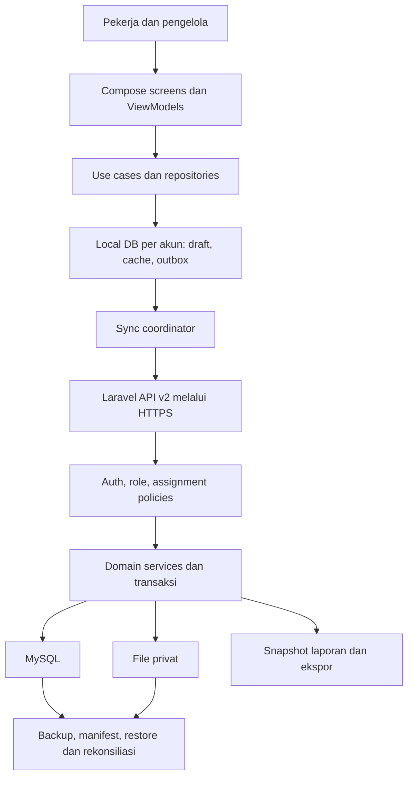

# Architecture: kondisi aktual dan target

## Baseline sebelum implementasi, diperiksa 29 Oktober 2026

`android/`: Kotlin/Compose native, `com.inofarm.jogja`, OwnerApp/OwnerViewModel, repository/OkHttp/JSON, SessionStore dan cache baca file terenkripsi. Dashboard sensor, riwayat event, konfigurasi, pekerja/shift. Tidak ada database lokal transaksi/outbox pada dependency/source yang diinventarisasi.
`backend/`: Laravel + Sanctum + MySQL, API v1 owner/leader berdasarkan tank_id dan API device; event ingestion, validation B, historical config/shift versions. Schema belum memuat domain keuangan/musim/kelompok.
`firmware/`: ESP32/PlatformIO dengan native test, menu/input/event queue; bukan target baru.
`src/`: prototipe React/TypeScript dan template Kotlin; tidak menjadi frontend produk target.
`docs/design/`: rancangan tanpa IoT sudah ada, belum implementasi. Detail versi toolchain dan sumber di audit; tidak mengganti versi hanya agar mengikuti tren.

## Subset executable setelah FIN06

Status/evidence di [IMPLEMENTATION_STATUS](IMPLEMENTATION_STATUS.md), source FIN06 `ff5869f`. `FinanceRoot` adalah launcher target -PfinanceApp, runtime app-scoped/vault generation, ViewModels/repositories auth/context/activity, SQLite encrypted draft/cache/outbox dan coordinator foreground. SQLiteOpenHelper dipilih tanpa dependency baru setelah evaluasi; Room/WorkManager bukan syarat PDF. Tidak menutup DB per Activity. Default launcher legacy dipertahankan sampai parity/cutover.

Laravel v2 berdampingan v1: identity/assignment/master, reference versions, activities/snapshots, mutation ledger/audit/feed/epoch. Singleton metadata lock memberi commit-order feed dan scope/version checks dalam transaksi; throughput produksi belum diuji. Empat migration additive diuji hanya MySQL inofarm_test, tidak diterapkan ke database pengguna. Kontrak subset di contracts/v2. Finance/harvest/reports/recovery masih akan dibangun.

## Target keseluruhan yang dirancang, belum seluruhnya diimplementasikan

Android: paket terpisah `core/{network,session,database,sync,designsystem}`, `feature/{auth,context,masters,schedule,activities,harvest,history,finance,reports,investment,administration}` sebagai arah organisasi, tidak wajib multi-module Gradle sejak awal. ViewModel per fitur, immutable UI state/StateFlow, use case aturan lokal, repository terpisah. Pertahankan pola cancellation/session generation supaya respons akun lama tidak tampil. Room dan WorkManager merupakan kandidat teknik untuk transaksi lokal/migrasi serta retry durable; evaluasi dokumentasi resmi dan kompatibilitas sebelum memilih dependency, bukan requirement teknologi dalam PDF. Local DB/outbox wajib secara perilaku, library DI tambahan tidak wajib.

Laravel: controller tipis, FormRequest/validator, Policies/authorization scope, service domain, Eloquent, database transaction. Domain: Identity/Assignments; Cultivation/Masters; Activities/Harvest; Sync/Audit; Expenses/Allocations; Assets/Depreciation; Sales; SeasonalEvaluation; Investment; Reports; BackupRecovery. Kalkulasi authoritative di backend; Android boleh preview yang dilabeli dan diuji konsisten.

## Boundary keamanan

Server mengikat actor dari sesi; mengecek role, assignment, relasi parent, musim terbuka dan version setiap write. UI gating bukan authorization. Query list/detail/export/file/pull semua scoped. Semua file privat lewat access layer; batas MIME/extension/size/count configurable dan diuji. Jangan log token/password/bukti transaksi atau menyimpan DB credential di APK. Clear session tidak boleh memakai mekanisme cache lama untuk menghapus outbox belum terkirim tanpa kebijakan eksplisit. Data akun lain tidak dapat dibaca atau dikirim ulang.

## Boundary konsistensi

Satu transaksi lokal untuk catatan + operasi. Satu transaksi backend untuk mutation + audit + operation result + change feed. Atomicity harus bertahan crash. Idempotensi record berbeda dari idempotensi operasi; edit/batal memiliki operation UUID baru. Konflik memakai base_version, tidak last-write-wins. Lock saldo biaya/panen/aset dengan urutan deterministik; validasi ulang setelah lock. Restore memakai sync epoch baru dan menahan replay lama untuk rekonsiliasi.

Cache/master pulled memakai cursor stabil, tombstone/deactivation, version dan scope authorization terbaru. Antrean ditahan pada 401/403/season closed/conflict; retry otomatis hanya kondisi transient yang tepat. Attachment punya state dan retry terpisah, tidak membuat catatan ganda. Pekerjaan finansial yang bergantung saldo authoritative harus dikonfirmasi server; offline boleh draf, tidak mengklaim saldo final.

## Strategi transisi

1. Bekukan kontrak v1 sebagai legacy; gunakan namespace v2 untuk domain baru (rancangan teknik, bukan endpoint dari PDF).
2. Tambahkan schema baru secara additive; jangan edit migration yang telah dijalankan untuk mengubah makna histori. Pertahankan users dan mapping eksplisit bila diperlukan; tank_id bukan greenhouse_id otomatis.
3. Akun worker lama adalah roster, bukan user login; tidak otomatis dibuatkan password/identitas. Event device tidak otomatis menjadi kegiatan manusia.
4. Uji memakai `inofarm_test` saja. Pengguna database least privilege; backend guard tetap aktif. Jangan jalankan migration/reset pada `inofarm_local` dalam task audit atau test.
5. Pertahankan data lama secara terpisah dengan provenance; impor bila diminta memerlukan mapping eksplisit, dry-run, backup dan rekonsiliasi jumlah/hash. Tidak mengarang musim, petugas, keuangan atau tanggal.
6. APK uji gunakan applicationIdSuffix terpisah sebelum migrasi storage/sesi dibuktikan. Cutover app+API dengan compatibility gate, rollback sebelum trafik write target; setelah write target rollback tidak boleh kehilangan transaksi.
7. Setelah parity, acceptance dan keputusan retensi, hentikan route device/telemetry, polling dashboard sensor dan build firmware dari jalur produk. Source legacy boleh diarsipkan kemudian, bukan dihapus sekarang.

Tidak ada deploy/cutover/drop tabel yang dijalankan. Playbook deployment, backup/RPO/RTO dan persetujuan produksi masih diperlukan.
