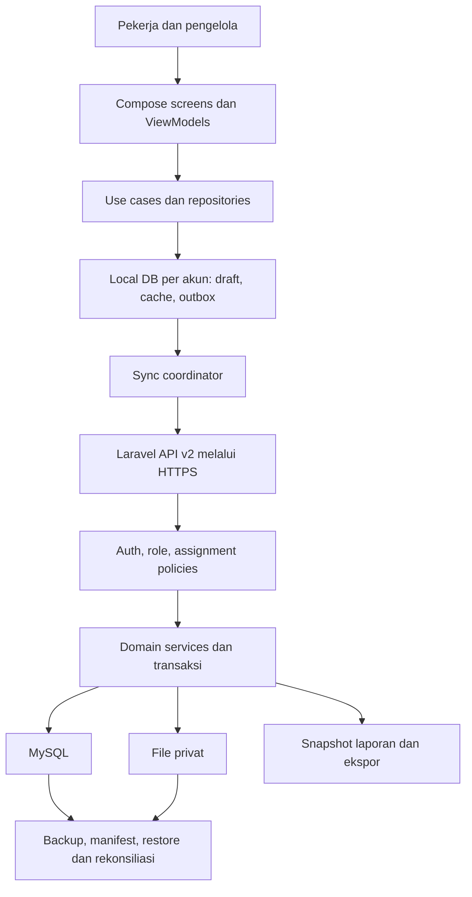

# Architecture: kondisi aktual dan target

Pengukuran manual2 November2026 menggunakan domain activity/ledger/sync existing, tipe `measurement`, additive schema15 nullable EC dan index, SQLite9/encrypted raw drafts/immutable outbox tetap. Dashboard memindai kandidat cache scoped dalam batch100 sampai valid, terpisah dari pagination riwayat; stable full pull memasok cache. API baca terbaru memakai commit-order scoped read dan immutable accepted snapshot. [Kontrak dan batas rollout](../../contracts/v2/MEASUREMENTS.md).

## Lanjutan FIN16–17 — 2 November 2026

FIN16 menambah feature/admin (typed fields, encrypted account journal; password hanya memori), Android JobScheduler/JobService memakai coordinator existing, dan vault StateFlow/current profile pada scoped sync/status. Tidak ada migration/dependency Android baru; wire2/schema14/SQLite9 tetap. symfony/mime dipatch8.1.10 saja. [Kontrak background/profile](../../contracts/v2/BACKGROUND_SYNC.md), [evidence](../migration/finance-20261029/FIN16_ACCEPTANCE.md), [operasi FIN17](../migration/finance-20261029/FIN17_INSTALL_RUN.md).

## FIN15 — 2 November 2026

FIN15 menambah schema14 backup_runs/restore_runs dan runtime identity sources, tanpa mengubah migration1–13/map8 beku. Backup mengambil repeatable-read + finance commit-order lock, JSONL base64 lossless per tabel, signed manifest/checksums dan referenced private blobs. Default root berada di luar seluruh filesystem yang dilayani HTTP. CLI restore hanya fresh owned MySQL testing berbeda server UUID/datadir, import bound parameters dari trusted schema, reconcile sebelum epoch rotation/session invalidation. Android SQLite9 dipertahankan: arsip/pemisahan authoritative vs local copy dan review receipt terfence sesi/epoch; tidak re-ID/rebase/replay otomatis. [Kontrak](../../contracts/v2/RECOVERY.md), [evidence/batas](../migration/finance-20261029/evidence/FIN15.md). Commit lokal per fitur; push tetap ditunda pengguna.

## FIN14 — 2 November 2026

FIN14 menambahkan ScopedRead → SavedReportStorage → ReportDocumentRenderer di backend, render di luar lock lalu pemeriksaan ulang token/manager/GH/epoch sebelum respons privat. Android memakai ReportExportTransport → ReportExportRepository → ACTION_CREATE_DOCUMENT; MIME/hash/byte length diverifikasi sebelum menulis URI. Dompdf3.1.6 pinned dengan remote/PHP/JavaScript disabled. Tidak ada migration baru; schema13 dan SQLite9 tetap. [Evidence/batas](../migration/finance-20261029/evidence/FIN14-backend.md), [kontrak](../../contracts/v2/REPORT_EXPORT.md). Commit lokal per fitur; push ditunda pengguna.

## Perbaikan histori FIN13 — 2 November 2026

Cancelled-only fresh-cache history kini dipertahankan dengan typed hydration/current scope; raw draft tidak ditimpa. APK/unit66 dan device17PASS (10 investasi +7 evaluasi musim). [Evidence](../migration/finance-20261029/evidence/20261102-CANCELLED_SCENARIO_HISTORY.md). Gap terkait ditutup lokal. Berikutnya FIN14; push ditunda pengguna, FIN15–17 di luar scope.

## Lanjutan FIN13 — 2 November 2026

Schema13 scenario + append-only annual versions dan FK report snapshot; shared immutable integrity reader. Native SQLite9 additive scenario index/hydration dan repository/ViewModel/forms ditulis; diverifikasi lokal dengan APK/unit/device/dua reboot nyata. [Evidence dan batas verifikasi](../migration/finance-20261029/evidence/FIN13-backend.md).

Native66 JVM/lint0,8 Android cases dan3 fase real HTTP/MySQL dengan dua OS reboot + SQL reconciliation PASS. [Evidence/batas native](../migration/finance-20261029/evidence/FIN13-native.md). FIN14 ekspor belum dimulai; checkpoint ini dipublikasikan atas instruksi terbaru pengguna.

## Lanjutan FIN12 — 2 November 2026

Native critical acceptance: JVM59/lint0,7 clean device cases and real API29 offline→two OS reboots→immutable reports/source correction/worker403+SQL reconciliation PASS. Broader cross-screen popup/touch regression remains open. [Native evidence](../migration/finance-20261029/evidence/FIN12-native.md).

FIN12 menambah schema12 report_snapshots immutable, service rasional eksak, batch accepted-source audit dan scoped preview/create/read/source pages di bawah sync-state consistency boundary. Public DTO/receipt/feed memuat hasil/hash; sumber bulk dipaginasi. Native UI masih tahap acceptance. [Evidence backend dan batas acceptance](../migration/finance-20261029/evidence/FIN12-backend.md). Regresi backend terbaru108 PASS/1755 assertions, dua race MySQL independen dan1024 oracle independen PASS; native acceptance masih berjalan.

## Lanjutan FIN11 — 30 Oktober 2026

FIN11 backend/schema11 dan native aset/penyusutan manual kini terverifikasi lokal: sumber/form/review, raw draft/autosave/Back/ON_STOP/logout, riwayat/audit/konflik/pembatalan, SQLite8 additive, dan tiga fase API nyata dengan dua reboot Android (boot3→4→5) serta SQL reconciliation PASS. Lihat [backend/math](../migration/finance-20261029/evidence/FIN11-backend.md), [native core](../migration/finance-20261029/evidence/FIN11-native-core.md), dan [native entry/acceptance](../migration/finance-20261029/evidence/FIN11-native-entry.md). Regresi69 mencatat66 PASS dan3 kegagalan yang ditindaklanjuti dengan fokus API36.1; tidak diklaim satu run69 bersih. JVM53/lint0errors; FIN12–17 dan gate produk tetap terbuka. Salinan proposal telah diterima dan hash/60 halaman cocok baseline; [verifikasi sumber](../migration/finance-20261029/evidence/20261030-PROPOSAL_RECEIVED.md). Nilai produksi tetap kosong; akses push ditunda pengguna.

## Baseline sebelum implementasi, diperiksa 29 Oktober 2026

`android/`: Kotlin/Compose native, `com.inofarm.jogja`, OwnerApp/OwnerViewModel, repository/OkHttp/JSON, SessionStore dan cache baca file terenkripsi. Dashboard sensor, riwayat event, konfigurasi, pekerja/shift. Tidak ada database lokal transaksi/outbox pada dependency/source yang diinventarisasi.
`backend/`: Laravel + Sanctum + MySQL, API v1 owner/leader berdasarkan tank_id dan API device; event ingestion, validation B, historical config/shift versions. Schema belum memuat domain keuangan/musim/kelompok.
`firmware/`: ESP32/PlatformIO dengan native test, menu/input/event queue; bukan target baru.
`src/`: prototipe React/TypeScript dan template Kotlin; tidak menjadi frontend produk target.
`docs/design/`: rancangan tanpa IoT sudah ada, belum implementasi. Detail versi toolchain dan sumber di audit; tidak mengganti versi hanya agar mengikuti tren.

## Subset executable setelah FIN06

Status/evidence di [IMPLEMENTATION_STATUS](IMPLEMENTATION_STATUS.md), source FIN06 `ff5869f`. `FinanceRoot` adalah launcher target -PfinanceApp, runtime app-scoped/vault generation, ViewModels/repositories auth/context/activity, SQLite encrypted draft/cache/outbox dan coordinator foreground. SQLiteOpenHelper dipilih tanpa dependency baru setelah evaluasi; Room/WorkManager bukan syarat PDF. Tidak menutup DB per Activity. Default launcher legacy dipertahankan sampai parity/cutover.

Laravel v2 berdampingan v1: identity/assignment/master, reference versions, activities/snapshots, mutation ledger/audit/feed/epoch. Singleton metadata lock memberi commit-order feed dan scope/version checks dalam transaksi; throughput produksi belum diuji. Empat migration additive diuji hanya MySQL inofarm_test, tidak diterapkan ke database pengguna. Kontrak subset di contracts/v2. Finance/harvest/reports/recovery masih akan dibangun.

## Target keseluruhan yang dirancang, belum seluruhnya diimplementasikan

Android: paket terpisah `core/{network,session,database,sync,designsystem}`, `feature/{auth,context,masters,schedule,activities,harvest,history,finance,reports,investment,administration}` sebagai arah organisasi, tidak wajib multi-module Gradle sejak awal. ViewModel per fitur, immutable UI state/StateFlow, use case aturan lokal, repository terpisah. Pertahankan pola cancellation/session generation supaya respons akun lama tidak tampil. Room dan WorkManager merupakan kandidat teknik untuk transaksi lokal/migrasi serta retry durable; evaluasi dokumentasi resmi dan kompatibilitas sebelum memilih dependency, bukan requirement teknologi dalam PDF. Local DB/outbox wajib secara perilaku, library DI tambahan tidak wajib.

Laravel: controller tipis, FormRequest/validator, Policies/authorization scope, service domain, Eloquent, database transaction. Domain: Identity/Assignments; Cultivation/Masters; Activities/Harvest; Sync/Audit; Expenses/Allocations; Assets/Depreciation; Sales; SeasonalEvaluation; Investment; Reports; BackupRecovery. Kalkulasi authoritative di backend; Android boleh preview yang dilabeli dan diuji konsisten.

## Boundary keamanan

Server mengikat actor dari sesi; mengecek role, assignment, relasi parent, musim terbuka dan version setiap write. UI gating bukan authorization. Query list/detail/export/file/pull semua scoped. Semua file privat lewat access layer; batas MIME/extension/size/count configurable dan diuji. Jangan log token/password/bukti transaksi atau menyimpan DB credential di APK. Clear session tidak boleh memakai mekanisme cache lama untuk menghapus outbox belum terkirim tanpa kebijakan eksplisit. Data akun lain tidak dapat dibaca atau dikirim ulang.

## Boundary konsistensi

Satu transaksi lokal untuk catatan + operasi. Satu transaksi backend untuk mutation + audit + operation result + change feed. Atomicity harus bertahan crash. Idempotensi record berbeda dari idempotensi operasi; edit/batal memiliki operation UUID baru. Konflik memakai base_version, tidak last-write-wins. Lock saldo biaya/panen/aset dengan urutan deterministik; validasi ulang setelah lock. Restore memakai sync epoch baru dan menahan replay lama untuk rekonsiliasi.

Cache/master pulled memakai cursor stabil, tombstone/deactivation, version dan scope authorization terbaru. Antrean ditahan pada 401/403/season closed/conflict; retry otomatis hanya kondisi transient yang tepat. Attachment punya state dan retry terpisah, tidak membuat catatan ganda. Pekerjaan finansial yang bergantung saldo authoritative harus dikonfirmasi server; offline boleh draf, tidak mengklaim saldo final.

## Strategi transisi

1. Bekukan kontrak v1 sebagai legacy; gunakan namespace v2 untuk domain baru (rancangan teknik, bukan endpoint dari PDF).
2. Tambahkan schema baru secara additive; jangan edit migration yang telah dijalankan untuk mengubah makna histori. Pertahankan users dan mapping eksplisit bila diperlukan; tank_id bukan greenhouse_id otomatis.
3. Akun worker lama adalah roster, bukan user login; tidak otomatis dibuatkan password/identitas. Event device tidak otomatis menjadi kegiatan manusia.
4. Uji memakai `inofarm_test` saja. Pengguna database least privilege; backend guard tetap aktif. Jangan jalankan migration/reset pada `inofarm_local` dalam task audit atau test.
5. Pertahankan data lama secara terpisah dengan provenance; impor bila diminta memerlukan mapping eksplisit, dry-run, backup dan rekonsiliasi jumlah/hash. Tidak mengarang musim, petugas, keuangan atau tanggal.
6. APK uji gunakan applicationIdSuffix terpisah sebelum migrasi storage/sesi dibuktikan. Cutover app+API dengan compatibility gate, rollback sebelum trafik write target; setelah write target rollback tidak boleh kehilangan transaksi.
7. Setelah parity, acceptance dan keputusan retensi, hentikan route device/telemetry, polling dashboard sensor dan build firmware dari jalur produk. Source legacy boleh diarsipkan kemudian, bukan dihapus sekarang.

Tidak ada deploy/cutover/drop tabel yang dijalankan. Playbook deployment, backup/RPO/RTO dan persetujuan produksi masih diperlukan.
