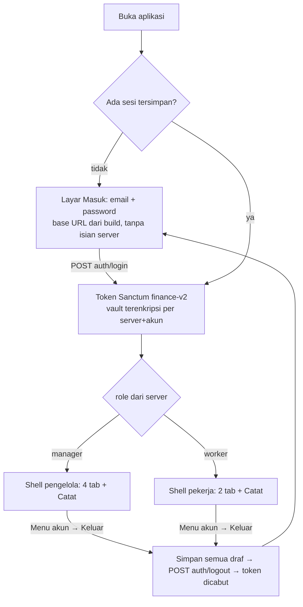
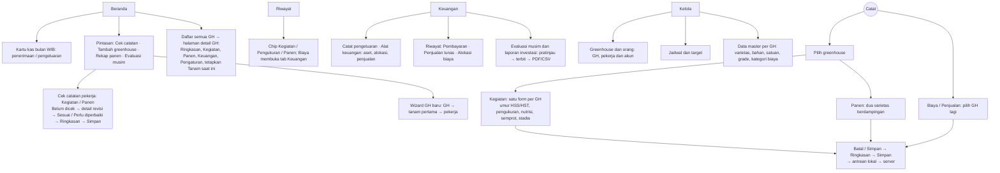
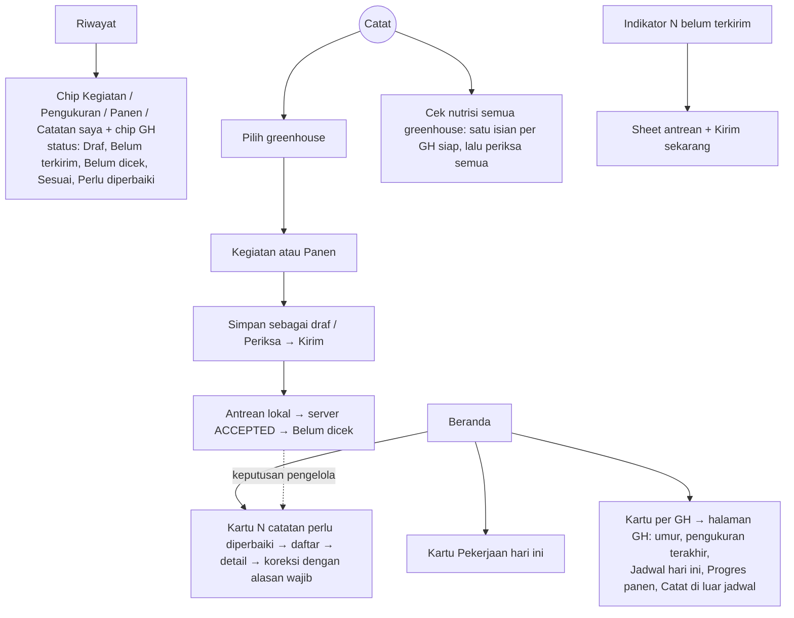

# Audit full-stack Inofarm, 18 November 2026

Audit baca-dan-uji, tanpa perubahan kode. Basis: `main` `e892561` (setelah PR #85). Emulator `Inofarm_Botanical_API30` dengan build debug terbaru dari `main`, terhubung ke Laravel lokal dan MySQL **`inofarm_finance_local`** (database aplikasi, atas izin pengguna: boleh simpan dan kirim, tidak boleh menghapus).

## Ringkasan

- **Inti produk masih utuh dan berjalan end-to-end di backend nyata.** Login dua peran, Catat kegiatan → Ringkasan → server, biaya → kas Beranda, kiriman pekerja → Cek catatan → keputusan "Sesuai": semuanya kuuji di emulator dan kucek barisnya di database.
- **Backend sehat.** PHPUnit 175 tes / 4.761 assertion lulus, cek kontrak dan cek konteks lulus, tidak ada migration tertunda. Batas pekerja di server benar: semua endpoint keuangan, akun dan Cek catatan menjawab 403, dan feed sinkronisasi pekerja tidak membawa entitas keuangan.
- **Masalah terbesar ada di kemudahan pemeliharaan dan sisa revisi.** Kumpulannya: satu file shell Android sebesar 1.790 baris, dua form kegiatan yang hidup berdampingan, API backend tanpa pemakai di Android, tabel IoT lama, dan dokumentasi status yang menumpuk sampai saling bertentangan.
- **Uji nyata menemukan 3 masalah yang langsung terasa pengguna.** (1) Master data kosong memblokir Nutrisi dan Biaya tanpa petunjuk. (2) Umur tanaman yang diketik pekerja dibantah kartu GH. (3) Angka di Cek catatan tampil mentah `2.200000 mS/cm`.

## 1. Alur sistem

Bagian ini memotret aplikasi seperti yang berjalan hari ini (source `FinanceRoot.kt`, `FinanceNavigation.kt`, `ManagerSheets.kt` dan penelusuran emulator), bukan rencana.

### 1.1 Masuk dan sesi

Draf dan antrean belum terkirim tetap di perangkat saat keluar. Sinkronisasi berjalan lewat koordinator foreground dan JobScheduler, membaca `sync/changes` ke cache lokal SQLite (schema 11). Layar membaca cache itu, bukan selalu GET ke server.

### 1.2 Pengelola (super admin, semua GH dan akun)

### 1.3 Pekerja (semua GH aktif, tanpa penugasan)

### 1.4 Jalur data satu kegiatan (terbukti hari ini)

| Langkah | Bukti 18 Nov |
|---|---|
| Pengelola: Catat → GH "tes" → Kegiatan, HSS 25, EC 2,4, PPM 1200, pH 6,1 → Simpan → Ringkasan → Simpan | Kartu GH berubah menjadi "25 HSS"; baris `activities` baru dengan `entry_batch_id`, `planting_group_id` null, `age_basis=hss`, `age_day=25` |
| Pengelola: Kelola → Data master → Kategori biaya (GH tes) → "Audit 18 Nov" → Simpan | "Tersimpan.", `expense_categories` 0 → 1 |
| Pengelola: Catat → Biaya → GH tes → Rp10.000, Pembayaran operasi | `expenses.amount=10000.00`, `paid_at` 11.00 UTC = 18.00 WIB; kas Beranda "Pengeluaran Rp10.000,00" |
| Pekerja: Catat → GH tes → Kegiatan, HSS 25, EC 2,2, PPM 1100 → Periksa → Kirim | Riwayat "Belum dicek"; Beranda pengelola "1 catatan pekerja perlu dicek" |
| Pengelola: Cek catatan → detail → Sesuai → Ringkasan → Simpan | `activity_reviews.decision=valid`, "Revisi 1 · Sesuai" |

## 2. Temuan frontend (uji di emulator terhadap backend nyata)

F1–F8 diperbaiki pada hari yang sama di branch `demo-fixes-f1-f8`: [bukti perbaikan](DEMO_FIXES_F1_F8_EVIDENCE_20261118.md).

| # | Tingkat | Temuan | Bukti |
|---|---|---|---|
| F1 | Tinggi | **Master data kosong memblokir alur.** Di `inofarm_finance_local`, `units` = 0 dan `expense_categories` = 0, sehingga bagian Nutrisi tidak bisa diisi dan Biaya tidak bisa dicatat. Picker hanya bilang "Belum ada pilihan pada data yang tersedia" tanpa arahan ke Kelola → Data master. Master berlaku per GH, jadi setiap GH baru mengulang masalah ini; API `copy-masters` sudah ada tetapi tidak dipakai Android. | Picker Satuan dan Kategori pengeluaran di emulator; `db:show --counts` |
| F2 | Tinggi | **Umur tanaman saling bantah.** Pekerja mengetik HSS 25, lalu halaman GH menampilkan "3 hari sejak semai" yang dihitung dari tanggal semai. Keputusan 17–18 Nov menyatakan umur diketik, bukan dihitung aplikasi. | Halaman GH "tes" sesudah kirim |
| F3 | Sedang | **Desimal mentah di Cek catatan**: "2.200000 mS/cm", "1100.000000 ppm" di inbox dan detail. Layar lain sudah memformat ("2,2"). | Inbox dan detail Cek catatan |
| F4 | Sedang | **Dua form kegiatan hidup berdampingan.** Catat membuka `EntryForm` baru (`vm.newEntry`), tetapi jadwal di Beranda pengelola dan agenda pekerja masih memanggil `vm.new` → `ActivityForm` lama berbasis tipe (`FinanceRoot.kt:956`, `:1038`, `:938`). Ini bertentangan dengan keputusan "satu form per GH" dan menggandakan kode serta tes. | Source |
| F5 | Sedang | **GH dipilih dua kali untuk Biaya/Penjualan.** Pilihan GH di sheet Catat hanya diteruskan untuk kegiatan/panen; Biaya membuka pemilih GH lagi. | Emulator; `FinanceRoot.kt:823` |
| F6 | Sedang | **"Tanam saat ini" berbeda antar peran.** GH "UJI Pemulihan WR 09 Nov": pengelola melihat "Tanam saat ini belum dipilih", pekerja melihat "Varietas UJI WR · Kelompok UJI WR" (pilihan otomatis `workerDefault`). | Beranda kedua peran |
| F7 | Rendah | Error validasi Biaya (mis. jenis pembayaran belum dipilih) hanya muncul sebagai daftar di ujung form (`FinancialEntryScreen.kt:239`), tidak di dekat field dan tanpa gulir otomatis, sehingga Simpan terasa tidak bereaksi. | Emulator dan source |
| F8 | Rendah | Sisa UI lama pekerja: tombol "Ubah musim atau kelompok" di halaman GH, dan filter GH ganda di Riwayat (chip GH + tombol Filter "Semua greenhouse"). | Emulator |
| F9 | Rendah | Tombol **Masuk** di layar login tertimpa bar navigasi sistem (API 30, navigasi 3 tombol) saat keyboard tertutup. | Tangkapan layar login |
| F10 | Rendah | Konsistensi kecil: app bar di form menampilkan "Selamat sore" (kegiatan pengelola), "Kelola" (biaya dibuka dari tab Kelola) atau "Inofarm" (pekerja); ringkasan memakai "2.4" sedangkan kartu "2,2"; form keuangan memakai label teknis "(YYYY-MM-DD)" dan "Detik boleh ditulis HH:mm:ss" yang tidak ada di form lain; chip "Nutrisi belum dicek" memakai kata "dicek" yang juga berarti verifikasi pengelola. | Emulator |
| F11 | Info | Aplikasi debug di emulator masih membawa sesi fixture "GH UI sintetis" dari tes instrumentasi. Tes instrumentasi dan pemakaian manual berbagi paket `com.inofarm.jogja.finance`, jadi data uji bisa terlihat seperti data sungguhan. | Layar pertama emulator |

Yang berjalan baik di uji ini: login/logout dua peran, kartu kas, pintasan Beranda, wizard dan Kelola terbuka, alur Batal / Simpan → Ringkasan, Periksa → Kirim pekerja, indikator antrean, label status Riwayat, dan Cek catatan sampai keputusan tersimpan.

## 3. Temuan backend (API, server, database)

### 3.1 Hasil pemeriksaan segar

| Pemeriksaan | Hasil |
|---|---|
| `scripts/test-backend.ps1` (guard lalu PHPUnit, hanya `inofarm_test`) | OK, 175 tes, 4.761 assertion |
| `check-finance-contracts.py` | PASS semua bagian |
| `check-finance-context.py` | 114 dokumen aktif, 586 tautan, 0 error |
| Android `testDebugUnitTest` + `lintDebug` | 137 tes lulus; lint 0 error, 19 peringatan (UseKtx, versi dependency) |
| `migrate:status --pending=1` di `inofarm_finance_local` | Tidak ada migration tertunda (27 file, sampai finance 22) |
| Probe akun pekerja ke server lokal | 403 untuk `manager-home`, sales, expenses, cost-allocations, assets, depreciation-allocations, season/investment reports, cash-flow, compare, recovery, users, activity-reviews, harvest-reviews; 200 untuk konteks/kegiatan/panen/sync. Tamu tanpa token: 401 |
| Isi `sync/changes` | Pekerja: greenhouses, seasons, varieties, grades, planting_groups, activity, harvest, harvest_balance, materials. Tidak ada entitas keuangan |
| Server | Laravel 13.42.0, PHP 8.5.11, debug OFF, timezone aplikasi UTC, MySQL 8.0.30 |

### 3.2 Temuan

| # | Tingkat | Temuan |
|---|---|---|
| B1 | Sedang | **API tanpa pemakai di Android**: `greenhouses/{id}/copy-masters`, `reports/cash-flow`, `season-reports/compare`, `seasons/{id}/material-usage`, `measurements/latest`, `{schedules,targets}/{id}/versions`, `expenses/{id}/availability`, `harvests/{id}/availability`, serta field penjualan `payment_method`, `payment_reference`, `customer_type`. Semuanya ada di OpenAPI dan diuji, tetapi tidak ada layar yang memanggilnya. Ini biaya pemeliharaan tanpa manfaat bagi pengguna sampai diputuskan: dipasang di Android atau ditandai "backend saja". |
| B2 | Sedang | **Otorisasi baca keuangan tersebar.** Route tulis memakai middleware `finance-manager`, tetapi GET keuangan (sales, expenses, assets, reports, investasi, recovery) mengandalkan `scope()` di tiap service. Probe hari ini membuktikan semuanya menolak pekerja, tetapi route GET baru yang lupa memanggil `scope()` akan bocor tanpa ketahuan. `seasons/{id}/material-usage` juga tanpa middleware dan belum kuprobe. |
| B3 | Rendah | `POST sync/operations` bernama umum tetapi hanya untuk activity, dan kegiatan punya dua jalur tulis (`POST activities` dan `sync/operations`). Nama dan jalur ganda menyulitkan orang baru. |
| B4 | Rendah | Banyak route catch-all `{resource}`, `{financeResource}`, `{reference}` dengan `whereIn`. Saat ini aman, tetapi urutan route menjadi penting; menambah nama resource baru bisa tertangkap route yang salah. |
| B5 | Rendah | **Legacy IoT**: 8 tabel (`tanks`, `devices`, `events`, `config_versions`, `phase_versions`, `workers`, `worker_versions`, `shift_versions`) dan 2 migration awal, 0 baris di `inofarm_finance_local`; nama repo masih "hydroponic-iot-&-nutrition-manager". Dipertahankan atas keputusan lama. |
| B6 | Info | **Isi database aplikasi adalah data coba**, bukan data pilot: GH bernama "tes", "ttt", "ygggg", "yyy"; 0 satuan, 0 jadwal, 0 target, 0 penjualan, 0 aset, 0 laporan, 2 akun. Bagian "evaluasi keuangan" (laporan musim, investasi, aset, penyusutan) belum pernah dipakai di database ini. |
| B7 | Info | Token kedaluwarsa tetap di `personal_access_tokens` sampai `sanctum:prune-expired` dijalankan scheduler. Scheduler butuh cron `schedule:run` di server pilot; di laptop tidak berjalan. Logout mencabut token dengan benar. |

## 4. Kemudahan pemeliharaan

| # | Temuan |
|---|---|
| M1 | **`feature/FinanceRoot.kt` 1.790 baris / 133 KB.** `FinanceHome` adalah satu composable sekitar 850 baris dengan 40+ parameter dan 59 `var ... by`. Layar dipilih dengan id integer 0–6 (termasuk "2 dan 3 daftar lama"), dan rantai kondisi yang sama ditulis ulang di `backEnabled`, `handleBack`, `destination`, `showNavigation` dan blok `when` layar. Setiap fitur baru menyentuh file ini. |
| M2 | Gaya kode padat: baris terpanjang 1.191 karakter, 51 baris di atas 200 karakter di `FinanceRoot.kt`. Sulit di-review dan di-diff. |
| M3 | **Dua jalur untuk satu hal**: dua form kegiatan (F4), dua cara memilih konteks (pengelola `recordingTarget`, pekerja `workerDefault` + kelompok), dua jalur tulis kegiatan di backend (B3). |
| M4 | **Dokumentasi menumpuk dan saling bertentangan.** `CLAUDE.md` 4.180 kata berisi paragraf status yang ditumpuk per tanggal; `docs/context` punya 77 file termasuk 14 `MASTER_PROMPT_*`, 6 `RUN_*` dan 4 `HANDOFF_*`. Contoh pertentangan: bagian navigasi `CLAUDE.md` masih menyebut UI pengelola "belum diverifikasi di emulator", padahal paragraf lain mencatat uji emulator 17–18 Nov. |
| M5 | Pekerjaan lokal belum di-commit masih ada di `main` (run config, `start-backend-for-studio.ps1`, beberapa dokumen dan `check-makalah-formulas.php`). Tidak kusentuh. |

## 5. Bahan keputusan: apakah project melenceng?

Pengguna memutuskan sendiri setelah membaca. Di bawah ini perubahan arah yang tercatat di repo. Aku tidak membandingkan langsung dengan isi PDF proposal.

| Area | Arah awal yang tercatat | Sekarang | Sumber keputusan |
|---|---|---|---|
| Fokus produk | Nama repo: hydroponic IoT dan manajer nutrisi | Pencatatan operasional manual dan evaluasi keuangan; IoT dilepas | Proposal aktif dan CLAUDE.md |
| Peran pengelola | Pengelola terikat penugasan GH | Super admin: semua GH dan akun | Masukan dosen, 11 Nov |
| Peran pekerja | Pekerja hanya GH penugasan | Semua GH aktif tanpa penugasan | Rombak pencatatan, 18 Nov |
| Unit pencatatan | Per kelompok tanam | Per greenhouse; hanya semprot per varietas | Keputusan pengguna, 17–18 Nov |
| Alur simpan pengelola | Form → Periksa → Simpan, draf | Batal / Simpan → Ringkasan | Keputusan pengguna, 17 Nov |
| Fitur lapangan backend | — | Salin master, cash flow, perbandingan musim, pemakaian bahan, QRIS, jumlah buah opsional | Jawaban lapangan, 17 Nov; belum di Android |

Yang perlu dicermati saat memutuskan: alur pencatatan sudah berganti bentuk beberapa kali (sisa bentuk lama di F4, F6, F8 dan M3), sedangkan bagian evaluasi keuangan, yang menjadi separuh judul produk, adalah bagian yang paling sedikit dipakai dan diuji dengan data nyata (B1, B6).

## 6. Lingkungan pengembangan

| # | Temuan | Perbaikan |
|---|---|---|
| E1 | **Keyboard laptop tidak bisa mengetik di emulator**: `hw.keyboard=no` di `config.ini` AVD `Inofarm_Botanical_API30` dan `Inofarm_Botanical_API29`. | Ubah menjadi `hw.keyboard=yes` di `%USERPROFILE%\.android\avd\Inofarm_Botanical_API30.avd\config.ini` (atau Device Manager → Edit → Show Advanced Settings → Enable keyboard input), lalu **Cold Boot**. |
| E2 | Env `JAVA_HOME` pengguna menunjuk ke `...\jdk-25.0.4.101-hotspot\bin\java.exe` (file), bukan folder JDK; `build-android.ps1` gagal tanpa override. | Set `JAVA_HOME` ke `C:\Program Files\Eclipse Adoptium\jdk-25.0.4.101-hotspot`. |
| E3 | AVD `Medium_Phone_API_37.0` terdaftar tetapi folder konfigurasinya tidak ada. | Hapus entri lewat Device Manager bila tidak dipakai. |

## 7. Data yang kutulis ke `inofarm_finance_local`

Tidak ada yang dihapus. Semua berada di GH "tes":

- 1 kegiatan pengelola (HSS 25, EC 2,4, PPM 1200, pH 6,1, sebelum inject), 18 Nov 17.53 WIB
- 1 kegiatan pekerja (HSS 25, EC 2,2, PPM 1100), 18 Nov 18.03 WIB, dan 1 keputusan Cek catatan "Sesuai"
- 1 kategori biaya "Audit 18 Nov"
- 1 pengeluaran Rp10.000 "Uji audit 18 Nov", pembayaran operasi
- baris `audit_logs`, `change_feed`, `sync_operations` dan `entity_identities` yang menyertainya; token probe sudah di-logout

Bila ingin disingkirkan, pakai pembatalan di aplikasi (kegiatan dan pengeluaran) dan Nonaktifkan untuk kategori. Histori tetap tersimpan sesuai aturan integritas.

## 8. Urutan perbaikan yang kusarankan

1. **F1**: arahan langsung ke Data master pada picker kosong, dan/atau pasang `copy-masters` di wizard GH; siapkan master minimal untuk pilot.
2. **F2 + F4 + F8**: tuntaskan rombak satu form. Jadwal membuka `EntryForm`, `ActivityForm` lama dan tombol "Ubah musim atau kelompok" dibuang, dan kartu GH menampilkan umur terakhir yang diketik.
3. **F3, F5, F7**: perbaikan kecil berdampak langsung.
4. **M1**: pecah `FinanceRoot.kt` menjadi shell pengelola dan pekerja dengan tipe layar tersegel, sebelum fitur berikutnya ditambahkan.
5. **B1 + B5**: putuskan nasib API tanpa pemakai dan tabel IoT lama.
6. **M4**: satu dokumen status yang selalu terkini; prompt dan run lama dipindah ke arsip.
7. **E1–E3**: rapikan lingkungan dev.

## Batas audit

- Emulator API 30 dan backend lokal, bukan ponsel fisik, TalkBack atau server pilot.
- Tidak diuji hari ini: panen, penjualan, aset/penyusutan, evaluasi musim, investasi, lampiran, recovery, wizard sampai selesai, koreksi pekerja, mode offline. Batas akses untuk area itu hanya dibuktikan lewat probe API.
- Tes instrumentasi Android (`connectedAndroidTest`) tidak dijalankan.
- PDF proposal tidak dibaca ulang.
