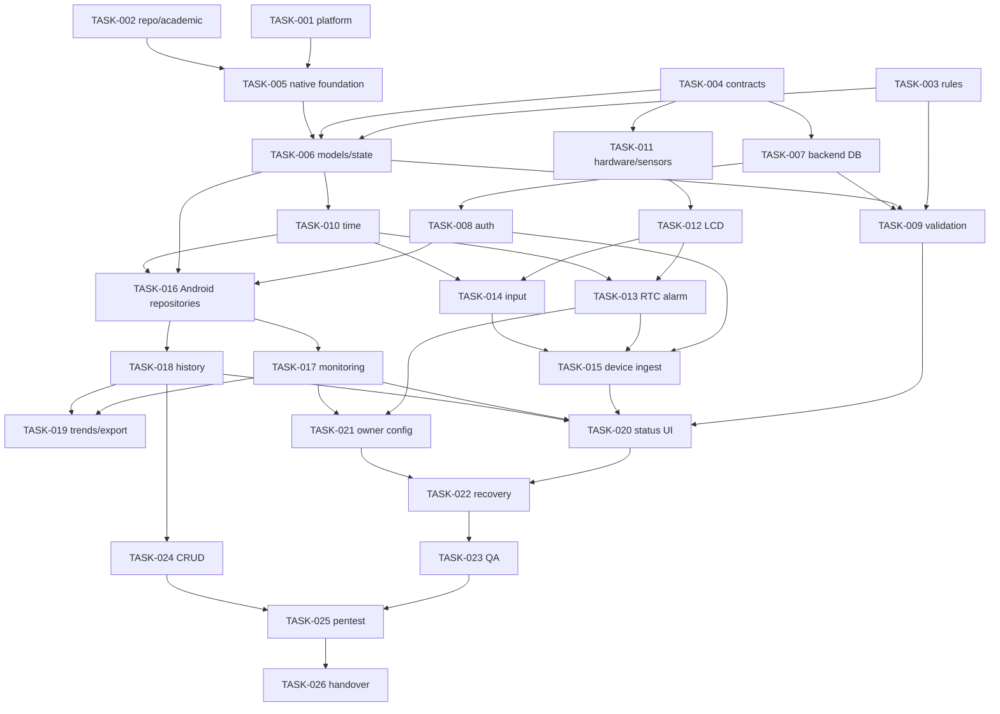

# Implementation Plan Bertahap dan Approval Gates

## Instalasi tim dan baseline GitHub — 24 Oktober 2026

Cara Instalasi.md, tautan README dan penguatan .gitignore selesai; backend guard4/12 dan suite20/404, Composer/Pint serta Android build/unit/lint PASS lokal sebelum publikasi. Verifikasi push dilakukan dengan hash remote; instalasi komputer teman dan hardware tetap belum diverifikasi. Tidak menandai task migrasi tanpa IoT atau handover DONE. [Evidence](../implementation/GITHUB_PUBLICATION.md).

## Rancangan ulang tanpa IoT — 21 Oktober 2026

Task penyusunan diagram proposal baru telah menghasilkan 17 diagram pada tujuh jenis, PDF 20 halaman, SVG, PNG dan sumber DOT/JSON dalam [paket diagram proposal](../design/mobile-greenhouse-20261021/README.md). Semua diagram dirender; seluruh halaman PDF dirender kembali dan diperiksa, termasuk perbaikan layout activity dan arah panah sequence. Status: VERIFIED_DOCUMENT_DESIGN, bukan IMPLEMENTED. Pekerjaan berikut: konfirmasi keuangan/parameter mitra, penyelarasan proposal, kemudian perencanaan migrasi aplikasi. Tidak ada source produk/database yang diubah pada task ini.

## Data demo lokal — 20 Oktober 2026

Permintaan inspeksi data dummy dan akun demo terpisah IMPLEMENTED_LOCAL:30 record+30 telemetry,10 hari penuh sebelumnya, tandon2. Full backend suite inofarm_test PASS20/404; HTTP login/read/filter/logout PASS;24 row existing unchanged. UI APK khusus demo/hardware tidak diverifikasi pada sesi ini. Gate handover tetap terbuka; [DEMO_DATA](../implementation/DEMO_DATA.md).

## Publikasi Git per fitur — 15 Oktober 2026

Pengguna mengotorisasi commit per fitur dan push ke GitLab UMY `andika.arya.ft23/inofarm_jogja`, memakai identitas Andika Arya Putra dan email kampus yang diberikan. Riwayat remote `main` beserta konfigurasi SAST/Secret Detection dipertahankan; impor snapshot lokal dikerjakan pada branch `codex/project-import` dan disusun menjadi commit berdasarkan fitur. Ini pengelompokan source yang sudah ada, bukan rekonstruksi tanggal pengerjaan. Environment, credential, cache IDE, runtime, log dan artefak build tidak dipublikasikan. Verifikasi lokal dan prosedur ada di [GIT_WORKFLOW](../implementation/GIT_WORKFLOW.md); tidak mengubah requirement/kontrak/aturan agronomis dan tidak menutup gate hardware, pentest atau handover.

## Progress perbaikan UI/navigasi — 15 Oktober 2026

Implementasi presentation/navigation, regression tests dan dokumentasi diotorisasi pengguna. Indikator Filter serta loop Dashboard–Pengaturan direproduksi dan koreksi lokal lulus uji; reservasi navigasi tetap 84/220dp diganti tinggi terukur. OwnerApp nyata diuji untuk query/ekspor applied, Reset/error, draft/recreation, shortcut berulang/system Back, akses akhir dengan touch scrolling, font 100/200%, portrait/landscape, layar pendek dan IME. Scope source: OwnerApp.kt, HistoryScreen.kt, NavigationRegressionTest.kt. Rincian checks/evidence: VERIFICATION / outputs/ui-navigation-20261015/README.md. Gate perangkat fisik/OEM, hardware, process death, pentest/reviewer/handover tetap terbuka; tidak menaikkan task hardware menjadi DONE.

## Progress membuka ulang — 15 Oktober 2026

CMD run ulang PASS dan MainActivity fokus; emulator existing embedded -qt-hide-window. Perbaikan GUI launcher/petunjuk/transcript, module/Gradle-before-run shared app dan Inofarm MainActivity explicit selesai. Klik Run IDE/cold-start GUI belum diuji langsung. Tidak source-app/backend/firmware change, commit/push/deploy atau perubahan gate handover. Detail VERIFICATION.

## Progress perbaikan login lokal — 14 Oktober 2026

Default endpoint debug/config release, disclosure login, friendly ConnectException, debug Android17 runtime permission dan launcher per-device diimplementasikan setelah keluhan pengguna. Build/unit10/lint0errors serta OwnerUiTest1 isolated .performance PASS; login owner nyata tanpa reverse dan screenshot diperiksa. UI helpers existing disesuaikan; full suite tidak diulang, permission denial/revocation/recreation/USB/customLAN/production belum diverifikasi. Tidak commit/push/deploy atau menutup task handover/hardware. Detail DECISIONS/VERIFICATION.

## Progress auto-run — 14 Oktober 2026

Follow-up provisioning owner sesuai identitas/password pilihan pengguna selesai lokal; hash/role/tank serta login/dashboard200 VERIFIED_LOCAL, token pemeriksaan logout. Tanpa migration/reset/fixture/source aplikasi; detail VERIFICATION.

User mengotorisasi launcher dan pemeriksaan instalasi. SDK37/JBR/Studio/AVD existing ditemukan. Run-Inofarm.cmd, scripts/run-android.ps1 dan android/.run/app.run.xml dibuat; build/install/start default serta CMD repeat -SkipStudio -SkipBackend PASS lokal, API health200 dan screenshot login diperiksa. Source app tetap existing. IDE import Gradle dari android selesai dan modul InofarmJogja.app dikenali menurut idea.log/gradle.xml; klik Run IDE, emulator cold-start/komputer lain belum diuji langsung. Task QA/handover/hardware tidak dinaikkan DONE; tidak stage/commit/push/deploy.

## Progress optimasi Android — 13 Oktober 2026

Scope performa diotorisasi eksplisit pengguna. Delta terkait TASK-016/018/019/022/023: restore async/main-safe repository, session snapshot+generation, per-resource encrypted AtomicFile, jendela cursor bidirectional, lazy worker/shift list, memoized trend, sampled nodpi heroes dan R8 release/profile telah diimplementasikan. Unit8, debug UI/state/correctness48 dan profile correctness/smoke/rendering22 PASS lokal. Pengukuran baru5×startup/cache dan3×per scene tab/scroll selesai; perbaikan warm startup/scroll belum terbukti konsisten. Build debug/lint/release/profile PASS; pengukuran/profile runtime dilaporkan terpisah pada [ANDROID_PERFORMANCE](../implementation/ANDROID_PERFORMANCE.md) dan [VERIFICATION](../implementation/VERIFICATION.md).

Source siap review pada branch codex/android-performance; staged index sebelumnya dipertahankan. Tidak commit/push/deploy/publikasi APK, firmware/React/backend mutation atau database tests. Tidak menaikkan task handover/QA fisik menjadi DONE: API26 runtime, perangkat owner, greenhouse/hardware, process-death/power-loss acceptance, pentest/reviewer/SOP tetap terbuka.

## Progress Liquid Glass — 12 Oktober 2026

| Scope prompt disetujui | Status / bukti |
|---|---|
| Inspeksi sembilan PNG, SOP/context/source, baseline | VERIFIED_LOCAL; baseline build/unit/lint/UI1 serta source/index hashes disimpan |
| Sembilan view Compose, navigasi, aset/motion/glass | IMPLEMENTED_LOCAL; komponen existing diperluas, data/kontrak tetap |
| Build/unit/UI/state dan comparison | VERIFIED_LOCAL; unit8 dan run gabungan27 on/off PASS dan targeted13 sesudah spacing final, sembilan screenshot runtime/comparison di output/liquid-glass-implementation |
| Animation off / profil final | PASS27 off; profile non-debug Auto/fallback diukur dan video diperiksa, bukan acceptance greenhouse |
| Field/hardware/SOP/pentest/reviewer/handover | OPEN / NOT_VERIFIABLE; tidak dinaikkan DONE |

Mengembangkan presentation TASK-005/017–023/027 dalam otorisasi12Oktober. Tidak stage/commit/push/deploy. Detail [UI_REDESIGN](../implementation/UI_REDESIGN.md).

## Progress redesign Android — 11 Oktober 2026

| Pekerjaan dalam izin redesign | Status | Bukti / batas |
|---|---|---|
| Audit source dan baseline visual | VERIFIED_LOCAL | Baseline OwnerUiTest1 dan screenshot sebelum redesign diperiksa. |
| Theme/hero/grid/nav/history/forms/motion | IMPLEMENTED_LOCAL | Kotlin/Compose existing, tanpa dependency/kontrak/domain baru. File/rationale di UI_REDESIGN. |
| Regresi software dan review render | VERIFIED_LOCAL | Unit8, UI/state20, animation-off13; 280dp/font200%, keyboard, landscape nyata, warnings/partial/last-known, reasons dan draft. Lihat VERIFICATION untuk run terpisah. |
| Field acceptance | OPEN / NOT_VERIFIABLE | Hardware/kalibrasi, spoken TalkBack full, device frame profiling/OEM/API coverage, greenhouse usability, process death, pentest/reviewer/SOP. |

Mengembangkan TASK-005/017–023 di presentation; tidak menaikkan seluruh task menjadi DONE atau mengubah TASK-024/Q-10. Lima docs/context diperbarui tanpa commit/push/deploy, dengan staging175 dipertahankan.

## Progress audit T1–T7 terbaru

Seluruh T1–T7 dipilih pengguna. Kebijakan refresh/cache disetujui eksplisit; status lokal berikut tidak menutup gate hardware/handover.

| Audit task | Status | Evidence / sisa gate |
|---|---|---|
| T1 | IMPLEMENTED_LOCAL | Guard pre-mutation4/12; backend18/247 pada inofarm_test. Fresh-only test account provision code/parser verified, grants fresh belum dijalankan. |
| T2 | IMPLEMENTED_LOCAL | Per-row day validation, native technical ranges, inactive rename, create/edit ACK/baseVersion; endpoint dan editor recreation regressions. |
| T3 | IMPLEMENTED_LOCAL / PHYSICAL_OPEN | Native8, headless + adapter compile; HTTP bench gate/fair preserved queue/network worker. SD power-loss/timing fisik belum diuji. |
| T4 | IMPLEMENTED_LOCAL | Resource/action separation, cancellation/epoch/query, editors, consistent filter/export, logout, picker recreation; state/UI regression. Full process-death acceptance belum ada. |
| T5 | IMPLEMENTED_LOCAL | Trusted-source reading dan latest receipt terpisah; backend replay/invalid clock regression, UI age/provenance, resume/30s active refresh. |
| T6 | IMPLEMENTED_LOCAL / ACCEPTANCE_OPEN | Lazy list500, full reasons, font200%/280dp, graph semantics, animation-off; TalkBack bound/tree smoke. Spoken walkthrough/device frame profiling/soak masih terbuka. |
| T7 | IMPLEMENTED_LOCAL | Keystore encrypted private cache schema1/server-account-tank/max500/max2MiB; scope/expiry/recreation tests. No offline mutations; live refresh attempted, historical checks preserved. |

[VERIFICATION](../implementation/VERIFICATION.md) adalah evidence terbaru dan menggantikan counts baseline tabel berikut. TASK-006 kini unit8; TASK-017–023 mencakup editor/nonempty500/font/cache/lifecycle lokal; acceptance fisik/long-run tetap terbuka. TASK-025–026 masih gate pentest/reviewer; Git workspace/branch kini ada, tanpa commit/push/deploy. 175 staged file awal tidak diubah stagingnya.

> **Update implementasi 10 Oktober 2026:** otorisasi coding/testing lintas modul telah diberikan pengguna; gate audit izin source per task tidak berlaku sebagai larangan umum. Status terkini pada matriks berikut menggantikan TODO baseline di bagian task lama. Lingkup software lokal dilaksanakan tanpa commit/push/deploy. Bukti perintah, counts dan keterbatasan: [VERIFICATION](../implementation/VERIFICATION.md). Kontrak aktual: [API](../implementation/API.md).

## Progress berdasarkan bukti terbaru

| Task | Status terkini | Bukti / sisa gate |
|---|---|---|
| 001–004 | PARTIAL | Platform/scope/stack/teknik integrasi diterapkan atas otorisasi terbaru. SOP platform, repository GitLab, nilai agronomis/hardware/Q-10 belum resolved sepenuhnya. |
| 005 | IMPLEMENTED_LOCAL | Android project/wrapper/APK/debug/lint dan navigasi/back/rotation emulator lulus. Dependency akademik TASK-002 belum selesai; tidak diklaim DONE keseluruhan gate. |
| 006 | IMPLEMENTED_LOCAL | Typed DTO/status/quality, unit mapping/finite/phase isolation, ViewModel/StateFlow dan API repository nyata, 8 unit tests. |
| 007 | IMPLEMENTED_LOCAL | Laravel migrations MySQL lokal, scoped models/index/constraints, transaction/as-of versions, cursor/filter/CSV; backend dan HTTP Android integration lulus. Deployment/backup/retention acceptance belum ada. |
| 008 | PARTIAL | CLI owner/device, login/token/logout/server scopes, Keystore, rate limits; access/brute-force tests. Rotation/revocation operational workflow dan pentest/reviewer belum selesai. |
| 009 | IMPLEMENTED_LOCAL | B-1 seluruh checks, empty/missing/failure/inclusive/source-time/mismatch diuji; konfigurasi angka produksi tetap menunggu owner, physical accuracy belum teruji. |
| 010 | PARTIAL | RFC3339/clock flags/source-receive-evaluate, UTC DB/WIB recurrence, nonfuture policy dan replay tests. RTC sync/drift/restart fisik NOT_VERIFIABLE. |
| 011 | NOT_VERIFIABLE_PHYSICAL | Driver BOM dan quality/null compiled, pin/calibration tetap kosong; sensor fisik belum diuji. |
| 012–014 | PARTIAL | Menu/core/review/manual phase+PPM, SD gate, LCD/button/reminder code compiled, native menu tests. Clock/LCD/button/LED/buzzer/handheld workflow fisik belum diverifikasi. |
| 015 | PARTIAL | API ingestion/idempotency/conflict dan historical replay diuji di MySQL; queue/config/ACK Arduino compiled. Power loss SD/network greenhouse belum diuji. |
| 016 | IMPLEMENTED_LOCAL | Real Android repository → Laravel HTTP → MySQL di emulator lulus login/config/phase/worker/shift/history/export/device event/replay/rename/logout. |
| 017–020 | IMPLEMENTED_LOCAL | Dashboard empat kartu/tren/latest, history/filter/cursor/CSV dan semua reasons memakai data backend; UI empty/back/rotation dan HTTP repo diuji. Data sensor fisik/visual nonempty menyeluruh/large-data acceptance belum tersedia. |
| 021 | PARTIAL | Owner configuration/fase dan save server vs applied device terpisah; empty config round-trip diuji. Cache/pengingat device fisik NOT_VERIFIABLE. |
| 022–023 | PARTIAL | Replay/optimistic version/cursor/source history dan emulator regression lulus. Offline process death/power-loss/soak/usability acceptance di greenhouse belum ada. |
| 024 | AWAITING_Q10 | CRUD versioned pekerja/shift diterapkan. Edit/delete immutable catatan nutrisi belum disahkan dan tidak diimplementasikan. |
| 025–026 | OPEN | Security regression lokal tersedia; belum merupakan pentest, reviewer atau paket submission/handover. Git workspace/branch kerja ada; tidak ada commit/push/deploy. |
| 027 | IMPLEMENTED_LOCAL / PHYSICAL_OPEN | Owner worker/shift UI+API, overlap/zero length/[start,end)/overnight/unscheduled/clock invalid/replay rename/deactivate snapshot diuji. Native week rollover diuji. Identitas penekan tombol tidak diverifikasi; RTC/hardware confirmation belum diuji. |

Tidak menaikkan semua task menjadi DONE hanya karena APK/backend/firmware dapat dibangun. Definition of Done/gate eksternal yang belum ada tetap terbuka. Detail baseline “Expected Files PROPOSED” berikut dibaca bersama source aktual dan evidence terbaru, bukan dianggap semua masih belum dibuat.

Audit 10 Oktober 2026. **Tidak ada task implementasi yang dikerjakan pada assignment audit ini.** Semua task di bawah awalnya TODO. Dependencies dan readiness gate menghalangi coding yang belum disahkan; TODO bukan izin menjalankan. Gunakan BLOCKED hanya ketika task yang sudah diambil terhambat dan penyebabnya dibuktikan, DONE hanya setelah acceptance/testing diverifikasi.

Baseline: belum ada native Android/Gradle, backend/API/database atau firmware; React dan template menjadi referensi, bukan existing native architecture untuk direfactor. [PRD](PRD.md) authoritative functional spec; [GAP](GAP_ANALYSIS.md) evidence; [ARCHITECTURE](ARCHITECTURE.md) target; [DATA_CONTRACTS](DATA_CONTRACTS.md) draft. Expected paths berikut **PROPOSED**, bukan file yang telah ditemukan. Tidak ada pemindahan/delete source disarankan sebagai prasyarat audit.

Update keputusan 10 Oktober 2026: pengguna mengonfirmasi database **MySQL**. Q-11 hanya terjawab untuk engine; TASK-004/007 tetap TODO karena stack/environment/schema/kontrak dan izin implementasi belum lengkap. Konfirmasi engine tidak menandakan persistence telah dibuat atau diuji.

## Aturan eksekusi dan verifikasi

- **Otorisasi terbaru U, 10 Oktober 2026:** implementasikan Android + Laravel/PHP REST API/MySQL + firmware ESP32 secara bertahap, lalu test/debug dalam scope. Tidak perlu approval ulang setiap task source yang masih dalam scope; gate audit-only sebelumnya bersifat historis. Pilihan teknik reversible/contract/API boleh dibuat dan dicatat; jangan mengarang nilai/rule agronomis. Owner aktif phase, worker record phase, mismatch warning-only; config produksi kosong; all validation reasons. Q hanya menahan behavior yang bergantung padanya. Split dependencies lintas backend/native/hardware sesuai kebutuhan nyata agar scaffolding/API/test dapat maju tanpa perangkat fisik. Git init/clone/workflow, commit/push/deployment/destructive operations tetap mengikuti otorisasi tersendiri. Semua task masih TODO pada penyusunan prompt ini karena belum diimplementasikan/diverifikasi.

- Keputusan pengguna 10 Oktober 2026: target Android native Kotlin saja, React referensi tampilan; scope direncanakan Android + backend MySQL + firmware ESP32/API/kontrak output. Input PPM hanya ESP32 untuk tahap sekarang; input harian greenhouse belum termasuk implementasi. Framework backend Laravel/PHP disetujui; toolchain firmware belum ditetapkan. TASK-001 mencatat keputusan produk ini dan memisahkan sisa gate akademik/toolchain; TASK-003 tidak perlu menanyakan ulang media input PPM yang sudah diputuskan. TASK-005/017/018 tidak membuat form create PPM Android. Semua status TODO tetap sampai AC diverifikasi.

- Mulai TASK-001 untuk menyelesaikan platform/source of truth; TASK-002–004 membuat scope/repo/rules/contracts konkret. User approval diperlukan sebelum source changes. Q yang belum selesai tidak boleh menjadi asumsi implementasi.
- Fase backend/firmware/native mengikuti dependencies, bukan urutan dokumen. Capstone2 Gantt rencana Okt2026–Jan2027 (P Gambar3.3) bukan official deadline. Target tanggal aktual/owner tim ditentukan TASK-001/002.
- S §3 clean layers dan S §1/6 input/auth required; teknologi Kotlin/Compose/repository adalah arah/rekomendasi, database **MySQL** telah dipilih; framework backend/auth dan versi/environment masih terbuka. Room/DI framework/WorkManager/MQTT tidak mandatory dan tidak ditambahkan otomatis.
- Validasi aplikasi React saat dependencies **sudah tersedia dan pengguna mengizinkan pekerjaan tersebut**: `npm run lint` = `tsc --noEmit`; `npm run build` = Vite build. Tidak ada tests script. Audit ini tidak menginstall dan tidak menjalankan build. Jangan jalankan `npm run clean` yang menghapus dist/server.js.
- Native setelah wrapper/module sudah dibuat pada root approved: `./gradlew.bat :app:assembleDebug`, `./gradlew.bat :app:testDebugUnitTest`, `./gradlew.bat :app:lintDebug`; `./gradlew.bat :app:connectedDebugAndroidTest` memerlukan emulator/device dan androidTest suite. Commands conditional, **tidak runnable sekarang**. Jika project root/module berbeda gunakan actual name. Dependency downloads/SDK acquisition harus berada dalam authorized future scope.
- Backend/firmware commands belum bisa ditentukan tanpa stack/toolchain. TASK-004 mencatat commands aktual dari script/wrapper/config yang ditambahkan setelah approval; jangan menciptakan endpoint/test command. Firmware compile/upload/serial dan backend test/migrate hanya pada task dan environment yang disetujui. Never mark hardware passed dari fake repository.
- Shared DoD setiap task: scope approved, AC evidence tersedia, applicable checks pass, relevant regression diperiksa, docs/task status diperbarui, review dilakukan, modified files dan limitations dilaporkan. Jika test tidak tersedia, laporkan dan jangan tandai verifikasi yang belum dilakukan.

## Dependency map dan checkpoint

Diagram ringkas; dependencies lengkap setiap task tetap berlaku. Human checkpoints: keputusan scope/rules/contracts setelah TASK-001–004; build setup setelah TASK-005; data/auth/producer vertical slice setelah TASK-007–016; owner+worker acceptance setelah TASK-022/023; remediation/reviewer sebelum handover TASK-025/026. Tidak ada implied approval untuk commit/push/merge/deploy.

## Fase A keputusan dan akademik

Klarifikasi lanjutan pengguna 10 Oktober 2026 untuk TASK-003/004: Android owner/leader saja, worker input IoT; awal satu ESP32/satu tandon, empat parameter monitoring. Jadwal pekerja hari/shift untuk assignment nama berdasarkan waktu input perangkat diinginkan pengguna, masuk rencana TASK-027; rancangan PRD §14 dan physical contract TASK-004 sebelum coding. Jangan gabungkan dengan future input harian greenhouse atau mengklaim verified worker identity. Bentuk validasi B gabungan dipilih; sisa rules/threshold Q-02. Backend Laravel/PHP REST API + MySQL disetujui; tidak ada instalasi/task DONE dari keputusan stack.

### TASK-001 Tetapkan platform dan baseline proyek

**Task ID:** TASK-001  
**Requirement Reference:** DER-NFR-002, DER-NFR-003; semua KF  
**Priority:** P0  
**Dependencies:** Tidak ada  
**Status:** TODO  
**Readiness gate:** Q-01; pembimbing/tim dan pengguna.

**Scope:** Documentation/decision saja: Android native target, web companion vs reference, platform SOP. Tidak membuat source baru.

**Expected Files:** docs/context/PRD.md, ARCHITECTURE.md, IMPLEMENTATION_PLAN.md.

**Implementation Steps:**

1. Bandingkan U Android dengan P §3.1/Gantt web+mobile dan S §2 minimum desktop/phone/tablet/Windows/macOS/Android/iOS.
2. Catat keputusan platform, penerapan SOP/exception jika disahkan pihak berwenang, acceptance platform matrix dan lokasi root/module native yang disetujui.
3. Inventaris toolchain Android Studio/JDK/SDK tersedia dengan read-only checks; tentukan kebutuhan setup tanpa install dulu.
4. Tentukan batas penggunaan prototipe React dan rencana penanggung jawab/tanggal aktual; update Q-01 tanpa menimpa evidence sumber.

**Acceptance Criteria:** Keputusan scope tertulis dan reviewer/owner diketahui; prototype vs native distinction tetap jelas.

**Testing Instructions:** Review keputusan terhadap PRD/Q-01, Gantt dan SOP; cek tidak ada exception SOP diasumsikan sendiri. Tidak perlu application test untuk task dokumentasi.

**Definition of Done:** shared DoD di atas + acceptance spesifik task terpenuhi dengan evidence dan review; requirements terkait di PRD/GAP dicocokkan; dependencies selesai; limitation yang mencegah acceptance tidak disembunyikan. Task dokumentasi tidak memerlukan invented application tests; task hardware memerlukan alat nyata.

**Expected Deliverable:** Decision record dalam context pack; platform acceptance matrix.

### TASK-002 Tetapkan repository GitLab dan prosedur akademik

**Task ID:** TASK-002  
**Requirement Reference:** DER-NFR-005; SOP-G-01–11, SOP-S-20/21  
**Priority:** P0  
**Dependencies:** Tidak ada  
**Status:** TODO  
**Readiness gate:** Q-13, Q-14.

**Scope:** Konfirmasi repo/account/access/branch/MR dan submission. Git mutations/commit/push hanya bila diotorisasi terpisah.

**Expected Files:** AGENTS.md, docs/context/GAP_ANALYSIS.md, IMPLEMENTATION_PLAN.md; Git metadata actual hanya jika authorized.

**Implementation Steps:**

1. Minta lokasi repository tim authoritative dan bukti akses GitLab UMY; catat konflik GitHub proposal dan host/network kampus.
2. Setelah repo yang benar tersedia gunakan read-only status/log/remote tanpa mencetak token; verifikasi branch policy/MR/CI actual.
3. Tentukan apakah clone/init diperlukan di task terpisah approved; jangan init workspace ekspor diam-diam.
4. Konfirmasi platform/nama berkas/format/deadline/bukti reviewer/pentest resmi yang tidak ditetapkan SOP; catat evidence kontribusi traceable, tanpa quota baru.

**Acceptance Criteria:** Repo authoritative dan workflow/submission assumptions tercatat; unknown tetap NOT_VERIFIABLE.

**Testing Instructions:** Bila repo tersedia: git status --short, git log ringkas, sanitized remote check. Review G h1–4 dan S h3. No commit/push pada task ini tanpa izin.

**Definition of Done:** shared DoD di atas + acceptance spesifik task terpenuhi dengan evidence dan review; requirements terkait di PRD/GAP dicocokkan; dependencies selesai; limitation yang mencegah acceptance tidak disembunyikan. Task dokumentasi tidak memerlukan invented application tests; task hardware memerlukan alat nyata.

**Expected Deliverable:** GitLab/academic decision dan checklist bukti.

### TASK-003 Sahkan business rules dan konflik workflow

**Task ID:** TASK-003  
**Requirement Reference:** KF-05, KF-06, KF-07, KF-10, DER-FR-002, DER-FR-007, DER-FR-009, DER-FR-010  
**Priority:** P0  
**Dependencies:** TASK-001  
**Status:** TODO  
**Readiness gate:** Q-02, Q-03, Q-04, Q-05, Q-12; owner/pembimbing.

**Scope:** Requirement decision: validation/schedule/phase/input/channel; tidak menulis validator sebelum sign-off.

**Expected Files:** docs/context/PRD.md, DATA_CONTRACTS.md, IMPLEMENTATION_PLAN.md.

**Implementation Steps:**

1. Buat decision table proposal narasi vs Activity/Class/ERD/flowchart: peran sensor, multi-failure primary/reasons, pending dan rule boundary.
2. Minta owner menetapkan rentang/jadwal/toleransi produksi; label wireframe sebagai contoh, jangan membawa hardcoded generatif dari template sebagai approved.
3. Terapkan keputusan input PPM ESP32-only tahap sekarang; putuskan sisa fase record/editor/active dan channel notifikasi. Input harian greenhouse tidak masuk implementasi task ini.
4. Tentukan recurrence/hari/fase/early-late/date rollover serta alarm response/timeout; tandai bagian yang belum dapat diputuskan.
5. Susun fixture test dari keputusan yang disahkan, termasuk combined violations dan missing config/data.

**Acceptance Criteria:** Setiap branch validation/schedule memiliki expected result disahkan; keputusan mencantumkan aktor dan provenance; unresolved behavior belum coding-ready.

**Testing Instructions:** Walkthrough Given/When/Then bersama owner/pembimbing; cek KF/DER tidak dihapus untuk menyembunyikan konflik.

**Definition of Done:** shared DoD di atas + acceptance spesifik task terpenuhi dengan evidence dan review; requirements terkait di PRD/GAP dicocokkan; dependencies selesai; limitation yang mencegah acceptance tidak disembunyikan. Task dokumentasi tidak memerlukan invented application tests; task hardware memerlukan alat nyata.

**Expected Deliverable:** Approved rule table dan test scenario specification.

### TASK-004 Sahkan kontrak data keamanan hardware dan CRUD

**Task ID:** TASK-004  
**Requirement Reference:** KF-08, KNF-04, DER-FR-005, DER-FR-006, DER-FR-011, DER-NFR-001, DER-NFR-004  
**Priority:** P0  
**Dependencies:** TASK-001, TASK-003  
**Status:** TODO  
**Readiness gate:** Q-06, Q-07, Q-08, Q-09, Q-10, Q-11.

**Scope:** Schema/API/identity/time/pinout/CRUD decisions; belum migration atau firmware.

**Expected Files:** docs/context/DATA_CONTRACTS.md, ARCHITECTURE.md, PRD.md.

**Implementation Steps:**

1. Review seluruh 11 ERD entities dan model TS dengan engine **MySQL** yang telah dipilih pengguna; tentukan versi/environment, framework backend/protocol/deployment scope tanpa mengklaim existing service.
2. Putuskan device trust/worker identity/owner permission dan namespace device/kebun/batch; tentukan data ownership/nullability/version/time representation.
3. Sahkan capture/receive/evaluate time, event ID/ACK/replay, snapshot sensor association dan config saved/applied semantics.
4. Review pinout aktual/catu daya dengan tim IoT terhadap gambar/narasi konflik; tetapkan sensor DHT22 dan komponen sesuai keputusan.
5. Pilih entitas full CRUD dan hak/correction/delete/retention/audit; catat actual future backend/firmware commands dan payload/query limits saat toolchain dipilih.

**Acceptance Criteria:** Contract siap mengikat producer/backend/consumer; hardware pin map direview; tidak ada ambiguous destructive historical CRUD.

**Testing Instructions:** Schema/DTO round-trip review dengan sample nonsecret; pin-map review hardware; source-to-contract field comparison. Commands final ditentukan dari stack actual, belum dieksekusi.

**Definition of Done:** shared DoD di atas + acceptance spesifik task terpenuhi dengan evidence dan review; requirements terkait di PRD/GAP dicocokkan; dependencies selesai; limitation yang mencegah acceptance tidak disembunyikan. Task dokumentasi tidak memerlukan invented application tests; task hardware memerlukan alat nyata.

**Expected Deliverable:** Approved contract, auth matrix, wiring decision, CRUD policy.

## Fase B foundation native data dan security

### TASK-005 Siapkan proyek native yang dapat dibangun

**Task ID:** TASK-005  
**Requirement Reference:** DER-NFR-003, REC-002  
**Priority:** P0  
**Dependencies:** TASK-001, TASK-002  
**Status:** TODO  
**Readiness gate:** Izin eksplisit source implementation dan Q-01 resolved.

**Scope:** Native foundation pada path approved. Preserve React/source/reference files; tidak port semua feature sekaligus.

**Expected Files:** PROPOSED app/, settings.gradle.kts, build.gradle.kts, gradle/wrapper/, gradle/libs.versions.toml, app/src/main/AndroidManifest.xml.

**Implementation Steps:**

1. Pilih compatible Kotlin/AGP/JDK/SDK/Compose berdasarkan installed toolchain dan official docs; dokumentasikan versi resolved.
2. Buat wrapper/settings/app manifest/application activity/theme sesuai namespace approved; centralize dependency versions.
3. Gunakan tiga destinations dengan shell data-empty honest, expose back-stack state dari navigation actual.
4. Audit template untuk missing imports/models/callbacks; ambil hanya komponen desain yang diperlukan; jangan klaim strings sebagai source compiled.
5. Tetapkan test/lint commands aktual dan periksa secret/artifact ignore policy.

**Acceptance Criteria:** assembleDebug dan lint native lulus; navigation shell terbuka pada emulator/device jika tersedia; no fake success data.

**Testing Instructions:** ./gradlew.bat :app:assembleDebug dan :app:lintDebug; smoke navigation/back/rotation. Jika web retained dan changed: npm run lint/build setelah dependency authorization.

**Definition of Done:** shared DoD di atas + acceptance spesifik task terpenuhi dengan evidence dan review; requirements terkait di PRD/GAP dicocokkan; dependencies selesai; limitation yang mencegah acceptance tidak disembunyikan. Task dokumentasi tidak memerlukan invented application tests; task hardware memerlukan alat nyata.

**Expected Deliverable:** Buildable Android foundation dan version/toolchain evidence.

### TASK-006 Buat domain model mapping dan UI state

**Task ID:** TASK-006  
**Requirement Reference:** KF-06, KF-07, KF-09, KNF-02, DER-FR-002, REC-002, REC-005, REC-006  
**Priority:** P1  
**Dependencies:** TASK-003, TASK-004, TASK-005  
**Status:** TODO  
**Readiness gate:** Kontrak/models phase/status sudah disahkan.

**Scope:** Typed domain/DTO/UI state interfaces berdasarkan approved contract. No API/DB implementation duplicate.

**Expected Files:** PROPOSED app/src/main/java/<package>/data/model/, data/repository/, ui/*ViewModel.kt, domain/ jika justified; unit tests.

**Implementation Steps:**

1. Definisikan typed phase/status/schedule/parameter/record/telemetry/device/time models; pisahkan phaseEditor dari phaseContext dan record.phase.
2. Buat DTO/domain/UI mappers dengan explicit unit/time/nullability/unknown handling.
3. Buat repository interfaces dan fake implementations untuk tests/demo yang labeled; fake tidak default production.
4. Expose immutable loading/data/empty/error/save UI state melalui ViewModel/StateFlow; scope lifecycle/cancellation; screens tidak langsung storage.
5. Tambahkan unit mapping/state tests yang memeriksa mismatch/invalid shape, bukan hanya getter implementation.

**Acceptance Criteria:** Lossless unit/phase/time mapping, state tidak memalsukan data; input invalid tidak menjadi valid domain record.

**Testing Instructions:** ./gradlew.bat :app:testDebugUnitTest dan :app:lintDebug; test missing/unknown/finite fields dan editor-phase isolation.

**Definition of Done:** shared DoD di atas + acceptance spesifik task terpenuhi dengan evidence dan review; requirements terkait di PRD/GAP dicocokkan; dependencies selesai; limitation yang mencegah acceptance tidak disembunyikan. Task dokumentasi tidak memerlukan invented application tests; task hardware memerlukan alat nyata.

**Expected Deliverable:** Domain/DTO/UI state foundations yang testable.

### TASK-007 Bangun persistence backend dan query terstruktur

**Task ID:** TASK-007  
**Requirement Reference:** KF-08, KNF-06, DER-NFR-003, DER-NFR-004  
**Priority:** P0  
**Dependencies:** TASK-004  
**Status:** TODO  
**Readiness gate:** Stack/database environment tersedia dan izin schema changes.

**Scope:** Backend/schema **MySQL** pada lokasi approved; versi/environment, relasi/limit sesuai decision; migrations hanya task scope authorized.

**Expected Files:** PROPOSED backend schema/model/repository/config dan database tests; path final TASK-004.

**Implementation Steps:**

1. Implementasikan yang telah disahkan: entities/relations/indices/constraints/retention dan migrations di development environment disetujui.
2. Pisahkan data access dari handlers/business, centralized environment configuration; no secret output.
3. Buat bounded ordered history/telemetry query dengan pagination dan date range; aggregate counts dengan scope explicit.
4. Pastikan transaction raw record/validation/config writes sesuai contract; idempotency storage uniqueness siap.
5. Buat seed/test data disjoint dari production; dokumentasi cara reset test environment tanpa menyentuh data pengguna.

**Acceptance Criteria:** Data dapat disimpan/dibaca ulang dengan relasi valid, paging stabil dan limit; malformed/constraint conflict terdeteksi.

**Testing Instructions:** Jalankan DB integration/query tests dengan runner stack TASK-004; inspect query plan/index/bounded result; migration verification hanya DB test approved.

**Definition of Done:** shared DoD di atas + acceptance spesifik task terpenuhi dengan evidence dan review; requirements terkait di PRD/GAP dicocokkan; dependencies selesai; limitation yang mencegah acceptance tidak disembunyikan. Task dokumentasi tidak memerlukan invented application tests; task hardware memerlukan alat nyata.

**Expected Deliverable:** Backend persistence layer dan schema/test evidence.

### TASK-008 Autentikasi otorisasi owner dan perangkat

**Task ID:** TASK-008  
**Requirement Reference:** DER-FR-005, DER-NFR-001  
**Priority:** P0  
**Dependencies:** TASK-004, TASK-007  
**Status:** TODO  
**Readiness gate:** Identity/trust Q-06 resolved; no secret shared with UI.

**Scope:** Session/login dan producer authorization; account creation sesuai approved scope, no self-registration invented.

**Expected Files:** PROPOSED backend auth/middleware/device provisioning, Android ui/session/data session, access tests.

**Implementation Steps:**

1. Implementasikan mekanisme autentikasi yang disahkan, password hash bila passwords digunakan, rate/brute-force controls dan session lifecycle.
2. Terapkan permissions pada server untuk owner config/CRUD dan device ingest; derive actor identity, reject role spoofing.
3. Buat native Login/logout/expired state dan safe session storage menurut actual mechanism.
4. Pusatkan konfigurasi publik API; keep backend/device sensitive credentials out of frontend/APK.
5. Uji credential valid/invalid, unauthorized/forbidden, cross-scope/device access, injection and logout/session expiry.

**Acceptance Criteria:** Login berhasil sesuai hak, unauthorized request ditolak server, credentials tidak reflected/logged; minimal login/access test evidence.

**Testing Instructions:** Backend auth/access tests runner actual; native unit/UI tests bila suite tersedia; manual session expiry/relogin; limited authorized security checks.

**Definition of Done:** shared DoD di atas + acceptance spesifik task terpenuhi dengan evidence dan review; requirements terkait di PRD/GAP dicocokkan; dependencies selesai; limitation yang mencegah acceptance tidak disembunyikan. Task dokumentasi tidak memerlukan invented application tests; task hardware memerlukan alat nyata.

**Expected Deliverable:** Authenticated owner session dan verified producer access boundary.

### TASK-009 Implement validasi authoritative dari decision table

**Task ID:** TASK-009  
**Requirement Reference:** KF-10, DER-FR-008, DER-FR-009, REC-005  
**Priority:** P0  
**Dependencies:** TASK-003, TASK-006, TASK-007  
**Status:** TODO  
**Readiness gate:** Q-02/Q-07 closed untuk branch yang diimplementasi.

**Scope:** Backend validator + optional client preview/provisional rules yang disahkan; tidak mempertahankan formula generated yang salah.

**Expected Files:** PROPOSED backend validation service/tests; app domain mapping/preview bila approved.

**Implementation Steps:**

1. Implementasikan pemeriksaan structural checks dan domain validity terpisah; reject NaN/infinite/unknown phase/malformed time.
2. Implementasikan waktu/PPM/sensor/prioritas/pending persis sesuai tabel yang disahkan; gunakan approved phase-specific parameter dan schedule occurrence.
3. Simpan status/reasons/waktu evaluasi/provenance parameter; distinguish missing config/error from valid.
4. Jika perangkat local LED rules diperlukan, share documented versioned logic/fixtures, provisional vs final explicitly.
5. Uji boundary/multi-violation/missing snapshot/config/early/late/date rollover dan compare server/client/device agreed results.

**Acceptance Criteria:** Setiap approved case sama expected decision table; invalid structure tidak valid; historical result/provenance tidak terhapus.

**Testing Instructions:** Backend validator unit/integration runner actual; native :app:testDebugUnitTest mapping/preview; device fixture verification later TASK-014/022.

**Definition of Done:** shared DoD di atas + acceptance spesifik task terpenuhi dengan evidence dan review; requirements terkait di PRD/GAP dicocokkan; dependencies selesai; limitation yang mencegah acceptance tidak disembunyikan. Task dokumentasi tidak memerlukan invented application tests; task hardware memerlukan alat nyata.

**Expected Deliverable:** Authoritative validator dan scenario evidence.

## Fase C waktu hardware dan producer integration

### TASK-010 Tetapkan waktu kanonik dan RTC/NTP provenance

**Task ID:** TASK-010  
**Requirement Reference:** KNF-04, KF-05, KF-07, REC-004  
**Priority:** P1  
**Dependencies:** TASK-004, TASK-006  
**Status:** TODO  
**Readiness gate:** Timezone/capture-vs-input decision Q-05/Q-11 approved.

**Scope:** Time models/conversion across firmware/backend/native. No numeric drift/tolerance invented.

**Expected Files:** PROPOSED firmware time module, backend datetime handling, app mappers/time tests.

**Implementation Steps:**

1. Implement agreed timestamp transport with explicit offset/UTC and source clock provenance; separate captured/received/evaluated times.
2. Implement RTC read/NTP initial synchronization/fallback according P §3.1; preserve RTC if offline.
3. Render Asia/Jakarta from canonical time, jangan append WIB ke local host time tanpa conversion.
4. Test timezone different host, day rollover, selected measurement vs captured input if both supported, network unavailable/RTC validity.
5. Document timestamp semantics for schedules/history queries and correction policy.

**Acceptance Criteria:** Displayed record timestamp dan domain instant konsisten; RTC fallback nyata diuji; tidak mengganti measurement time dengan Date.now submit.

**Testing Instructions:** Unit conversion tests (:app:testDebugUnitTest/actual backend runner); RTC/NTP Serial Monitor bench tests saat perangkat tersedia.

**Definition of Done:** shared DoD di atas + acceptance spesifik task terpenuhi dengan evidence dan review; requirements terkait di PRD/GAP dicocokkan; dependencies selesai; limitation yang mencegah acceptance tidak disembunyikan. Task dokumentasi tidak memerlukan invented application tests; task hardware memerlukan alat nyata.

**Expected Deliverable:** Canonical time utilities dan RTC time contract verification.

### TASK-011 Siapkan hardware dan telemetry sensor terkalibrasi

**Task ID:** TASK-011  
**Requirement Reference:** KF-01, KF-02, KF-03, KNF-05  
**Priority:** P1  
**Dependencies:** TASK-004  
**Status:** TODO  
**Readiness gate:** Q-08/Q-09 resolved; hardware/tools tersedia.

**Scope:** Hardware approved sensors/pinmap dan firmware reading module; no automatic PPM/dosing.

**Expected Files:** PROPOSED firmware sensor modules/config, calibration/test evidence dan wiring docs.

**Implementation Steps:**

1. Verifikasi BOM/pinout/catu daya/casing terhadap signed wiring decision; review pull-up/I2C/SPI/pH analog connections.
2. Implement DS18B20, DHT22 dua nilai dan PH-4502C read/calibration, explicit failed/missing reading state.
3. Kalibrasi pH buffer4/7/10 dan suhu terhadap thermometer; dokumentasikan readings/error tanpa mengarang accuracy target.
4. Tambahkan timestamps menggunakan TASK-010 saat integrasi; jika dependency belum selesai hanya sensor bench data, no final time claim.
5. Periksa box ABS/cable glands secara fisik; electrical safety/power switching hanya sesuai design engineer approved.

**Acceptance Criteria:** Empat nilai sensor nyata dapat dibaca dan calibration evidence ada; no added sensor; hardware protection inspected.

**Testing Instructions:** Firmware compile via approved Arduino/PlatformIO command TASK-004; bench Serial Monitor/reference measurements; no numeric pass target invented.

**Definition of Done:** shared DoD di atas + acceptance spesifik task terpenuhi dengan evidence dan review; requirements terkait di PRD/GAP dicocokkan; dependencies selesai; limitation yang mencegah acceptance tidak disembunyikan. Task dokumentasi tidak memerlukan invented application tests; task hardware memerlukan alat nyata.

**Expected Deliverable:** Sensor firmware/BOM/wiring/calibration record.

### TASK-012 Implement LCD monitoring dan menu perangkat

**Task ID:** TASK-012  
**Requirement Reference:** KF-04, KNF-01, KNF-02, DER-FR-007  
**Priority:** P1  
**Dependencies:** TASK-011  
**Status:** TODO  
**Readiness gate:** LCD/tombol fisik tersedia; labels/nav pinmap approved.

**Scope:** LCD20x4 empat parameter/menu/buttons, screen navigation/error. Tidak Android worker input.

**Expected Files:** PROPOSED firmware lcd/menu/button modules/tests.

**Implementation Steps:**

1. Map button actions OK/BACK/UP-DOWN atau LEFT-RIGHT sesuai wiring decision, debounce sesuai test hardware.
2. Render empat parameter dan identity/unit/state pada LCD20x4, paging bila diperlukan tanpa text truncation.
3. Buat entry fase/PPM dan summary confirm/correct/cancel states sebagai menu workflow, data submission pada TASK-014.
4. Kembali ke monitoring dan pertahankan draft yang sesuai saat BACK berdasarkan signed flow; show unavailable sensor honestly.

**Acceptance Criteria:** Worker melihat empat parameter dan menavigasi menu/confirm/cancel tanpa Android; LCD tidak unreadable/cutoff.

**Testing Instructions:** Firmware compile + button/menu bench script actual; worker walkthrough langsung; capture photo/sequence evidence.

**Definition of Done:** shared DoD di atas + acceptance spesifik task terpenuhi dengan evidence dan review; requirements terkait di PRD/GAP dicocokkan; dependencies selesai; limitation yang mencegah acceptance tidak disembunyikan. Task dokumentasi tidak memerlukan invented application tests; task hardware memerlukan alat nyata.

**Expected Deliverable:** LCD/navigation state machine dan UX bench evidence.

### TASK-013 Pengingat RTC dan konfigurasi jadwal lokal

**Task ID:** TASK-013  
**Requirement Reference:** KF-05, KNF-04, DER-FR-006  
**Priority:** P1  
**Dependencies:** TASK-003, TASK-010, TASK-012  
**Status:** TODO  
**Readiness gate:** Approved recurrence/tolerance/alarm/pending table; RTC/device available.

**Scope:** RTC schedule check/LCD/buzzer/alarm state; no pump/automated dosing.

**Expected Files:** PROPOSED firmware schedule/config/alarm modules and tests.

**Implementation Steps:**

1. Implement schedule occurrence/time comparison sesuai signed days/phase/timezone rules dan RTC.
2. Muat/cache jadwal terakhir yang disahkan agar kehilangan WiFi tidak mematikan local reminder; missing config error explicit.
3. Aktifkan LCD/buzzer sesuai duration/ack behavior approved; prevent duplicate alarm occurrence according rule.
4. Catat status jadwal/pending event hanya jika disahkan; no phantom nutrient record.
5. Uji sebelum/saat/setelah jadwal, rollover/restart/WiFi loss, worker acknowledgement.

**Acceptance Criteria:** Alarm terjadi pada waktu signed rule, tetap RTC when disconnected; no automated nutrient action.

**Testing Instructions:** Firmware scheduler unit/simulator tests if available; RTC bench advancing clock/schedule using approved test values; buzzer/LCD observation.

**Definition of Done:** shared DoD di atas + acceptance spesifik task terpenuhi dengan evidence dan review; requirements terkait di PRD/GAP dicocokkan; dependencies selesai; limitation yang mencegah acceptance tidak disembunyikan. Task dokumentasi tidak memerlukan invented application tests; task hardware memerlukan alat nyata.

**Expected Deliverable:** Verified local reminder engine.

### TASK-014 Pencatatan pekerja fase PPM dan konfirmasi

**Task ID:** TASK-014  
**Requirement Reference:** KF-06, KF-07, DER-FR-007, DER-FR-008  
**Priority:** P1  
**Dependencies:** TASK-003, TASK-004, TASK-010, TASK-012  
**Status:** TODO  
**Readiness gate:** Worker identity/range/increment/feedback contract approved; handheld tersedia.

**Scope:** Input via LCD/buttons dari handheld; create PPM Android di luar scope tahap sekarang sesuai keputusan pengguna Q-03.

**Expected Files:** PROPOSED firmware phase/ppm/manual record menu/store modules; tests.

**Implementation Steps:**

1. Implement fase choices dan digit PPM input within approved structure/range without TDS reader.
2. Tampilkan summary phase/manualPPM/capture time/sensor snapshot; support edit-before-confirm dan cancel.
3. Pada konfirmasi, buat payload/ID event yang stabil; source actor/device/time teridentifikasi; malformed input ditolak, agronomic abnormal handled by approved rule.
4. Implement LED/LCD provisional/final feedback per Q-07, avoid final valid while backend unavailable.
5. Test all worker flow branches dan compare handheld entered value vs payload exactly.

**Acceptance Criteria:** Confirm menghasilkan satu record nilai yang sama; cancel tidak simpan/kirim; phase editor owner tidak mengganti worker record.

**Testing Instructions:** Firmware compile/menu bench and handheld entry tests; contract payload comparison; validation fixtures signed TASK-003; no hardware pass from web mock.

**Definition of Done:** shared DoD di atas + acceptance spesifik task terpenuhi dengan evidence dan review; requirements terkait di PRD/GAP dicocokkan; dependencies selesai; limitation yang mencegah acceptance tidak disembunyikan. Task dokumentasi tidak memerlukan invented application tests; task hardware memerlukan alat nyata.

**Expected Deliverable:** Manual recording workflow and record producer.

### TASK-015 Device ingestion dan MicroSD durable replay

**Task ID:** TASK-015  
**Requirement Reference:** KF-08, KNF-03, DER-FR-006, REC-003  
**Priority:** P0  
**Dependencies:** TASK-007, TASK-008, TASK-010, TASK-013, TASK-014  
**Status:** TODO  
**Readiness gate:** Approved network/transport/ACK/trust, dev API and hardware.

**Scope:** ESP32 telemetry/manual ingest API and offline queue/ACK; no deployment to unknown public service.

**Expected Files:** PROPOSED backend ingest handlers/tests, firmware transport/MicroSD queue/config; contract docs.

**Implementation Steps:**

1. Implementasikan yang telah disahkan: ingest operations with authenticated device, payload validation and bounded size; use actual configured API base.
2. Persist local event stable ID/time/payload before remote send when required; queue survives device restart.
3. Setelah ACK server menyatakan tersimpan, tandai synced; same-ID same content dedupe, conflict content explicit.
4. Kirim record manual/referensi sensor kemudian terima hasil validasi pending/final sesuai kontrak; distinguish network success vs data saved.
5. Test WiFi drop before/after send/ACK, duplicate replay/out-of-order/batch limit, device unauthorized and MicroSD failure.

**Acceptance Criteria:** Real ESP32 event readable backend once, timestamps preserved; offline confirmed records survive and replay without duplicate; failures not fake success.

**Testing Instructions:** Actual backend ingest integration/contract suite + firmware build/Serial/WiFi bench; DB count before/after duplicate replay; handoff integration checkpoint review.

**Definition of Done:** shared DoD di atas + acceptance spesifik task terpenuhi dengan evidence dan review; requirements terkait di PRD/GAP dicocokkan; dependencies selesai; limitation yang mencegah acceptance tidak disembunyikan. Task dokumentasi tidak memerlukan invented application tests; task hardware memerlukan alat nyata.

**Expected Deliverable:** Working device→backend vertical slice and recovery evidence.

## Fase D dashboard owner terintegrasi

### TASK-016 Android repositories dan API mapping

**Task ID:** TASK-016  
**Requirement Reference:** KF-08, KF-09, KNF-06, DER-FR-004, DER-NFR-004  
**Priority:** P1  
**Dependencies:** TASK-006, TASK-007, TASK-008, TASK-010  
**Status:** TODO  
**Readiness gate:** Actual configured API/contracts/access available; no fabricated URLs.

**Scope:** Remote data repositories/latest/history/settings/session; cache read optional REC-001 if approved.

**Expected Files:** PROPOSED app data/remote/repository/local optional, ViewModel wiring, tests; backend read endpoints implementation.

**Implementation Steps:**

1. Implement public base configuration central, session auth and actual DTO mapping to domain model.
2. Sediakan pembacaan history/trend/latest/config terbatas beserta error melalui repositories; lifecycle/cancellation/timeouts agreed.
3. Kembalikan last contact perangkat dan waktu capture telemetry secara terpisah; no status toggle or random data on real mode.
4. If Room selected, read cache last-known/time/quality without pretending freshness; no owner offline write queue invented.
5. Test valid/malformed/error/unauthorized responses, pagination/retry/source mapping with approved mock transport and dev API.

**Acceptance Criteria:** Repositories return actual domain data/error with correct source/time/unit and scope; fake data confined to labeled tests/demo.

**Testing Instructions:** ./gradlew.bat :app:testDebugUnitTest, :app:assembleDebug, :app:lintDebug; dev API smoke with approved endpoint/account.

**Definition of Done:** shared DoD di atas + acceptance spesifik task terpenuhi dengan evidence dan review; requirements terkait di PRD/GAP dicocokkan; dependencies selesai; limitation yang mencegah acceptance tidak disembunyikan. Task dokumentasi tidak memerlukan invented application tests; task hardware memerlukan alat nyata.

**Expected Deliverable:** Native data access layer integrated to verified dev backend.

### TASK-017 Dashboard monitoring latest data dan state

**Task ID:** TASK-017  
**Requirement Reference:** KF-01, KF-02, KF-03, KNF-02, DER-FR-001, DER-FR-004, REC-006  
**Priority:** P1  
**Dependencies:** TASK-005, TASK-006, TASK-016  
**Status:** TODO  
**Readiness gate:** Latest/device/phase contract available.

**Scope:** Owner native monitoring layout memakai approved data; tidak ada form create PPM Android pada tahap sekarang sesuai keputusan pengguna Q-03.

**Expected Files:** PROPOSED ui/dashboard screens/ViewModel/theme/strings/tests.

**Implementation Steps:**

1. Port required visual elements empat sensor/phase/device status/latest record dari design references, bind repository state.
2. Tampilkan captured time/device last contact, sensor quality/missing, approved stale/disconnected rule; remove fallback fabricated valid.
3. Refresh mengambil sumber aktual dan menangani loading/error/retry; latest record by approved chronological meaning.
4. Hubungkan navigasi history/settings ke back-stack aktual; verify lifecycle rotation/reentry and no stale local status reset.
5. Pastikan keadaan kosong tanpa lastRecord tidak menampilkan aktivitas manual atau badge Valid; abnormal styling/label consistent.

**Acceptance Criteria:** Data sama dengan dev backend/ESP32; refresh bukan random; empty/error/offline states honest; no editorPhase changes cropPhase.

**Testing Instructions:** Native unit/UI tests and assemble/lint; emulator/device compare sensor values/time with backend; rotation/back/reentry smoke.

**Definition of Done:** shared DoD di atas + acceptance spesifik task terpenuhi dengan evidence dan review; requirements terkait di PRD/GAP dicocokkan; dependencies selesai; limitation yang mencegah acceptance tidak disembunyikan. Task dokumentasi tidak memerlukan invented application tests; task hardware memerlukan alat nyata.

**Expected Deliverable:** Functional owner monitoring dashboard.

### TASK-018 Riwayat terpusat date range dan pagination

**Task ID:** TASK-018  
**Requirement Reference:** KF-09, KNF-06, DER-NFR-004  
**Priority:** P1  
**Dependencies:** TASK-006, TASK-016  
**Status:** TODO  
**Readiness gate:** Date timezone/count filter scope disahkan TASK-004.

**Scope:** History list/date filters/status/counts sesuai approved scope. No unapproved destructive edits.

**Expected Files:** PROPOSED ui/history/ViewModel/data query/tests.

**Implementation Steps:**

1. Muat record manual aktual with phase/PPM/time/validation reasons; empty/pending states explicit.
2. Implementasikan rentang tanggal kanonik + status filters, reset, paging with bounded result and stable order.
3. Tetapkan jumlah sesuai arti total/dataset terfilter yang disahkan; label scope so misleading totals avoided.
4. Pertahankan perilaku filter/back-stack/reload per state design; handle first/next page errors independently.

**Acceptance Criteria:** Two-date fixture and live data filter tepat, paging tidak duplikat/missing; reload/sesi lain membaca same stored records.

**Testing Instructions:** History mapping/ViewModel tests (:app:testDebugUnitTest); UI date-range/empty/error/paging tests; dev API compare results.

**Definition of Done:** shared DoD di atas + acceptance spesifik task terpenuhi dengan evidence dan review; requirements terkait di PRD/GAP dicocokkan; dependencies selesai; limitation yang mencegah acceptance tidak disembunyikan. Task dokumentasi tidak memerlukan invented application tests; task hardware memerlukan alat nyata.

**Expected Deliverable:** Native nutrient history with real persistence and filters.

### TASK-019 Tren sensor PPM manual dan ekspor aman

**Task ID:** TASK-019  
**Requirement Reference:** DER-FR-003, KF-09, REC-006  
**Priority:** P1  
**Dependencies:** TASK-017, TASK-018  
**Status:** TODO  
**Readiness gate:** Metric/window/export scope Q-11 approved.

**Scope:** Actual chart series dan export wireframe scope. Chart library only if justified; no static path pretending data.

**Expected Files:** PROPOSED ui/chart/history export adapter/tests; backend trend bounded query.

**Implementation Steps:**

1. Petakan pengukuran captured aktual to chronological series dengan correct units; manual PPM source label explicit.
2. Tangani series sparse/missing/stale/error, numeric scale and separate incompatible units clearly.
3. Implementasikan semantik ekspor (current filter vs all) as approved, consistently with pagination scope.
4. Escape quotes/newlines CSV dan tangani teks pengguna yang diawali formula secara aman sesuai format ekspor yang disepakati; lepaskan resources.
5. Test known dataset values/tooltip/time/date range and export parser round-trip with quotes/newline/formula-prefixed text.

**Acceptance Criteria:** Charts track data changed in backend; no PPM auto-sensor label; exported dataset/scope agrees UI and safe serialization.

**Testing Instructions:** Chart mapper/export unit tests, actual exported file re-open/parsing; UI metric/filter checks; assemble/lint.

**Definition of Done:** shared DoD di atas + acceptance spesifik task terpenuhi dengan evidence dan review; requirements terkait di PRD/GAP dicocokkan; dependencies selesai; limitation yang mencegah acceptance tidak disembunyikan. Task dokumentasi tidak memerlukan invented application tests; task hardware memerlukan alat nyata.

**Expected Deliverable:** Data-backed trends and scoped export.

### TASK-020 Status validasi dan feedback pada owner

**Task ID:** TASK-020  
**Requirement Reference:** KF-10, DER-FR-009, DER-FR-001  
**Priority:** P1  
**Dependencies:** TASK-009, TASK-015, TASK-017, TASK-018  
**Status:** TODO  
**Readiness gate:** Server validation contract/status table actual.

**Scope:** Display authoritative validation and reasons across latest/history, no client policy rewrite.

**Expected Files:** PROPOSED ui validation status components/mappers/ViewModels/tests.

**Implementation Steps:**

1. Petakan enam status yang disahkan beserta transport/error state tanpa menganggap unknown/pending sebagai valid.
2. Tampilkan reasons/waktu/provenance konfigurasi hasil bila relevan; provisional offline result labeled if allowed.
3. Sesuaikan teks/warna/ikon badge dengan makna valid/late/low/high/sensor/pending; jangan memberi fallback hijau ketika record tidak ada.
4. Verifikasi record aktual kasus late+PPM memiliki hasil server dan alasan yang persis sesuai aturan disahkan.

**Acceptance Criteria:** Status/label/reasons dashboard/history match same backend result; empty/unknown never final valid.

**Testing Instructions:** Native mapper/UI tests with signed decision table and live producer record; assemble/lint; owner walkthrough.

**Definition of Done:** shared DoD di atas + acceptance spesifik task terpenuhi dengan evidence dan review; requirements terkait di PRD/GAP dicocokkan; dependencies selesai; limitation yang mencegah acceptance tidak disembunyikan. Task dokumentasi tidak memerlukan invented application tests; task hardware memerlukan alat nyata.

**Expected Deliverable:** Consistent authoritative validation presentation.

### TASK-021 Owner configuration schedule dan notification integration

**Task ID:** TASK-021  
**Requirement Reference:** DER-FR-002, KF-05, DER-FR-010, DER-NFR-001  
**Priority:** P1  
**Dependencies:** TASK-003, TASK-008, TASK-013, TASK-016, TASK-017  
**Status:** TODO  
**Readiness gate:** Q-04/05/12 and version/apply contract approved.

**Scope:** Authorized owner config load/edit/save/device apply; notifications only channel approved.

**Expected Files:** PROPOSED ui/settings/ViewModel, backend config/notification ops, firmware apply config/tests.

**Implementation Steps:**

1. Pisahkan fase yang dipilih editor dari fase kebun aktif/record; izinkan editing hanya jadwal/rentang/ambang sensor yang disahkan.
2. Validasi input lokal/server (finite/time/min≤max/approved constraints); reject empty malformed fields without success.
3. Simpan konfigurasi berversi dan pertahankan draft ketika gagal; success ACK means server saved, device applied feedback distinct.
4. Terapkan konfigurasi ke firmware dan buktikan jadwal/parameter yang berubah mulai berlaku; version conflict handled.
5. Jika inbox/push owner disahkan, hasilkan event/read state aktual dan hilangkan perilaku fixture; buzzer lokal tetap pengingat utama.

**Acceptance Criteria:** Owner settings persist across sessions and reach device; fake success absent; device alarm follows new approved config; notifications actual if in scope.

**Testing Instructions:** Native form/repo tests, backend access/config/version tests; device schedule apply bench; save storage/network failures and role spoof tests.

**Definition of Done:** shared DoD di atas + acceptance spesifik task terpenuhi dengan evidence dan review; requirements terkait di PRD/GAP dicocokkan; dependencies selesai; limitation yang mencegah acceptance tidak disembunyikan. Task dokumentasi tidak memerlukan invented application tests; task hardware memerlukan alat nyata.

**Expected Deliverable:** End-to-end owner config and approved notification behavior.

## Fase E recovery QA CRUD dan penyerahan

### TASK-022 Uji recovery offline sinkronisasi dan record integrity

**Task ID:** TASK-022  
**Requirement Reference:** DER-FR-006, KNF-03, KNF-04, KNF-06, REC-003, REC-004, REC-005  
**Priority:** P1  
**Dependencies:** TASK-015, TASK-016, TASK-020, TASK-021  
**Status:** TODO  
**Readiness gate:** Actual hardware/dev service and failure-scenario permission.

**Scope:** System failure recovery checkpoint; optional Android cache only if approved.

**Expected Files:** PROPOSED firmware/backend/app recovery tests/reports; docs contracts/gap updates.

**Implementation Steps:**

1. Uji kehilangan WiFi, device reboot, RTC/NTP unavailable, SD write fail, backend outage and lost ACK at different boundaries.
2. Amati alarm/input tetap mengikuti kebijakan offline dan data bertahan tanpa ACK final palsu.
3. Pastikan reconnect/replay menghasilkan satu penyimpanan dan waktu sumber tetap terjaga; late/out-of-order data correct latest/history behavior.
4. Test owner settings failure/conflict/provisional outcome vs device applied version; verify no unauthorized record rewrite.
5. Update evidence/status only for verified cases; missing hardware/network state stays NOT_VERIFIABLE.

**Acceptance Criteria:** Offline confirmed record recovers once, old telemetry does not overwrite latest incorrectly, failure state honest and RTC/provenance consistent.

**Testing Instructions:** Backend duplicate/idempotency tests, firmware WiFi/SD/RTC bench, native offline/error UI; DB event count/history before/after replay.

**Definition of Done:** shared DoD di atas + acceptance spesifik task terpenuhi dengan evidence dan review; requirements terkait di PRD/GAP dicocokkan; dependencies selesai; limitation yang mencegah acceptance tidak disembunyikan. Task dokumentasi tidak memerlukan invented application tests; task hardware memerlukan alat nyata.

**Expected Deliverable:** Recovery and data integrity evidence across full slice.

### TASK-023 QA usability platform dan long-run acceptance

**Task ID:** TASK-023  
**Requirement Reference:** KNF-01, KNF-02, KNF-03, KNF-05, KNF-06, DER-NFR-002, REC-007  
**Priority:** P1  
**Dependencies:** TASK-017, TASK-018, TASK-019, TASK-020, TASK-021, TASK-022  
**Status:** TODO  
**Readiness gate:** Scope matrix Q-01 and actual tools/hardware/users available.

**Scope:** All approved target platforms and proposal hardware tests; no unsupported pass rate target.

**Expected Files:** PROPOSED unit/UI/black-box/usability/calibration/long-run reports; context coverage updates.

**Implementation Steps:**

1. Jalankan matriks skenario KF/KNF/DER yang disahkan with Given/When/Then; verify requirement IDs preserved.
2. Jalankan assemble/unit/lint/instrumented tests native dan check web jika platform dipertahankan; devices/resolutions/rotation/font size/overflow/loading/error.
3. Lakukan usability test LCD pekerja dan dashboard owner, SUS method per P without invented score cutoff.
4. Lakukan uji jaringan/proteksi/kalibrasi greenhouse dan long-run 24–48 jam yang direncanakan; catat kegagalan/kondisi.
5. Tinjau regression dan acceptance bersama tim/owner; unresolved cases remain open rather than marking all DONE.

**Acceptance Criteria:** Applicable test outcomes evidenced, all target platform/flows evaluated or explicit limitation; no UI-only hardware claims.

**Testing Instructions:** Native Gradle commands in plan header; actual backend/firmware tests; black-box field walkthrough, long-run log and usability record.

**Definition of Done:** shared DoD di atas + acceptance spesifik task terpenuhi dengan evidence dan review; requirements terkait di PRD/GAP dicocokkan; dependencies selesai; limitation yang mencegah acceptance tidak disembunyikan. Task dokumentasi tidak memerlukan invented application tests; task hardware memerlukan alat nyata.

**Expected Deliverable:** Requirement-linked QA report and verified coverage updates.

### TASK-024 Full CRUD yang disahkan dan audit koreksi

**Task ID:** TASK-024  
**Requirement Reference:** DER-FR-011, DER-NFR-001, DER-NFR-004, KF-09  
**Priority:** P1  
**Dependencies:** TASK-004, TASK-007, TASK-008, TASK-018  
**Status:** TODO  
**Readiness gate:** Q-10 entity/rights/retention approved.

**Scope:** CRUD untuk entitas approved Q-10. History deletion/correction only within retention/audit policy.

**Expected Files:** PROPOSED backend CRUD/controller/repository/tests, relevant native owner screens, audit docs.

**Implementation Steps:**

1. Implement create/read/update/delete approved business entity with server authorization and relation constraints.
2. Jika koreksi record manual diizinkan, pertahankan original/provenance, kebijakan revalidation serta aktor/waktu/alasan; hindari rewrite diam-diam.
3. Terapkan bounded query/pagination dan typed validation setiap operasi.
4. Test login/add/edit/delete/access minimal S §7 and reject unauthorized/cross-scope/invalid-related-delete.
5. Demonstrasikan CRUD kepada reviewer menggunakan test fixtures yang terpisah dari produksi.

**Acceptance Criteria:** SOP CRUD represented on approved entity, all five minimal scenarios have evidence; audit record integrity preserved.

**Testing Instructions:** Actual backend CRUD integration/access suite; native form/UI tests as applicable; inspect before/after audit/relationships; build/lint relevant client.

**Definition of Done:** shared DoD di atas + acceptance spesifik task terpenuhi dengan evidence dan review; requirements terkait di PRD/GAP dicocokkan; dependencies selesai; limitation yang mencegah acceptance tidak disembunyikan. Task dokumentasi tidak memerlukan invented application tests; task hardware memerlukan alat nyata.

**Expected Deliverable:** Verified CRUD and correction/access evidence.

### TASK-025 Pentest berizin remediation dan verifikasi security

**Task ID:** TASK-025  
**Requirement Reference:** DER-NFR-001, DER-FR-005; SOP-S-01/02/03/05/17  
**Priority:** P1  
**Dependencies:** TASK-008, TASK-023, TASK-024  
**Status:** TODO  
**Readiness gate:** Target credentials/tools/test window and written scope permission.

**Scope:** Hanya scope development/deployment yang diizinkan; tidak melakukan scan publik/kampus tanpa otorisasi.

**Expected Files:** PROPOSED pentest scope/results/remediation/retest evidence; source patches only separately approved task.

**Implementation Steps:**

1. Sepakati batas target/app/API/device dan pengujian pentest yang diizinkan; catat penanggung jawab/scope/bukti reviewer.
2. Test auth brute force/session/access/injection/input/file access (upload limits only if upload exists), request limits and secrets handling.
3. Tinjau penyimpanan password/server env/APK/web bundle/logs dan transport/access controls; jangan salin secret asli ke laporan.
4. Catat temuan/severity, buat task remediation yang disetujui dan ulangi test relevan setelah perubahan.
5. Catat masalah tersisa/gate handover bersama reviewer; inspeksi source saja bukan bukti pentest lulus.

**Acceptance Criteria:** Pentest dilakukan pada authorized target, relevant vulnerabilities remediated/retested dan limitations reviewer-visible.

**Testing Instructions:** Approved security tool/manual protocol plus login/access/input regression; actual commands written in scope report, no invented scanner calls now.

**Definition of Done:** shared DoD di atas + acceptance spesifik task terpenuhi dengan evidence dan review; requirements terkait di PRD/GAP dicocokkan; dependencies selesai; limitation yang mencegah acceptance tidak disembunyikan. Task dokumentasi tidak memerlukan invented application tests; task hardware memerlukan alat nyata.

**Expected Deliverable:** Pentest/remediation/retest evidence for submission.

### TASK-026 Paket final akademik review dan handover

**Task ID:** TASK-026  
**Requirement Reference:** DER-NFR-005; semua KF/KNF deliverables P §3.1  
**Priority:** P1  
**Dependencies:** TASK-002, TASK-022, TASK-023, TASK-024, TASK-025  
**Status:** TODO  
**Readiness gate:** Q-13/14 deadlines/format/platform confirmed; required reviews/tests completed.

**Scope:** Finalisasi keluaran/bukti dan feedback reviewer; commit/push/deploy/submit only specific user authorization.

**Expected Files:** PROPOSED final report/manuals/API/wiring/firmware/demo materials at approved paths; context docs; repository evidence.

**Implementation Steps:**

1. Kumpulkan hardware/firmware.bin/dashboard/API docs, laporan BAB I–V, manual pekerja/admin owner, skematik/wiring/source dan video greenhouse sesuai P.
2. Cocokkan coverage/status task dengan bukti test/pentest/lapangan; dokumentasikan requirement yang belum selesai secara jujur.
3. Siapkan checklist compliance akademik mencakup branch/history/validasi commit dan bukti remote GitLab, MR/CI bila applicable.
4. Terapkan penamaan/format/platform/tanggal pengumpulan dari konfirmasi resmi, dapatkan review final, tangani revisi dan catat hasil verifikasi lulus.
5. Hanya setelah otorisasi eksplisit, lakukan commit/push/deploy/submit yang diperlukan beserta bukti verifikasi; rencana ini bukan otorisasi.

**Acceptance Criteria:** Deliverable/source/bukti tersedia dalam format disahkan; hasil reviewer/revisi dapat ditelusuri; tidak ada klaim selesai tanpa verifikasi.

**Testing Instructions:** Final coverage/compliance consistency review; rebuild/retest only if code changed/failures unresolved; verify release artifact/API/device demo, GitLab receipt if authorized.

**Definition of Done:** shared DoD di atas + acceptance spesifik task terpenuhi dengan evidence dan review; requirements terkait di PRD/GAP dicocokkan; dependencies selesai; limitation yang mencegah acceptance tidak disembunyikan. Task dokumentasi tidak memerlukan invented application tests; task hardware memerlukan alat nyata.

**Expected Deliverable:** Reviewable final Capstone package, handover/submission evidence.

## Fase F jadwal pekerja tambahan dari pengguna

### TASK-027 Jadwal pekerja dan assignment catatan dari waktu ESP32

**Requirement Reference:** DER-FR-012 (U), KNF-04, DER-NFR-001, REC-004/005. **Priority:** P1. **Dependencies:** TASK-004, TASK-007, TASK-008, TASK-010; UI mengikuti TASK-005/006/016, integrasi producer mengikuti TASK-014/015. **Status:** TODO.

**Scope:** Permintaan pengguna merancang jadwal pekerja terbaik untuk assignment waktu/hari input IoT; rencana versi awal. Backend **Laravel/PHP REST API + MySQL** dan Android Kotlin. Bukan login pekerja, input PPM Android, atau future input harian greenhouse. Rancangan perilaku PRD §14; physical schema/API approved TASK-004. Izin coding tetap task terpisah setelah klarifikasi yang diperlukan.

**Steps:** Buat daftar pekerja dan jadwal owner melalui Pengaturan; implement recurrence/effective version/occurrences dan non-overlap, interval [start,end), lintas hari, Asia/Jakarta; resolve event konfirmasi input di backend berdasarkan timestamp sumber/clock quality; simpan snapshot/referensi historis dan tangani belum terjadwal/konflik/waktu tidak dapat ditentukan tanpa membuang record; jaga assignment pada offline replay dan perubahan roster; authorization server dan input validation; history/detail menampilkan pekerja terjadwal serta provenance. Jadwal nutrisi dan jadwal pekerja terpisah. Tidak membuat production roster atau jam shift.

**Expected Files:** PROPOSED backend worker/shift migrations, validation/services/API/tests dan Android settings worker/shift UI/repository; path sesuai setup approved. **AC/verification:** boundary tepat, lintas tengah malam/minggu, overlap, tanpa jadwal, duplicate/replay, invalid clock, edit jadwal dan rename pekerja tidak merombak catatan lama; unauthorized mutation ditolak; tugas backend diuji tanpa klaim RTC hardware lulus; integrasi alat tetap wajib setelah tersedia. Shared DoD berlaku; semua status masih TODO.

**Update keputusan:** Laravel/PHP telah dipilih; validasi B gabungan dipilih. Pernyataan backend/bentuk sensor/shift belum diputuskan pada baseline sebelumnya digantikan PRD §3/13/14 terbaru. Gambar Stitch acuan UI TASK-005/017/018/019/021/027, bukan nilai operasional. Sesuaikan kontrak/rule version bila hasil testing membutuhkan perubahan yang disetujui. TASK-027 bukan optional improvement; heading optional berikut hanya untuk REC yang tidak wajib.

## Optional improvements setelah core

REC-001 Android Room/cache dan WorkManager, DI framework/multi-module, MQTT broker transport, extra chart interactions dan tooling clipboard fixes hanya dijadwalkan bila manfaat/scope disetujui. Tidak ada task otomatis menambah sensor/ML/dosing atau rewrite frontend. Task security/SOP bukan optional. Kontribusi GitLab, reviewer dan evidence diperiksa terhadap SOP, bukan quota buatan. Semua task tetap TODO saat audit selesai; rekomendasi task pertama TASK-001, lalu keputusan independen TASK-002.
