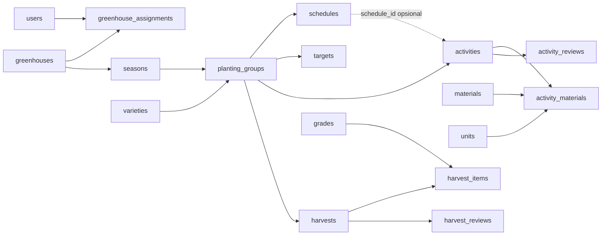

# Master prompt: halaman pekerja bergaya Canopy

Disusun 12 November 2026 untuk dikerjakan **Claude Sonnet 5.5** di Claude Code. Salin semua teks di bawah garis pembatas ke sesi baru di repo ini. Dokumen ini berdiri sendiri: bagian 6 memuat spesifikasi tiap layar secara lengkap, sehingga mockup tidak wajib dibuka.

Mockup acuan: kanvas Artifact "Inofarm Pekerja Canopy" (14 layar, 390 dp), `https://claude.ai/artifact/KbMoPHaLnMRRY12kBLPaa7`. Kanvas ini privat milik pengguna. Bila sesimu bisa membacanya (Artifact `read`), pakai sebagai acuan visual. Bila tidak, bagian 6 sudah cukup. Semua angka, nama greenhouse dan nama pekerja di mockup adalah **data contoh**, bukan data produksi.

---

Kamu melanjutkan aplikasi Android **Inofarm** (Kotlin, Jetpack Compose Material3): pencatatan operasional dan evaluasi keuangan greenhouse melon hidroponik. Role wire hanya `worker` (pekerja) dan `manager` (pengelola, super admin). Sisi pengelola sudah dirombak ke tampilan **Canopy** dan sudah di-merge ke `main` (PR #57). Tugasmu: membawa **seluruh halaman pekerja** ke tampilan Canopy sesuai spesifikasi di bawah, **tanpa mengubah tampilan, perilaku, backend, atau database pengelola**.

## 0. Skill dan mode kerja (wajib)

- Pekerjaan ini **frontend Android**. Pakai skill **`impeccable`** dan **`antislop`** untuk semua pekerjaan UI, copy, dan layout. Muat juga skill turunan antislop yang terpasang bila relevan (`antislop-ui`, `antislop-layoutmobile`, `antislop-human`). Panggil lewat tool `Skill` dengan nama persis.
- **Antislop mode: `during`.** Pengguna memilihnya secara eksplisit untuk pekerjaan ini. Sebelum edit UI pertama, umumkan sekali: `antislop active: during (session override).` Ikuti `.claude/skills/antislop/SKILL.md` di folder induk repo (`../.claude/skills/antislop/SKILL.md` relatif dari root repo). Delivery Gate antislop (Block 1 sampai 4) wajib dilaporkan PASS/FAIL dengan bukti sebelum menyerahkan tiap fase UI.
- **Impeccable:** jalankan `impeccable context` sekali di awal sesi dengan `--target` file pekerja yang dikerjakan (`../.claude/skills/impeccable/scripts/impeccable.cmd` di Windows). Mode permukaan: **Operate**. Baca `reference/craft-floor.md` sebelum edit UI pertama. Pakai `impeccable-finish-reviewer` di akhir fase Beranda, Form, dan Riwayat.
- **Jangan memakai skill `ponytail` untuk UI.** Pekerjaan ini tidak merencanakan perubahan backend. Bila nanti pengguna menyetujui perubahan backend (bagian 4.4), kerjakan bagian itu dengan `ponytail`.
- `backend/CLAUDE.md` meminta pemasangan Laravel Boost. Jangan dipasang: `backend/AGENTS.md` melarangnya.

## 1. Mulai dari sumber yang benar

1. `git fetch origin`. Remote clone ini bernama `origin` (`https://github.com/Andikarya17/inofarm_Jogja_Capstone.git`); beberapa dokumen menyebutnya `github`, dan keduanya repo yang sama. Pastikan `git log --oneline origin/main -3` memuat `Merge pull request #57 from Andikarya17/codex/canopy-polish`.
2. Branch baru dari `origin/main` (bukan dari `main` lokal yang mungkin tertinggal), satu branch per fase di bagian 8, berprefix `codex/worker-canopy-`. Branch `codex/worker-canopy-ux` mungkin sudah ada dan berisi prompt ini; boleh dipakai sebagai dasar fase 0.
3. Jangan push, merge ke main, atau force-push tanpa izin pengguna. Jangan stage `outputs/`, env, dump, log, build, `.runtime/`, `tmp/`, atau folder inspirasi UI.
4. Baca berurutan sebelum menulis kode:
   - `CLAUDE.md`, `AGENTS.md`, `backend/AGENTS.md`, `PRODUCT.md`.
   - `DESIGN.md` (root): token warna, Plus Jakarta Sans, radius `FarmShape`, spacing `FarmSpace`, komponen Canopy, aturan K8.
   - `docs/context/FRONTEND_CANOPY_EVIDENCE_20261112.md`: apa yang sudah Canopy, 15 nama tes `FinanceEntryUiTest` yang gagal di baseline.
   - `docs/context/MASTER_PROMPT_FRONTEND_CANOPY.md`: pola komponen dan aturan kompatibilitas tag.
   - `docs/context/WORKER_FLOW_EVIDENCE_20261111.md`: alur pekerja sekarang dan bagian "Perubahan yang menyentuh pengelola".
   - `docs/context/WORKER_ALIGNMENT_EVIDENCE_20261110.md`, `docs/context/MANAGER_SUPERADMIN_EVIDENCE_20261111.md`, `docs/context/MANAGER_EXCEL_MAPPING_20261110.md`, `docs/migration/finance-20261029/DECISIONS.md`.
   - `docs/context/API_ROUTE_MAP_20261110.md`, `docs/context/DATABASE_INVENTORY_20261110.md`, `contracts/v2/MEASUREMENTS.md`, `contracts/v2/HARVEST_VERIFICATION.md`.
5. Tulis ringkasan singkat ke pengguna: pemahamanmu tentang sisi pengelola, file yang dipakai bersama, dan rencana per fase. **Tunggu persetujuan sebelum mengubah kode.**

## 2. Keputusan yang sudah dikunci pengguna

| # | Keputusan |
|---|---|
| W1 | **Aturan K8 dicabut untuk pekerja.** Form kegiatan, pengukuran, panen, koreksi dan langkah Periksa pekerja memakai kerangka Canopy (`FarmFormFrame` dan kawan-kawan). Label pekerja tetap: `Simpan sebagai draf` dan `Kirim`. |
| W2 | **Navigasi pekerja tetap dua tab + Catat**, tampil sebagai **dock forest** seperti pengelola: Beranda, Catat (lingkaran sage di tengah), Riwayat. Tag `finance-tab-0`, `finance-tab-1`, `finance-record-fab` dipertahankan. |
| W3 | **Pekerja menangani semua greenhouse penugasannya setiap hari.** Beranda menampilkan semua greenhouse; konteks musim dan kelompok dipilih otomatis bila hanya ada satu yang sah. |
| W4 | **Alur baru "Cek nutrisi semua greenhouse"**: pengukuran diisi berurutan per greenhouse yang siap dicatat; tiap greenhouse tetap satu catatan pengukuran. |
| W5 | **Tidak ada perubahan backend, API, kontrak, migration server, atau schema SQLite lokal.** Semua data sudah tersedia lewat cache `sync/changes` dan endpoint yang ada (bagian 4). |
| W6 | **Template jadwal dari Excel tidak dikerjakan.** `MANAGER_EXCEL_MAPPING_20261110.md` dan `DECISIONS.md` melarang nilai studi menjadi data produksi. Jadwal tetap diisi pengelola. |
| W7 | **"Pohon tak berbuah"** dicatat sebagai teks di `observations.sample_basis` (isian "Sampel atau cara pengamatan"), bukan kolom baru. |
| W8 | Antislop mode `during`; skill UI `impeccable` + `antislop`. |

## 3. Batas: jangan rusak pengelola

### 3.1 File bersama (ubah hanya cabang pekerja atau tambah parameter berdefault)

| Lokasi | Aturan |
|---|---|
| `feature/FinanceRoot.kt` (~1.380 baris, ~80 cabang `manager`) | Ubah hanya cabang pekerja. `ActivityForm` dan review sudah bercabang `worker = true` (tata letak lama) vs `FarmFormFrame` (pengelola) sekitar baris 1005 sampai 1040. Jangan menyederhanakan `if (manager)` yang ada. |
| `feature/harvest/HarvestScreen.kt` | `HarvestForm` bercabang sama (sekitar baris 45 sampai 70). Ubah cabang pekerja saja. |
| `feature/FormCanopy.kt` | `FarmFormFrame`, `FarmFormHeader`, `FarmContextStrip`, `FarmFormSection`, `FarmFormBar(saveLabel = ...)`, `FarmReviewFrame`, `FarmWhenCard`, `FarmFieldPair`, `FarmDetailCard`, `FarmInfoCard`, `FarmStepIndicator`. Pakai apa adanya. Bila butuh opsi baru, tambah parameter berdefault yang membuat panggilan pengelola tetap identik. |
| `core/design/CanopyKit.kt` | `FarmDockNavigation` saat ini `require(items.size == 4)`. Untuk W2, longgarkan menjadi 2 atau 4 item tanpa mengubah tata letak 4 item, atau tambah fungsi baru yang memakai bagian dalam yang sama. Tambahkan tes JVM atau Compose yang membuktikan dock pengelola tidak berubah. |
| `core/design/*` lain (`InofarmTheme.kt`, `FarmChrome.kt`, `FarmMenu.kt`, `FarmPicker.kt`) | Token dan komponen global. **Jangan ubah nilai yang ada.** Tambah varian bila perlu. |
| `feature/history/HistoryScreen.kt`, `HistoryCanopy.kt` | `HistoryScreen(..., canopy: Boolean = false)` sudah ada. Pekerja memakai `canopy = true` lewat parameter; jalur pengelola tidak berubah. |
| `feature/QueueScreen.kt`, `feature/ManagerSheets.kt` (`RecordSheet`, `RecordTypeChips(manager, mine)`), `feature/FinanceNavigation.kt` | Diparameterkan per peran. Pertahankan parameter dan tag yang ada. |

### 3.2 File khusus pekerja (aman diubah)

`feature/context/WorkerGreenhouseCards.kt`, `WorkerDayAgenda.kt`, `WorkerEventTime.kt`, `HomeContextCard.kt`, `feature/harvest/WorkerHarvestProgress.kt`, `feature/activities/domain/CorrectionReference.kt`. File baru pekerja boleh ditambahkan di `feature/context/` atau `feature/worker/`.

### 3.3 Aturan tampilan

- Warna dari token tema (`MaterialTheme.colorScheme`, `ForestScheme`, `FarmTone`), bukan hex lepas. Radius `FarmShape`, spacing `FarmSpace`, nominal lewat `FarmAmount`, angka tabular. Sentuh minimal 48 dp. Daftar memberi ruang `LocalFarmListBottomInset` di belakang dock.
- Tidak ada warna baru. Amber hanya untuk perhatian dan Cacat, merah hanya untuk "Perlu diperbaiki" dan hapus, sage untuk aksi Catat dan hasil layak.
- Istilah status sama dengan pengelola: **Draf**, **Belum terkirim**, **Terkirim**, **Belum dicek**, **Sesuai**, **Perlu diperbaiki**, **N belum terkirim**, `Simpan sebagai draf`, `Kirim`. Pekerja tidak melihat ID kiriman, jumlah percobaan kirim, versi server mentah, atau nama kunci wire.
- **Pertahankan semua test tag yang ada.** Contoh: `finance-record-fab`, `finance-tab-$index`, `finance-draft-status`, `finance-review`, `finance-save-draft`, `finance-queue`, `finance-type`, `finance-type-option-$id`, `harvest-review`, `harvest-save-draft`, `harvest-quality-N`, `harvest-add-item`, `manager-add-greenhouse`, `manager-back`. Bila tombol pindah ke `FarmFormBar`, berikan tag yang sama. Tes yang menyentuh tombol di bar memakai `scrollIfScrollable()`.
- Tidak ada animasi tak berhingga. Gerak masuk memakai `farmStaggerEntrance` sekali per proses. Tekan memakai `farmPressable`. Hormati skala animasi sistem.
- Periksa terang, gelap, font 200%, lebar 360 dp, keyboard terbuka.
- Copy berbahasa Indonesia sehari-hari, **tanpa em dash**, tanpa buzzword, tanpa angka karangan di UI produksi.

## 4. Data: relasi, sumber, dan batas backend

### 4.1 Relasi yang dipakai pekerja



| Tabel | Kolom penting untuk UI pekerja |
|---|---|
| `greenhouses` | `id`, `name`, `active`, `running_group_id` (tanam saat ini; migration 16) |
| `greenhouse_assignments` | penugasan pekerja efektif; tanpa penugasan, pekerja tidak melihat greenhouse itu |
| `seasons` | `greenhouse_id`, `name`, `status` (`open`/tutup) |
| `planting_groups` | `season_id`, `variety_id`, `name`, `sowing_date`, `transplant_date`, `active`, `harvest_target` (JSON), `harvest_completion` (JSON) |
| `schedules` | `planting_group_id`, `activity_type` (`general`, `nutrition`, `spray`, `stage`, `measurement`), `planned_at`, `notes` (nama pekerjaan ada di sini), `active` |
| `targets` | `planting_group_id`, `activity_type`, `parameter`, `unit`, `target_value`, `minimum`, `maximum`, `tolerance`, `effective_from`, `effective_until` |
| `activities` | `planting_group_id`, `schedule_id`, `recorded_by`, `recorded_by_role`, `activity_type`, `occurred_at`, `manual_ec`, `manual_ppm`, `manual_ph`, `observations` (JSON), `actual_stage`, `work_state` (`completed`/`skipped`), `skipped_reason`, `notes`, `record_state`, `version` |
| `activities.observations` | `dissolved_oxygen_mg_l`, `water_temperature_c`, `plant_height_cm`, `leaf_width_cm` (desimal string), `leaf_count` (integer), `sample_basis` (teks, maks 500) |
| `activity_materials` | `material_id`, `unit_id`, `quantity` |
| `activity_reviews` | `activity_id`, `activity_version`, `decision` (`valid` = Sesuai, `invalid` = Perlu diperbaiki), `reason`, `reviewer_name` |
| `harvests` / `harvest_items` | `occurred_at`, `notes`; item: `grade_id`, `fruit_count`, `weight_kg`, `quality` (`saleable` = Layak, `defective` = Cacat) |
| `harvest_reviews` | satu review per revisi panen, `decision` `valid`/`invalid`, `reason` |

### 4.2 Sumber data di Android

- Semua layar pekerja membaca **cache lokal terenkripsi** hasil `sync/changes` (SQLiteOpenHelper schema 10, `LocalFinanceStore`, `ContextRepository`, `CultivationUiState`). Jangan menambah GET list baru untuk layar yang sudah bisa dibaca dari cache.
- Pengukuran terakhir: `LocalFinanceStore.latestMeasurement(scope, gh, group, today)` (sudah mengecualikan revisi `invalid`).
- Jadwal dan agenda hari ini: logika di `WorkerDayAgenda.kt` (`planned_at` hari WIB, realisasi lewat `schedule_id`, catatan dilewati).
- Perlu diperbaiki: `rememberWorkerCorrections(...)` di `WorkerGreenhouseCards.kt` (review `invalid` pada catatan akun sendiri).
- Progres panen: `GET planting-groups/{id}/harvest-progress` dan `/sources` (respons berdasarkan peran, tanpa nilai penjualan), dengan cache progres terenkripsi yang sudah ada (`WorkerHarvestProgress.kt`).
- Tulis: kegiatan dan pengukuran lewat draf/outbox lalu `POST sync/operations`; panen lewat endpoint panen (`OperationRoute.forOperation`). Retry mempertahankan UUID, envelope dan hash. Desimal dikirim sebagai string bertitik; UI menampilkan koma.
- Filter "Catatan saya" dan filter greenhouse di Riwayat dijalankan **setelah kueri** karena pencatat ada di badan terenkripsi. Jangan menambah kolom indeks SQLite.

### 4.3 Aturan server yang tidak boleh dilonggarkan

- Pekerja hanya melihat greenhouse dengan penugasan efektif; di luar itu 403 atau 404.
- Pekerja tidak boleh mengakses biaya, alokasi, aset, penyusutan, penjualan, laporan, ekspor, recovery, termasuk lewat sync atau file.
- Koreksi hanya untuk catatan sendiri, versi cocok, musim terbuka, **alasan wajib**. Pembatalan tidak boleh.
- Keputusan cek (Sesuai / Perlu diperbaiki + alasan) hanya terbaca pada catatan sendiri. Koreksi membuat revisi baru yang perlu keputusan baru.
- Pengukuran wajib EC dan PPM, `materials = []`, tidak dikonversi satu sama lain.

### 4.4 Bila ternyata butuh data baru dari server

Jangan membuat endpoint khusus pekerja, mengubah `GreenhouseAccess`, menambah migration, atau mengubah schema SQLite tanpa bertanya ke pengguna. Cek dulu `API_ROUTE_MAP_20261110.md` dan `contracts/v2/openapi.json`; kemungkinan datanya sudah ada di `sync/changes`. Bila pengguna menyetujui perubahan backend: kerjakan dengan skill `ponytail`, tambah tes di `backend/tests/Feature/` (misalnya `FinanceAuthScopeTest.php`, `ManagerSuperAdminAccessTest.php`), perbarui OpenAPI dan kontrak, pastikan `OpenApiParityTest` lulus, baseline 157 tes backend tetap lulus, dan tes hanya di MySQL `inofarm_test`.

## 5. Arah visual

Design Read: *alat pencatatan lapangan untuk pekerja greenhouse yang berpindah antar greenhouse sepanjang hari, bahasa visual Canopy forest–sage–krem dari DESIGN.md, dial ENERGY 1 / RHYTHM 2 / MOTION 2 untuk form dan riwayat, 2 / 2 / 2 untuk Beranda.*

- Bidang forest (`forest-background` #132820, `forest-surface` #203B30) menjadi kanopi di atas: kartu ringkasan Beranda, hero greenhouse, strip konteks form, kepala kartu Periksa, dock.
- Bidang solid krem (`background` #F4F3E8, `surface` #FFFDF4, garis `divider` #D3DBCB) untuk isi, daftar dan form.
- Satu aksen: sage (`#D4E4B7`) untuk tombol Catat, kartu "Cek nutrisi semua greenhouse", total panen, dan hero progres panen.
- Motif identitas: garis daun `FarmLeafMotif` di sudut kartu forest Beranda.
- Satu fokus per layar: Beranda pada kartu greenhouse yang paling butuh tindakan; form pada isian angka utama.

## 6. Spesifikasi layar

Lebar acuan 390 dp, padding halaman 16 dp. Semua teks di bawah adalah copy UI yang dipakai (data contoh ditandai dengan kurung siku `[...]` dan harus diganti data nyata).

### 6.1 Navigasi dan shell pekerja

- Dock forest kapsul (`FarmDockNavigation`, radius 26 dp, tinggi min 72 dp) dengan tiga slot: **Beranda** (`finance-tab-0`), **Catat** (lingkaran sage 56 dp dalam cincin 66 dp, naik 26 dp, `finance-record-fab`), **Riwayat** (`finance-tab-1`). Pil terpilih `#385442`. Label berhenti membesar setelah skala font 1,3.
- Dock tampil di Beranda, halaman greenhouse, dan Riwayat. Disembunyikan di form, Periksa, detail, sheet, dan saat penulisan berjalan (aturan sama dengan pengelola).
- Header Beranda: sapaan sesuai jam (`Selamat pagi/siang/sore/malam, [nama]`), tanggal WIB sebagai judul, tombol `N belum terkirim` (ikon sinkron, hanya tampil bila ada, live region sopan) dan tombol avatar inisial yang membuka menu akun (nama, peran, `Keluar`). Pada font di atas 1,3 tombol belum terkirim pindah ke baris sendiri (aturan yang sudah ada).
- Sinkronisasi otomatis saat dibuka, kembali ke depan, dan setelah menyimpan. Tombol ikon Perbarui yang sudah ada tetap berfungsi (boleh dipindah ke menu akun bila tidak merusak tes).

### 6.2 Beranda (semua greenhouse)

1. **Kartu forest ringkasan** (radius 24 dp, motif daun): `Pekerjaan hari ini · [3] greenhouse`, angka besar `[7] dari [15] tugas`, batang progres sage dengan `contentDescription` "7 dari 15 tugas selesai", baris kecil `Diperbarui [07.42] WIB dari perangkat`. Hitungan tugas = jadwal hari ini semua greenhouse yang terlihat; selesai = punya realisasi atau dilewati. Bila tidak ada jadwal sama sekali: `Belum ada jadwal hari ini. Kegiatan tetap bisa dicatat lewat Catat.`
2. **Kartu "N catatan perlu diperbaiki"** (permukaan `error-surface`, teks `error`, ikon peringatan, chevron), hanya bila N > 0, keterangan `Ada alasan dari pengelola`. Membuka layar 6.5.
3. Judul `Greenhouse` + keterangan `Urut dari yang belum selesai`.
4. **Kartu per greenhouse** (`surface`, garis tipis, radius 20 dp, seluruh kartu satu ketukan, `farmPressable`):
   - Nama greenhouse (titleMedium bold), `[varietas] · [kelompok]`, dan di kanan angka umur besar (HST, atau HSS bila belum pindah tanam) dengan label satuan.
   - Chip status (`FarmStatusChip`, teks selalu tertulis): `Nutrisi dicek [07.30]` (Good) atau `Nutrisi belum dicek` (Amber); `[3] dari [5] tugas` (Good); `PPM di bawah acuan` / `PPM di atas acuan` (Amber) bila pengukuran terakhir hari ini di luar target yang berlaku; `[N] belum terkirim` bila ada.
   - Garis pemisah lalu `Berikutnya · [judul jadwal] · [Pagi/Sore]` (jadwal hari ini pertama yang belum terealisasi; Pagi bila jam < 12.00 WIB).
   - Greenhouse tanpa tanam saat ini: ubin amber + `Tanam saat ini belum dipilih pengelola`, tanpa chip.
   - Urutan: kartu dengan tugas belum selesai atau nutrisi belum dicek di atas; yang selesai di bawah; tanpa tanam paling bawah. Urutan stabil (nama sebagai pemecah seri).
5. Tidak ada tombol Catat di Beranda selain dock.
6. State: loading (skeleton tidak dipakai sebagai produk; pakai indikator dan teks `Memuat data perangkat…`), kosong (`Belum ada greenhouse dalam penugasan. Hubungi pengelola.`), error cache/sinkron dengan pesan yang ada.

### 6.3 Satu greenhouse (tugas hari ini)

Dibuka dari kartu Beranda. Back kembali ke Beranda.

1. Bar atas: tombol kembali (48 dp, `contentDescription` "Kembali ke semua greenhouse") + nama greenhouse.
2. **Hero forest** (radius 24 dp): `[Kamis, 12 Nov 2026] · [nama musim]`, `[varietas] · [kelompok]` (titleLarge bold), tiga ubin `forest-surface` (radius 14 dp): HSS `hari sejak semai`, HST `hari sejak pindah tanam` (atau `belum pindah tanam`), stadia `[nama stadia]` `stadia tercatat` (dari `actual_stage` terakhir; bila tidak ada `belum dicatat`). Bila ada lebih dari satu kelompok aktif, chip kelompok di bawah hero (`FarmChoiceChips`).
3. **Pengukuran terakhir** + jam WIB di kanan: dua kartu EC (`mS/cm`) dan PPM (`ppm`) memakai `MeasurementCards` (berjajar, menumpuk di bawah 268 dp atau font > 1,3). Di bawahnya chip status cek (`Belum dicek`/`Sesuai`/`Perlu diperbaiki`), chip acuan Amber `Di bawah acuan [1.300] ppm` bila relevan, dan `[pencatat] · [terkirim/belum terkirim]`. Tanpa data: `Belum ada pengukuran untuk kelompok ini.`
4. **Jadwal hari ini** + `[3] dari [5] selesai`: satu kartu berisi baris (min 64 dp, pemisah tipis):
   - Selesai: lingkaran Good bercentang, judul, `[jenis] · selesai [08.10]`.
   - Dilewati: lingkaran Amber bergaris, judul, `Dilewati · [alasan]`.
   - Belum: lingkaran bergaris `outline`, judul, `[jenis] · [pagi/sore]`, tombol kecil `Catat` (`primary`, min 44 dp) yang membuka form sesuai jenis dengan `schedule_id`, jenis terkunci, dan untuk `measurement` membuka form pengukuran.
   - Judul jadwal diambil dari `schedules.notes` (baris pertama); jenis dari `activity_type`.
   - Keterangan di bawah kartu: `Catat dari jadwal membuka form dengan jenis terisi.`
5. **Belum dicatat dari 7 hari terakhir**: baris lipat (`details`-like, animasi tinggi 180 ms) dengan chip Amber `[2] jadwal`; isinya baris yang sama dengan tombol `Catat` (tanggal kejadian default = tanggal jadwal).
6. **Progres panen**: baris aksi (ubin ikon keranjang, judul, `Belum ada panen di kelompok ini` atau `[1.240] dari [1.600] buah layak`, chevron) ke layar 6.13.
7. Tombol bergaris penuh lebar `Catat di luar jadwal` (membuka sheet Catat dengan greenhouse ini terpilih).

### 6.4 Sheet Catat

`RecordSheet` versi pekerja (bidang `surface`, sudut atas 28 dp, terbuka penuh).

1. Judul `Catat` + tombol tutup bulat.
2. `Greenhouse`: `FarmChoiceChips` berisi greenhouse penugasan; pilihan terakhir terpilih otomatis (disimpan per sesi akun). Greenhouse tanpa tanam saat ini tampil nonaktif. Keterangan di bawah: `[Kelompok 2] · HST [16]`. Bila kelompok ambigu, chip kelompok muncul.
3. Tiga kotak setara (grid 3 kolom, radius 20 dp, min 132 dp): **Kegiatan** `Pekerjaan harian dan bahan`, **Pengukuran** `EC, PPM, pH`, **Panen** `Hasil per grade`. Pada font > 1,3 menjadi daftar baris.
4. Baris sage `Cek nutrisi semua greenhouse` · `Isi berurutan, satu catatan per greenhouse` · chevron (layar 6.10). Hanya tampil bila ada minimal satu greenhouse siap catat.
5. Bila greenhouse terpilih belum punya tanam, baris `Mulai tanam` **tidak** ditampilkan untuk pekerja (itu hak pengelola).

### 6.5 Perlu diperbaiki

Layar dengan bar atas kembali + judul `Perlu diperbaiki`, keterangan `Pengelola menandai catatan ini. Baca alasannya, lalu koreksi. Koreksi akan dicek ulang.` Satu kartu per catatan: jenis + ringkasan, tanggal kanan, `[greenhouse] · [kelompok]`, kutipan alasan di bidang `error-surface`, tombol `Buka dan koreksi` (membuka detail 6.12). Kosong: `Tidak ada catatan yang perlu diperbaiki.`

### 6.6 Sheet Belum terkirim

Pertahankan `QueueScreen` mode pekerja dan judulnya, dengan tampilan Canopy: judul `Belum terkirim`, keterangan `[2] catatan aman di perangkat, menunggu internet.`, tombol utama `Kirim sekarang` (ikon sinkron). Dua kelompok: `Menunggu dikirim` (baris ikon jenis, ringkasan, greenhouse · waktu, chip Amber `Belum terkirim`) dan `Ditolak, perlu dicek` (ubin error, alasan dalam bahasa biasa, chevron). Penutup: `Catatan dikirim otomatis saat ada internet.` Tanpa ID kiriman, tanpa jumlah percobaan. Back dari detail yang dibuka dari sheet kembali ke sheet (perilaku yang sudah ada).

### 6.7 Form kegiatan (pekerja)

Pakai `FarmFormFrame`:
- `FarmFormHeader`: tombol X (`Simpan draf dan kembali`), judul `Catat kegiatan` atau `Koreksi kegiatan`, status draf (`finance-draft-status`).
- `FarmContextStrip`: greenhouse, kelompok · varietas, `HST [n]` di kanan.
- Bila dari jadwal: kartu info sage `Dari jadwal: [judul] · [pagi/sore]. Jenis kegiatan dikunci ke [jenis].`
- `FarmFormSection("Jenis kegiatan")`: `FarmChoiceChips` Pekerjaan umum, Nutrisi, Penyemprotan, Stadia (tag `finance-type`). Terkunci bila dari jadwal atau koreksi (aturan yang sudah ada). Pengukuran tidak ditawarkan di sini.
- `FarmFormSection("Waktu kegiatan")`: `FarmWhenCard` (`Kamis, 12 Nov 2026 · 16:10 WIB`, `Ubah` membuka picker Android dari `WorkerEventTime`; isian manual detik tetap bisa dibuka). `FarmCheckbox` `Kegiatan dilewati`; bila dicentang, isian `Alasan kegiatan dilewati` wajib dan bagian bahan disembunyikan.
- `FarmFormSection("Bahan yang dipakai")` untuk Nutrisi dan Penyemprotan: tiap bahan `FarmDetailCard` (pemilih bahan, `FarmFieldPair` jumlah + satuan, ikon hapus merah `Hapus bahan N`), tombol garis putus `Tambah bahan`. Jumlah `[n] bahan` di kanan judul.
- Stadia: isian `Kondisi stadia aktual`.
- `FarmFormSection("Catatan lapangan")`: area teks dengan placeholder `Tulis yang dikerjakan`.
- `FarmInfoCard` acuan: anjuran jadwal atau target yang berlaku; kalimat `Isi jumlah yang benar-benar dipakai, bukan angka anjuran.`
- Koreksi: isian `Alasan koreksi` wajib di atas, kartu info `Waktu kejadian tidak berubah, acuan lama dipakai otomatis.` (logika `CorrectionReference`).
- `FarmFormBar(saveTag = "finance-save-draft", mainTag = "finance-review", mainLabel = "Periksa", saveLabel = "Simpan sebagai draf")`.
- Error validasi di bawah isian terkait, tidak diulang sebagai daftar notice.

### 6.8 Form pengukuran (pekerja)

- Header `Catat pengukuran`, strip konteks, `FarmWhenCard` berlabel `Waktu ukur`.
- `FarmFormSection("Hasil ukur")`: `FarmFieldPair` EC (`mS/cm`) dan PPM (`ppm`), angka besar (displaySmall), keyboard desimal, koma diterima. Peringatan Amber di bawah PPM/EC/pH bila di luar target: ikon + `PPM di bawah acuan [1.300] ppm. Tetap bisa dikirim.` (teks, bukan warna saja; garis isian menebal amber). Keterangan `EC dan PPM wajib diisi dan tidak dikonversi satu sama lain. Desimal pakai koma.` Isian `pH (opsional)` setengah lebar.
- Bagian lipat `Pengamatan (opsional)` (terbuka bila sudah ada isian): DO `mg/L`, suhu air `°C`, tinggi tanaman `cm`, jumlah daun `helai`, lebar daun `cm` (berpasangan), lalu `Sampel atau cara pengamatan` dengan placeholder `Misalnya 5 tanaman baris tengah, pohon tak berbuah 0`.
- `FarmInfoCard`: `Acuan HST [16]` + `PPM [1.300] ppm · pH [5,8 sampai 6,2]` dari `targets` yang berlaku pada waktu ukur. Tanpa target: `Acuan untuk waktu ini belum diatur pengelola.`
- Bar sama dengan 6.7.

### 6.9 Form panen (pekerja)

- Header `Catat panen` / `Koreksi panen`, strip konteks (ikon keranjang), `FarmWhenCard` `Waktu panen`.
- Judul `Rincian per grade` + `[2] rincian`.
- Tiap rincian `FarmDetailCard`: pemilih grade (terkunci untuk rincian yang sudah tersimpan, dengan kalimat yang ada), segmen `Layak` / `Cacat` (`FarmChoiceChips` tag `harvest-quality-N`, Cacat terpilih memakai `warning` dengan teks putih), `FarmFieldPair` `Jumlah` (`buah`) dan `Bobot` (`kg`), ikon hapus.
- Tombol garis putus `Tambah grade panen` (`harvest-add-item`).
- Kartu total sage (live region sopan): `Total isian` `[228] buah` dengan `[210] layak · [18] cacat`, dan `Bobot` `[333,5] kg`.
- Isian `Keterangan panen (opsional)`.
- Bar: `harvest-save-draft` `Simpan sebagai draf`, `harvest-review` `Periksa`.

### 6.10 Cek nutrisi semua greenhouse (alur baru)

- Daftar greenhouse yang **siap catat** (penugasan aktif, tanam saat ini sah, musim terbuka), urut seperti Beranda. Greenhouse lain dilewati dengan kartu Amber `[Greenhouse C] dilewati karena tanam saat ini belum dipilih pengelola.`
- Header `Cek nutrisi semua greenhouse` + `Greenhouse [2] dari [2]`, `FarmStepIndicator` per greenhouse.
- Baris ringkas Good untuk greenhouse yang sudah tersimpan di sesi ini: `[Greenhouse A] tersimpan · EC [2,4] · PPM [1.250]`.
- Strip konteks greenhouse aktif, waktu ukur (default sekarang), EC, PPM, pH, acuan satu baris.
- Bar: `Lewati` (bergaris) dan `Simpan dan lanjut ke [Greenhouse B]`; pada greenhouse terakhir `Simpan dan periksa semua`.
- Implementasi: tiap greenhouse membuat **draf pengukuran sendiri** lewat `ActivityViewModel` yang ada (jenis `measurement`, `materials = []`), disimpan di perangkat sebelum pindah ke greenhouse berikutnya. Periksa terakhir menampilkan semua draf dari alur ini dan `Kirim` mengantrekan masing-masing sebagai operasi terpisah. Keluar di tengah jalan menyimpan draf yang sudah diisi; tidak ada data yang hilang saat proses mati.
- Tes: alur dua greenhouse, lewati satu, matikan proses di tengah, buka lagi, draf tetap ada.

### 6.11 Langkah Periksa (semua jenis)

`FarmReviewFrame`:
- Judul `Periksa [kegiatan/pengukuran/panen]`, kalimat `Pastikan isinya benar. Setelah dikirim, catatan terkirim otomatis saat ada internet.`
- Kartu dengan kepala forest (ubin ikon jenis, jenis, `[greenhouse] · [Kamis, 12 Nov 2026] · [07:30] WIB`), baris angka utama dua kolom (pengukuran: EC dan PPM; panen: jumlah dan bobot; kegiatan: jenis dan status selesai/dilewati), lalu pasangan label-nilai (`FarmFact`): kelompok · HST, pH, pengamatan yang diisi, bahan, grade per kondisi (label Cacat berwarna amber), keterangan, acuan beserta posisinya terhadap acuan.
- `FarmInfoCard` `Setelah dikirim`: `Muncul di Riwayat dengan label Belum terkirim sampai diterima, lalu menunggu cek pengelola.`
- Bar: `Ubah isian` (bergaris) dan `Kirim` (ikon centang, tag `finance-queue` / `harvest-queue` yang ada).

### 6.12 Riwayat dan detail

**Riwayat** (`HistoryScreen(canopy = true)` untuk pekerja):
- Judul `Riwayat`, tombol `Filter` dengan badge jumlah filter aktif (membuka sheet filter yang ada; tanggal `Dari`/`Sampai` memakai picker Android pekerja).
- Keterangan `Catatan saya · diperbarui [07.42] WIB`.
- Baris chip jenis (`RecordTypeChips(manager = false, mine = ...)`): Semua, Kegiatan, Pengukuran, Panen. Baris chip greenhouse: `Semua greenhouse`, lalu nama pendek tiap greenhouse penugasan, dan chip `Catatan saya` (aktif secara bawaan). Chip greenhouse **baru** dan difilter setelah kueri (bagian 4.2).
- Dikelompokkan per hari WIB: `Hari ini · Kamis, 12 Nov`, `Kemarin · Rabu, 11 Nov`, lalu tanggal.
- Baris: ubin ikon jenis (draf memakai garis putus), judul jenis atau nama pekerjaan, ringkasan nilai (`EC 2,4 mS/cm · PPM 1.250`, `Grade A 210 buah · Grade B cacat 18`, `Demolish 12 ml`), `[greenhouse] · [kelompok]`, di kanan jam dan satu chip status: `Draf`, `Belum terkirim`, `Belum dicek`, `Sesuai`, `Perlu diperbaiki`.
- `Muat 50 berikutnya` (tag yang ada).

**Detail catatan pekerja**:
- Bar kembali + `Detail [jenis]`, chip status kirim dan status cek.
- Bila `Perlu diperbaiki`: kartu `error-surface` `Alasan dari pengelola` + waktu + kutipan alasan.
- Kartu fakta: baris angka utama dua kolom, lalu greenhouse · kelompok, waktu · HST, rincian (grade + kondisi, bahan, pengamatan), keterangan, `Pencatat`, `Revisi ke-[n], diterima [waktu]`.
- Tombol utama `Koreksi catatan` (hanya catatan sendiri, musim terbuka), kalimat `Koreksi membuat revisi baru dan dicek ulang oleh pengelola. Alasan koreksi wajib. Pembatalan hanya bisa dilakukan pengelola.`, tombol bergaris `Kembali ke riwayat`.
- Tidak menampilkan saldo bobot penjualan (aturan yang ada).

### 6.13 Koreksi panen dan kegiatan

Form 6.7 atau 6.9 dalam mode koreksi:
- Kartu `error-surface` `Alasan dari pengelola` di atas (bila ada).
- Isian `Alasan koreksi (wajib)` dengan fokus awal.
- Rincian yang berubah diberi chip Amber `Diubah` dan teks `Sebelumnya [312,5] kg` di bawah isian.
- Kartu info acuan dari `CorrectionReference`: tidak ada pilihan acuan untuk pekerja.

### 6.14 Progres panen

`WorkerHarvestProgress` bergaya Canopy:
- Bar kembali + `Progres panen`, `[greenhouse] · [kelompok] · [varietas]`.
- Hero sage: `Hasil layak dibanding target`, `[1.240] dari [1.600] buah` besar, batang progres (beralih 240 ms antar-snapshot), `[1.802,4] kg layak · target [2.300] kg`. Tanpa target: `Target panen belum diatur pengelola` dan tanpa batang.
- `Menurut kondisi dan keputusan`: pasangan label-nilai Layak, Cacat (amber), Sudah dicek Sesuai, Belum dicek.
- `Sumber per revisi`: baris panen (tanggal, jumlah, revisi, pencatat, chip status) yang membuka detail bila versi cocok (aturan yang ada).
- Keterangan `Target dan penutupan panen diatur pengelola.` Data tersimpan ditandai bila offline (label yang ada).

## 7. Aksesibilitas dan ketahanan

- Setiap ikon tanpa teks punya `contentDescription`; ikon dekoratif `null`. Kartu yang bisa disentuh digabung semantiknya dan dibaca sebagai satu kalimat.
- Status tidak hanya warna: selalu ada teks.
- Live region sopan untuk jumlah belum terkirim, total panen, dan pesan simpan.
- Font 200%: kartu greenhouse membungkus, angka HST pindah ke baris sendiri bila sempit, `FarmFieldPair` bertumpuk, dock label berhenti membesar.
- 360 dp: tidak ada overflow horizontal; chip membungkus atau bergulir horizontal dengan tepi terlihat.
- Gelap: kartu forest tetap forest, permukaan krem menjadi lapisan forest sesuai tema yang ada; chip Cacat amber diperiksa di permukaan gelap.
- Process death, Back, IME: draf tersimpan di setiap form dan di alur cek nutrisi.

## 8. Urutan fase

Satu branch per fase dari ujung fase sebelumnya. Setiap fase: AC, file, tes, bukti, commit `feat(worker): ...` atau `fix(worker): ...` hanya setelah pemeriksaan lulus.

| Fase | Branch | Isi | Acceptance utama |
|---|---|---|---|
| 0 | `codex/worker-canopy-baseline` | Jalankan pemeriksaan baseline (bagian 9), catat angka, screenshot pengelola dan pekerja "sebelum" | Angka cocok dengan baseline; daftar 15 tes gagal tercatat per nama |
| 1 | `codex/worker-canopy-shell` | Dock pekerja (W2), header sapaan, menu akun, tombol belum terkirim | `workerNavigationHasTwoTabsRecordButtonAndUnsentSheet` dan `ManagerNavigationTest` lulus; dock pengelola tidak berubah (screenshot + tes) |
| 2 | `codex/worker-canopy-home` | Beranda 6.2, Perlu diperbaiki 6.5 | Tes kartu Beranda lama lulus; tes baru untuk urutan kartu, chip nutrisi, ringkasan tugas, greenhouse tanpa tanam |
| 3 | `codex/worker-canopy-greenhouse` | Satu greenhouse 6.3, sheet Catat 6.4, sheet Belum terkirim 6.6 | `workerAgendaDistinguishesRealizationsAndSkippedRecords`, `workerScheduleEntryHasNoTypeChoice`, `workerSelectsGreenhouseDirectlyAndOpensReadyRecordingContext` lulus |
| 4 | `codex/worker-canopy-forms` | Form 6.7, 6.8, 6.9, Periksa 6.11, koreksi 6.13 | `workerActivityFormNeverOffersMeasurementAndScheduleLocksTheType`, `workerCorrectionHasNoReferenceChoiceAndUsesPlainButtons`, `workerNativePickersAndImeKeepDraftOnNavigation` lulus; form pengelola tidak berubah (screenshot) |
| 5 | `codex/worker-canopy-history` | Riwayat dan detail 6.12, progres panen 6.14 | `workerHistoryShowsCheckStatusFiltersToOwnRecordsAndPicksDates` lulus; tes baru chip greenhouse |
| 6 | `codex/worker-canopy-nutrition-run` | Alur cek nutrisi 6.10 | Tes alur dua greenhouse, lewati, process death |
| 7 | `codex/worker-canopy-docs` | Bukti, DESIGN.md (bagian pekerja), status CLAUDE.md, Delivery Gate | Bagian 10 lengkap |

Berhenti dan tanya pengguna bila: butuh data baru dari server (4.4), sebuah tes pengelola gagal karena perubahan bersama dan perbaikannya mengubah perilaku pengelola, atau spesifikasi di sini bertentangan dengan aturan integritas di `CLAUDE.md`.

## 9. Pemeriksaan dan bukti pengelola tidak rusak

Sebelum dan sesudah setiap fase:

```powershell
./scripts/build-android.ps1 -JavaHome "C:/Program Files/Eclipse Adoptium/jdk-25.0.4.101-hotspot"
python scripts/check-finance-context.py
```

`./scripts/test-backend.ps1` hanya bila backend berubah (tidak direncanakan).

Baseline yang harus dipertahankan:
- JVM 104 tes lulus; lint 0 error, 18 warning, 1 hint.
- `check-finance-context.py` pada `origin/main` (`ebe557c`, dicek 12 November 2026) **gagal dengan dua tautan rusak yang sudah ada sebelumnya**: `MANAGER_SUPERADMIN_EVIDENCE_20261111.md` merujuk `MASTER_PROMPT_MANAGER_SUPERADMIN.md` dan `WORKER_FLOW_EVIDENCE_20261111.md` merujuk `MASTER_PROMPT_WORKER_FLOW.md`, keduanya tidak ada di repo. Jangan menambah tautan rusak baru. Tanyakan ke pengguna apakah dua tautan lama itu diperbaiki di fase 7 (misalnya diarahkan ke dokumen yang ada) atau dibiarkan.
- `FinanceEntryUiTest` penuh: 15 gagal pada baseline dengan nama yang tercatat di `FRONTEND_CANOPY_EVIDENCE_20261112.md`. Bandingkan **per nama tes**; tidak boleh ada kegagalan baru. Jangan menghapus assertion untuk membuat tes lulus. Perubahan tes harus setara dan dicatat (contoh pola: `scrollIfScrollable()`, `choose()` menerima opsi terpilih).
- `FinanceAdminUiTest` (2 tes) dan `ManagerNavigationTest` lulus.
- Screenshot pengelola sebelum dan sesudah untuk layar yang kodenya disentuh (Beranda, Riwayat, form kegiatan, pengukuran, panen, sheet Catat), terang dan 200%, di `outputs/worker-canopy-20261112/` (tidak di-commit). Screenshot pekerja untuk 14 layar: terang, gelap, 200% pada 360 dp.
- Jangan menjalankan runner fixture/device bersamaan dengan PHPUnit pada database uji yang sama, dan jangan menjalankan tes emulator bersamaan dengan build Gradle.
- Tes backend (bila ada) hanya di MySQL `inofarm_test`. Jangan pernah `migrate:fresh`, seed, reset, atau restore pada `inofarm_finance_local`, `inofarm_local`, atau database pengguna. Jangan menjalankan `scripts/local-database.ps1` untuk memeriksa.

## 10. Laporan dan dokumen

- Tulis `docs/context/WORKER_CANOPY_EVIDENCE_20261112.md`: matriks temuan → penerimaan → file → tes, hasil pemeriksaan dari output perintah sesi ini (bukan disalin dari dokumen lama), daftar perubahan tes, dan bagian wajib **"Perubahan yang menyentuh pengelola"** (tulis "tidak ada" bila memang tidak ada).
- Bedakan bukti emulator + fixture MockWebServer dari perangkat fisik atau backend nyata. Jangan mengklaim TalkBack, perangkat fisik, atau angka performa yang tidak diukur.
- Perbarui `DESIGN.md` bagian pekerja (dock dua tab, form pekerja Canopy, alur cek nutrisi, hapus kalimat K8 untuk pekerja) dan paragraf status di `CLAUDE.md` **hanya setelah pemeriksaan lulus**.
- Laporan akhir ke pengguna: apa yang selesai per fase, commit, tes dan hasilnya, Delivery Gate antislop, yang belum terverifikasi, dan pertanyaan terbuka.
